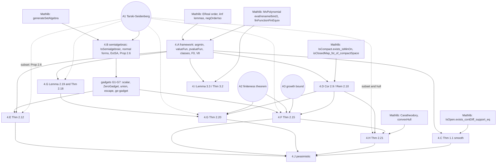

# Blueprint: Lean 4 + Mathlib formalization of "Geometric and computational hardness of bilevel programming"

* **Paper.** Jérôme Bolte, Tùng Lê, Edouard Pauwels, Samuel Vaiter, *Geometric and computational hardness of bilevel programming*,
  arXiv:2407.12372, **v2 (28 Jan 2025)**.
* **Purpose.** Master plan for a Lean 4 + Mathlib formalization (toolchain `leanprover/lean4:v4.36.0-rc2`, Mathlib commit
  `1df8067a`; all Mathlib names below were located in that source tree by grep, file:line given relative to `Mathlib/`). The
  document is self-contained: an implementer should not need the research notes. It records the proof route chosen for every
  result, the exact Lean-style statements, the Mathlib declarations used, the assumptions that are *not* proved (and why), and
  every confirmed error in the paper.
* **State.** Nothing has been compiled (no Lean toolchain was available while planning). All Lean text is pseudo-Lean: types are
  meant to be right; tactic details are not.
* **Audience.** Mathematicians and Lean developers implementing it file by file, lemma by lemma.

## Table of contents

* [Status legend](#status-legend)
* [How to read](#how-to-read)
* [1. Executive summary](#1-executive-summary)
  * [Dependency diagram](#dependency-diagram)
  * [Which theorem needs which assumption](#which-theorem-needs-which-assumption)
* [2. Conventions and Lean encoding](#2-conventions-and-lean-encoding)
  * [2.1 Points, polynomials, evaluation](#21-points-polynomials-evaluation)
  * [2.2 Bilevel data, value functions (all in EReal)](#22-bilevel-data-value-functions-all-in-ereal)
  * [2.3 Boxes, classes, convexity](#23-boxes-classes-convexity)
  * [2.4 Semialgebraic sets and functions (chosen definition)](#24-semialgebraic-sets-and-functions-chosen-definition)
  * [2.5 The quarantined assumptions A1–A3 (exact statements, one file)](#25-the-quarantined-assumptions-a1a3-exact-statements-one-file)
  * [2.6 Notational table (paper ↔ Lean)](#26-notational-table-paper--lean)
* [3. Module / file plan and build order](#3-module--file-plan-and-build-order)
* [4. Result groups, in dependency order](#4-result-groups-in-dependency-order)
  * [4.A Shared framework (HardnessBilevel/Framework/*)  — ids fw.*](#4a-shared-framework-hardnessbilevelframework---ids-fw)
  * [4.B Semialgebraic infrastructure (HardnessBilevel/Semialgebraic/*) — ids sa.*](#4b-semialgebraic-infrastructure-hardnessbilevelsemialgebraic--ids-sa)
  * [4.C Theorem 1.1 (smooth data realize every lsc function) — ids t11.*](#4c-theorem-11-smooth-data-realize-every-lsc-function--ids-t11)
  * [4.D Berge-type results: Theorem 2.8, Corollary 2.9, Remark 2.10 — ids berge.*](#4d-berge-type-results-theorem-28-corollary-29-remark-210--ids-berge)
  * [4.E Shared gadget module and Theorem 2.12 (unconstrained lower level) — ids gad.*, t212.*](#4e-shared-gadget-module-and-theorem-212-unconstrained-lower-level--ids-gad-t212)
  * [4.F Theorem 2.15 (bounded box: $\mathcal P_{\rm bounded}=\mathcal{SA}\cap\mathcal{LSC}\cap\mathcal{CB}$) — ids gad.G6, t215.*](#4f-theorem-215-bounded-box-mathcal-p_rm-boundedmathcalsacapmathcallsccapmathcalcb--ids-gadg6-t215)
  * [4.G Convex lower level: Lemma 2.19, Theorems 2.18 and 2.20 — ids fw.convex_*, t219.*, t218.*, t220.*](#4g-convex-lower-level-lemma-219-theorems-218-and-220--ids-fwconvex_-t219-t218-t220)
  * [4.H Theorem 2.21 (compact convex lower level: $\mathcal C_{cc}=\mathcal{SA}\cap\mathcal{LSC}\cap\mathcal{CB}$) — ids t221.*](#4h-theorem-221-compact-convex-lower-level-mathcal-c_ccmathcalsacapmathcallsccapmathcalcb--ids-t221)
  * [4.I Section 3: computational hardness (Theorem 3.2, Lemma 3.3, Appendix D) — ids s3.*](#4i-section-3-computational-hardness-theorem-32-lemma-33-appendix-d--ids-s3)
  * [4.J Pessimistic counterparts (paper §2.4) — ids pess.*](#4j-pessimistic-counterparts-paper-24--ids-pess)
* [5. Paper errata (confirmed) and the fix adopted in the blueprint](#5-paper-errata-confirmed-and-the-fix-adopted-in-the-blueprint)
  * [5.1 Mathematical errors and gaps](#51-mathematical-errors-and-gaps)
  * [5.2 Section 3 and Appendix D errors; imprecisions that change a Lean statement](#52-section-3-and-appendix-d-errors-imprecisions-that-change-a-lean-statement)
  * [5.3 Items examined and NOT errata (dropped)](#53-items-examined-and-not-errata-dropped)
* [6. Risks, open questions, alternatives rejected](#6-risks-open-questions-alternatives-rejected)
  * [6.1 Risks (ranked)](#61-risks-ranked)
  * [6.2 Open questions](#62-open-questions)
  * [6.3 Alternatives considered and rejected](#63-alternatives-considered-and-rejected)
* [7. Roadmap and checklist](#7-roadmap-and-checklist)
  * [7.1 Phases (what to formalize first to de-risk)](#71-phases-what-to-formalize-first-to-de-risk)
  * [7.2 Checklist](#72-checklist)
  * [7.3 Total effort (order of magnitude)](#73-total-effort-order-of-magnitude)

## Status legend

| tag | meaning |
|---|---|
| `[prove]` | to be fully proved in Lean from Mathlib; no assumption |
| `[assume: A1 Tarski–Seidenberg]` | proved relative to the quarantined class `HasSemialgebraicProjections` (§2.5) |
| `[assume: A2 finiteness]` | relative to `HasFinitenessTheorem` (paper Prop 2.4) |
| `[assume: A3 growth]` | relative to `HasGrowthBound` (corrected paper Prop 2.5) |
| `[not formalized: complexity]` | stated informally only (Σ₂ᵖ-hardness, Appendix D) |
| `[optional]` / `[stretch]` | not on the critical path |
| effort `S/M/L/XL` | S < 1 h, M ≈ half a day, L ≈ 1–2 days, XL > 2 days (per lemma, for an experienced Lean/Mathlib user) |

A result with several tags (e.g. `[assume: A1, A2]`) needs every listed assumption as an explicit instance-implicit hypothesis.

## How to read

* §1 is the one-screen overview (what is proved, what is assumed, dependency diagram).
* §2 fixes the Lean encoding; read it before any lemma, since every statement uses it.
* §3 is the file plan with build order; §4 contains the mathematics, one subsection per result group in dependency order
  (4.A–4.J); §5 lists the confirmed paper errata (referenced as `E-n` from §4); §6 risks and rejected alternatives; §7 the roadmap
  and checklist.
* **Lemma ids** are stable: `fw.*` (framework), `sa.*` (semialgebraic layer), `gad.*` (gadgets), `t11.*`, `berge.*`, `t212.*`,
  `t215.*`, `t219.*`, `t218.*`, `t220.*`, `t221.*`, `s3.*`, `pess.*`; assumption ids `A1`, `A2`, `A3`. Every id that is referenced
  is defined exactly once in §4.


## 1. Executive summary

**What the paper proves.** For a bilevel program $\min_{x,\,y\in\Theta(x)}P(x,y)$, $\Theta(x)=\arg\min_{y\in\mathcal Y}Q(x,y)$,
the *value function* $\varphi(x)$ is characterized exactly, depending on the regularity of $(P,Q)$ and the lower-level set
$\mathcal Y$ (Table 4 of the paper):

| data | class of value functions | blueprint |
|---|---|---|
| $P,Q\in C^\infty$, $\mathcal Y=\mathbb R^3$ | every lsc $f$ with closed domain (Thm 1.1) | §4.C |
| polynomial, unbounded box | $\mathcal{SA}$ (Thm 2.12) | §4.E |
| polynomial, bounded box | $\mathcal{SA}\cap\mathcal{LSC}\cap\mathcal{CB}$ (Thm 2.15) | §4.F |
| polynomial, $Q$ convex in $y$, unbounded box | contains $\mathcal{PP}$, contained in $\mathcal{SA}$ (Thm 2.18) | §4.G |
| same, bounded box | $\mathcal{PP}\cap\mathcal{LSC}\subseteq\cdot\subseteq\mathcal{SA}\cap\mathcal{LSC}\cap\mathcal{CB}$ (Thm 2.20) | §4.G |
| same, compact convex semialgebraic $\mathcal Y$ | $\mathcal{SA}\cap\mathcal{LSC}\cap\mathcal{CB}$ (Thm 2.21) | §4.H |
| degree-5 polynomials, bounded box | deciding "optimal value $<c$" is $\Sigma_2^p$-hard (Thm 3.2 via Lemma 3.3) | §4.I |
| pessimistic versions | same with usc instead of lsc | §4.J |

**Formalized fully (`[prove]`, no assumption).** The shared framework (argmin sets, optimistic/pessimistic value functions in
`EReal`, polynomial/box/class definitions, value-function lemmas); **Theorem 1.1** (Whitney via Mathlib's
`IsOpen.exists_contDiff_support_eq`); **Theorem 2.8 / Corollary 2.9 / Remark 2.10** (Berge-type, by a closed-graph +
compact-projection argument); the **construction directions** of Thm 2.12 (⊇), Lemma 2.19, Thm 2.18 (⊇), and the core lemmas of
Thm 2.15 and Thm 2.20 (the pure order-theoretic parts); the **linearization** lemma of Thm 2.21; **Lemma 3.3** completely
(reduction, correctness, degree ≤ 5, integrality); the pessimistic counterparts by negation.

**Formalized relative to explicitly stated assumptions (quarantined, never instantiated; see §2.5).**

| id | statement | consumers |
|---|---|---|
| **A1** `HasSemialgebraicProjections` (Tarski–Seidenberg, projection form) | forgetting finitely many coordinates preserves semialgebraicity | Prop 2.6 (⊆ directions of 2.12, 2.15, 2.18, 2.20, 2.21), epigraph semialgebraic in 2.15 (⊇), hull semialgebraic in 2.21 (⊇), growth bound derivation (optional) |
| **A2** `HasFinitenessTheorem` (paper Prop 2.4) | every closed semialgebraic set is a finite union of finite intersections of $\{p\ge0\}$ | Thm 2.15 (⊇), Thm 2.20 (⊇) |
| **A3** `HasGrowthBound` (corrected paper Prop 2.5) | semialgebraic $f$ bounded on bounded sets has $|f(x)|\le B+(1+\sum x_i^2)^M$ | Thm 2.15 (⊇) only (and hence 2.21 (⊇)) |

Only A1 is genuinely hard; A3 is derivable from A1 at M–L effort (a documented stretch goal) and A2 at XL (documented). The
paper's Prop 2.5 is **false** as stated for $n\ge2$ (E-1); A3 is the corrected statement.

**Out of scope.** Complexity theory: the Σ₂ᵖ-hardness conclusion of Thm 3.2 and Appendix D (Mathlib has no P/NP/polynomial
hierarchy); Appendix B (Jeroslow), the examples of Appendix A (Thomae, Weierstrass, Cantor, Smith–Volterra–Cantor), the closing
remarks about pessimistic hardness; Thm 2.3/2.4/2.5 *proofs* (assumed or optional stretch).

### Dependency diagram



Reading the diagram: solid arrows are `[prove]` dependencies; dashed arrows from A1 are the "⊆" directions (all `Prop 2.6`:
first-order descriptions + projection). Lemma 3.3 depends only on the framework and Mathlib. The pessimistic section depends on
`fw.pvalue_eq_neg_value_neg` and `sa.ext_neg`.

### Which theorem needs which assumption

| result | ⊇ (construction) | ⊆ (representation bound) |
|---|---|---|
| Thm 1.1 | none | — |
| Cor 2.9 / Rem 2.10 / Berge | none | — |
| Thm 2.12 | none | A1 (Prop 2.6) |
| Thm 2.15 | A1 (epigraph is one projection) + A2 + A3 | A1 + Cor 2.9 |
| Lemma 2.19, Thm 2.18 | none | A1 (Prop 2.6) |
| Thm 2.20 | A2 only (the `D_i = {f ≤ P_i}` route avoids closure of SA sets) | A1 + Cor 2.9 |
| Thm 2.21 | A1 (hull semialgebraic) + whatever 2.15 needs (A1, A2, A3) | A1 (Prop 2.6 for general `Y`) + Cor 2.9 |
| Lemma 3.3 | none | — |
| Thm 3.2 | `[not formalized: complexity]` | — |

"Closure of a semialgebraic set is semialgebraic" is **off the critical path** (an optional lemma from A1).


## 2. Conventions and Lean encoding

### 2.1 Points, polynomials, evaluation

* Upper variable `x : Fin n → ℝ`; lower variable `y : ι → ℝ` for a **finite index type** `ι : Type` with `[Fintype ι]`. `Fin m` is
  the special case `ι := Fin m`; constructions naturally produce nested sum types (e.g. `Unit ⊕ (τ_Γ ⊕ (τ₋ ⊕ (Unit ⊕ Unit)))`), so
  all class definitions quantify `∃ (ι : Type) (_ : Fintype ι) …` and no `Fin (a+b+c)` arithmetic is ever done. One transport
  lemma `fw.comp_equiv` (value functions invariant under relabelling the lower variables) handles the remaining reindexing.
* Sup norm / Pi topology on `Fin n → ℝ`, `ι → ℝ`; no `EuclideanSpace`. The paper's `‖x‖^N` bounds become the polynomial `(1 + ∑ i, x i ^ 2) ^ M`.
* Polynomials: `MvPolynomial (Fin n ⊕ ι) ℝ`, evaluated at `Sum.elim x y` by **`MvPolynomial.eval`** (one encoding throughout;
  Section 3 uses `aeval` for `ℤ`-coefficient data with documented glue). The predicate `IsPolyFun F := ∃ p, ∀ x y, F x y = eval
  (Sum.elim x y) p` is what the classes quantify over; constructions provide the polynomial term (`rename`, `X`, `C`, `+ * ^ ∑ ∏`)
  and the evaluation formula, never "is polynomial" after the fact.
* Graphs live in **`Fin n ⊕ Unit → ℝ`** (value coordinate `Sum.inr ()`), not `(Fin n → ℝ) × ℝ`; so semialgebraicity is stated for
  subsets of `κ → ℝ` for an arbitrary finite `κ` and `Fin n ⊕ Unit` needs no `Fin.snoc` bookkeeping.

### 2.2 Bilevel data, value functions (all in `EReal`)

`P Q : (Fin n → ℝ) → (ι → ℝ) → ℝ`, `Y : Set (ι → ℝ)`.
* `argminSet Q Y x := {y | y ∈ Y ∧ ∀ y' ∈ Y, Q x y ≤ Q x y'}` (the paper's Θ(x)).
* `valueFun P Q Y x : EReal := ⨅ y ∈ argminSet Q Y x, ((P x y : ℝ) : EReal)` — `⊤` if Θ(x) is empty, `⊥` if `P x` is unbounded
  below on it (paper's φ_o).
* `pvalueFun P Q Y x : EReal := ⨆ y ∈ argminSet Q Y x, ((P x y : ℝ) : EReal)` — `⊥` if empty (paper's φ_p). Proved: `pvalueFun P Q
  Y = fun x => -valueFun (-P) Q Y x` (`fw.pvalue_eq_neg_value_neg`; **definition** by `⨆`, lemma by `EReal.negOrderIso`).
* `optVal P Q Y := ⨅ x, valueFun P Q Y x` (upper-level set `𝒳 = ℝⁿ` explicit; Section 3 only).
* **Real-valued statements** are `valueFun P Q Y x = ((f x : ℝ) : EReal)`; for construction directions the **attained form**
  `IsLeast (P x '' argminSet Q Y x) (f x)` is proved and converted once by `fw.value_eq_of_isLeast`. Class definitions stay
  `valueFun`-based (attainment-defined classes would be too small for `⊆ SA` and for `±∞` values).
* **EReal pitfalls.** (i) Never cast `ℕ ℤ ℚ` into `EReal` directly (no `IntCast`/`RatCast`): write `((c : ℝ) : EReal)`. (ii) `⨅ y
  ∈ A, f y` is `⨅ y, ⨅ (_ : y ∈ A), f y`; use `iInf₂_le`, `le_iInf₂`. (iii) `iInf_emptyset` needs the set to be literally `∅`:
  rewrite the argmin equality first. (iv) Case split on an `EReal` value with `generalize hx : h x = e; induction e using
  EReal.rec` — **not** `induction (h x)` (loses the equation) nor `by_cases h x = ⊤`. (v) Avoid EReal arithmetic: all comparisons
  through `EReal.coe_le_coe_iff`, `coe_lt_coe_iff`, `coe_eq_coe_iff` (protected: write `EReal.…`), `EReal.eq_bot_iff_forall_lt`,
  `eq_top_iff_forall_lt`. (vi) Many lemmas (`iInf_le`, `le_iInf`, `iInf₂_le`, `le_iInf₂`, `iInf_emptyset`, `iInf_eq_bot`,
  `iInf_lt_iff`, `le_iInf_iff`, `Equiv.iInf_comp`, `Equiv.biInf_comp`, `OrderIso.map_iInf₂`, `add_nonneg`,
  `add_eq_zero_iff_of_nonneg`, `Finset.sum_nonneg`, `Finset.sum_eq_zero_iff_of_nonneg`, `Finset.single_le_sum`, `sub_eq_zero`,
  `iInf_lt_iff`) exist only through `@[to_dual]`/`@[to_additive]`: **grep for the `iSup`/`mul` twin** (e.g. `le_iSup₂`,
  `iSup₂_le`, `iSup_emptyset`, `lt_iSup_iff`, `prod_eq_one_iff_of_one_le`). (vii) `Finset.prod_eq_zero_iff` needs `NoZeroDivisors`
  and `Nontrivial`; `Finset.prod_pos` needs `PosMulStrictMono` etc.; ℝ has all.
* **Smoothness.** `open scoped ContDiff`; C^∞ is `ContDiff ℝ ∞ f`; **`ContDiff ℝ ⊤ f` means analytic** (`ω`) in current Mathlib
  (`Analysis/Calculus/ContDiff/FTaylorSeries.lean:116–120`). Thm 1.1 is false for analytic data.
* **Deprecations to avoid.** `stdSimplex`, `isClosed_stdSimplex`, `isCompact_stdSimplex`, `stdSimplex_subset_Icc` (all deprecated
  2026-08-29): use the inline weight set `{w | (∀ i, 0 ≤ w i) ∧ ∑ i, w i = 1}`. `Set.mem_setOf_eq` is a deprecated alias of
  `Set.mem_ofPred_eq`. `IsMinOn.on_subset` is deprecated (use `IsMinOn.of_subset`). `Polynomial.finite_setOf_isRoot` is deprecated
  (use `finite_setOfPred_isRoot`).

### 2.3 Boxes, classes, convexity

* `boxSet (lo hi : ι → EReal) := {y | ∀ i, lo i ≤ ↑(y i) ∧ ↑(y i) ≤ hi i}` (Icc/Ici/Iic/univ in one predicate). `IsBoundedBox S`
  (real `lo ≤ hi`, hence nonempty and compact), `IsUnboundedBox S` (**literal** paper definition: all intervals nonempty and `∃ i,
  lo i = ⊥ ∨ hi i = ⊤`; "unbounded box" is *not* ambiguous, paper §2: "if there exists an index i such that a_i = −∞ or b_i =
  +∞"). Thm 2.12 uses `univ`; Thm 2.18 uses a mixed box (some `Ici 0`, some `univ`).
* **Convexity of the lower level:** `ConvexLower Q := ∀ x, ConvexOn ℝ Set.univ (fun y => Q x y)`. All constructions satisfy it on
  `univ`; the ⊆ directions never use convexity; so the classes agree with the `ConvexOn ℝ Y` reading.
* Classes `P_unbound, P_bounded, C_unbound, C_bounded, C_cc` and pessimistic twins are **sets of `EReal`-valued functions** `(Fin
  n → ℝ) → EReal` (fixes the type mismatch of paper Def 2.11, E-3). **`C_cc` requires `Y.Nonempty`** (otherwise `⊤ ∈ C_cc \ CB`,
  E-7). Target classes `LSC`, `USC`, `CB` (two-sided real bounds on compacts; forces real values), `SA` (extended-real
  semialgebraic).

### 2.4 Semialgebraic sets and functions (chosen definition)

`IsSemialgebraic (s : Set (ι → ℝ)) := s ∈ MeasureTheory.generateSetAlgebra ({zero sets of polynomials} ∪ {positivity sets of
polynomials})` (`MeasureTheory/SetAlgebra.lean:117`; needs `open MeasureTheory`). The paper's definition (finite unions of basic
sets `{P = 0 ∧ ∀ j, Q_j > 0}`) and Prop C.1 (disjoint basic sets) are **theorems** (`sa.finite_union_basic`, `sa.disjoint_basic`),
as is the sign-condition normal form (`sa.sign_normal_form`). `IsSemialgebraicMap f := IsSemialgebraic (graphSet f)`.
Extended-real functions: `structure IsExtSemialgebraic h : Prop` with fields `top`, `bot`, `graph` (graph of `h|dom h` in `ι ⊕
Unit → ℝ`); `dom` is derived. Details in §4.B.

### 2.5 The quarantined assumptions A1–A3 (exact statements, one file)

All three are `class … : Prop` in the single file **`HardnessBilevel/Assumptions/Classes.lean`**, with the exact statements below.
They mirror TauCeti's naming so a bridge instance can discharge A1 later.

```lean
/-- A1: Tarski–Seidenberg (projection form). -/
class HasSemialgebraicProjections : Prop where
  image_comp_inl {α β : Type} [Fintype α] [Finite β] {S : Set (α ⊕ β → ℝ)} :
    IsSemialgebraic S → IsSemialgebraic ((fun z : α ⊕ β → ℝ => z ∘ Sum.inl) '' S)

/-- A2: finiteness theorem (paper Prop 2.4; BCR Thm 2.7.2). -/
class HasFinitenessTheorem : Prop where
  exists_eq_iUnion_iInter_nonneg {ι : Type} [Fintype ι] {s : Set (ι → ℝ)} :
    IsSemialgebraic s → IsClosed s →
    ∃ (I J : ℕ) (P : Fin I → Fin J → MvPolynomial ι ℝ), s = ⋃ i, ⋂ j, {x | 0 ≤ MvPolynomial.eval x (P i j)}

/-- A3: growth bound (CORRECTED paper Prop 2.5; the paper's version is false for n ≥ 2). -/
class HasGrowthBound : Prop where
  growth {n : ℕ} {f : (Fin n → ℝ) → ℝ} :
    IsSemialgebraic {z : Fin n ⊕ Unit → ℝ | f (z ∘ Sum.inl) = z (Sum.inr ())} →
    (∀ r : ℝ, ∃ B : ℝ, ∀ x, ∑ i, x i ^ 2 ≤ r → |f x| ≤ B) →
    ∃ (B : ℝ) (M : ℕ), ∀ x, |f x| ≤ B + (1 + ∑ i, x i ^ 2) ^ M
```

**No-instance policy (binding).**
1. There is **no `instance`** of `HasSemialgebraicProjections`, `HasFinitenessTheorem` or `HasGrowthBound` anywhere in the library
   — not even a `sorry`ed one (typeclass search would silently use it, and a corollary stated without the binder would depend on
   `sorryAx` invisibly).
2. Every top-level theorem that needs an assumption takes it as an **explicit instance-implicit binder**
   (`[HasSemialgebraicProjections]`, `[HasFinitenessTheorem]`, `[HasGrowthBound]`), so the assumption is visible in the signature
   and `#print axioms` on the main development stays clean (only `propext`, `Classical.choice`, `Quot.sound`).
3. Theorems not listed as consumers in §1 carry **no** binders. Since no instance exists, a theorem that secretly used an
   assumption would simply fail to elaborate; in addition `#print axioms` on the assumption-free results must show only `propext`,
   `Classical.choice`, `Quot.sound` (no `sorryAx`).
4. A leaf file `HardnessBilevel/Assumptions/Unsafe.lean`, **imported by nothing**, may hold `theorem
   hasSemialgebraicProjections_real : HasSemialgebraicProjections := sorry` (and the like) for experiments; later replaced by a
   bridge to TauCeti (Apache-2.0, same toolchain, CAD-based proof, no `sorry` found by text grep in the 118-module closure — not
   compiled by us) or a port of the Cohen–Hörmander development of jbaelaw (no licence file).
5. Status tags in §4 (`[assume: A1]` …) must match the binders actually used; the final read-through checks this.

### 2.6 Notational table (paper ↔ Lean)

| paper | Lean |
|---|---|
| $\Theta(x)=\arg\min_{y\in\mathcal Y}Q(x,y)$ | `argminSet Q Y x` |
| $\varphi_o(x)$ (BP-O), $\varphi$ | `valueFun P Q Y x : EReal` |
| $\varphi_p(x)$ (BP-P) | `pvalueFun P Q Y x : EReal` |
| optimal value of the bilevel problem | `optVal P Q Y = ⨅ x, valueFun P Q Y x` |
| $\mathcal Y$ box, bounded / unbounded | `boxSet lo hi`, `IsBoundedBox`, `IsUnboundedBox` |
| $\mathcal P_{\rm bounded},\mathcal P_{\rm unbound}$ (Def 2.11) | `P_bounded n`, `P_unbound n : Set ((Fin n → ℝ) → EReal)` |
| $\mathcal C_{\rm bounded},\mathcal C_{\rm unbound}$ (Def 2.16) | `C_bounded n`, `C_unbound n` |
| $\mathcal C_{cc}$ (eq. (18)) | `C_cc n` (with `Y.Nonempty`) |
| $\mathcal{SA}$ (Def 2.2) | `SA n := {h | IsExtSemialgebraic h}` |
| $\mathcal{LSC},\mathcal{CB}$ | `LSC n`, `CB n` |
| $\mathcal{PP}$ (Def 2.17) | `PP n` |
| semialgebraic set (Def 2.1) | `IsSemialgebraic` (Boolean algebra def.) |
| basic set | `IsBasicSA` (uniform inequality index) |
| Thm 2.3 (T–S) | class `HasSemialgebraicProjections` (A1) |
| Prop 2.4 (finiteness) | class `HasFinitenessTheorem` (A2) |
| Prop 2.5 (growth; false as stated) | class `HasGrowthBound` (A3) |
| Prop 2.6 | `sa.value_semialgebraic` |
| Thm 2.8, Cor 2.9, Rem 2.10 | `berge.isClosed_graph`, `berge.cor29`, `berge.rem210` |
| epigraph, hypograph | `{z : Fin n ⊕ Unit → ℝ | f (z ∘ Sum.inl) ≤ z (Sum.inr ())}` |
| $\mathbb 1_S$ | `Set.indicator S 1` |
| Whitney Thm A.1 | `t11.whitney` |
| SSI (Problem 3.1) | `SSI`, `SSI.Yes` |


## 3. Module / file plan and build order

Root namespace `Bilevel`; library name `HardnessBilevel`. Dependencies between files are acyclic and follow the build order;
imports listed are intra-project (all files import the needed Mathlib parts). "Effort" is the sum of the lemma efforts in §4.

| # | file | purpose | lemma ids | imports | effort |
|---|---|---|---|---|---|
| 1 | `Framework/Basic.lean` | `argminSet`, `valueFun`, `pvalueFun`, `optVal`; F1–F4, V1–V5, F0, `mem_argmin_univ` | `fw.mem_argmin_iff`…`fw.value_eq_of_isLeast` | — | M |
| 2 | `Framework/Value.lean` | V3, V4, V8, `pvalue_*`, `value_eq_bot_of_unbounded`, optional V6/V7/V9 | `fw.value_eq_coe_iff`, `fw.value_eq_bot_iff`, `fw.pvalue_eq_neg_value_neg` | 1 | M |
| 3 | `Framework/Separable.lean` | F5, F6, F7 (`comp_equiv`), F8, `argmin_pi_sum`, `argmin_scalar` | `fw.argmin_prod_add`, `fw.argmin_pi_sum`, `fw.comp_equiv`, `fw.argmin_isClosed` | 1 | M |
| 4 | `Framework/Poly.lean` | `IsPolyFun`, closure lemmas, continuity | `fw.isPolyFun_closure`, `fw.continuous_polyFun` | — | M |
| 5 | `Framework/Box.lean` | `boxSet`, `IsBoundedBox`, `IsUnboundedBox`, lemmas | `fw.box_lemmas` | — | S–M |
| 6 | `Framework/Semicont.lean` | `lsc_real_bridge`, `usc_neg`, EReal negation helpers | `fw.lsc_real_bridge`, `fw.usc_neg` | — | S |
| 7 | `Semialgebraic/Basic.lean` | `IsSemialgebraic`, Boolean API, sign sets, normal forms, basic-set theorems | `sa.gen`…`sa.disjoint_basic` | — | M–L |
| 8 | `Semialgebraic/Poly.lean` | polynomial preimages, reindex, cylinder, graphs, boxes, singletons, balls | `sa.preimage_poly`, `sa.reindex`, `sa.box`… | 7 | M |
| 9 | `Semialgebraic/Ext.lean` | `IsExtSemialgebraic`, `ext_dom`, `ext_coe`, `ext_neg`, `ext_graph_equiv`(opt.) | `sa.ext_*` | 7, 8 | M |
| 10 | `Assumptions/Classes.lean` | the three classes (statements of §2.5), **no instances** | A1, A2, A3 | 7 | S |
| 11 | `Semialgebraic/Projection.lean` | `exists_sumElim`, `forall_sumElim`, quantifier calculus, optional closure | `sa.exists_sumElim`, `sa.quantifier_calculus`, `sa.closure` | 8, 10 | M |
| 12 | `Semialgebraic/Value.lean` | Prop 2.6, `class_sub_SA`, hull semialgebraic | `sa.value_semialgebraic`, `sa.class_sub_SA`, `sa.hull_semialgebraic` | 2, 9, 11 | L |
| 13 | `Smooth/Whitney.lean`, `Smooth/Thm11.lean` | Thm 1.1 and pessimistic twin | `t11.*` | 1, 2, 6 | M |
| 14 | `Framework/Berge.lean` | Thm 2.8, Cor 2.9, Rem 2.10 | `berge.*` | 1, 3, 4, 5, 6 | M–L |
| 15 | `Gadgets/Scalar.lean`, `Gadgets/ZeroLocus.lean` | G1, `ZeroGadget`, G2–G5 | `gad.G1`…`gad.G5` | 4, 7 | M |
| 16 | `Gadgets/Box.lean` | G6, G7 | `gad.G6`, `gad.G7` | 4 | M |
| 17 | `Unbounded/Thm212.lean` | Thm 2.12 (⊇), real-valued corollary, `eq_SA` | `t212.*` | 1–5, 9, 15 | L |
| 18 | `Bounded/Thm215.lean` | core lemma + top-level 2.15 (⊇/⊆/eq) | `t215.*` | 1, 3, 12, 14, 16 | L |
| 19 | `Convex/Toolkit.lean` | separable argmin (pi), 1-D argmins, convexity toolkit | `fw.argmin_pi_sum`, `fw.argmin_scalar`, `fw.convex_toolkit` | 3 | M |
| 20 | `Convex/Lemma219.lean`, `Convex/Thm218.lean` | Lemma 2.19, Thm 2.18 | `t219.main`, `t218.*` | 19, 4, 5, 12 | M–L |
| 21 | `Convex/Thm220.lean` | Thm 2.20 core + statement (+ optional Euclid remark) | `t220.*` | 19, 12, 14 | L–XL |
| 22 | `Convex/Linearize.lean`, `Convex/Hull.lean`, `Convex/Thm221.lean` | linearization, hull compact/semialgebraic, Thm 2.21 | `t221.*` | 18, 12, 14 | L |
| 23 | `Hardness/SSI.lean`, `Construction.lean`, `Analysis.lean`, `Reduction.lean` | Section 3 | `s3.*` | 1, 3, 4 | M–L |
| 24 | `Pessimistic.lean` | all pessimistic corollaries | `pess.*` | 9, 13, 14, 17, 18, 20, 21, 22 | S–M |
| 25 | `Assumptions/Unsafe.lean` | **leaf, imported by nothing**: experiment instances | — | 10 | S |
| — | `Semialgebraic/Growth.lean`, `Semialgebraic/Finiteness.lean` | **stretch**: A3 from A1; A2 plan | `sa.thin_set`, `sa.one_var_growth`, `sa.growth_proof` | 11 | L; XL |

**Build order (de-risking first, see §7):** 1–6 (framework), 13 and 14 (no semialgebraic geometry), 15–17 (Thm 2.12 ⊇ and the
gadgets), 19–20 (Lemma 2.19, Thm 2.18 ⊇), 23 (Section 3), 7–12 (semialgebraic layer under A1), 18, 21, 22 (the A2/A3 theorems),
24.

Dependencies on assumptions per file: only files 11, 12, 17 (the `eq_SA` half), 18, 20 (the `⊆ SA` half), 21, 22, 24 mention
`[HasSemialgebraicProjections]` / `[HasFinitenessTheorem]` / `[HasGrowthBound]`; files 1–6, 13–17 (⊇ parts), 19, 23 do not.


## 4. Result groups, in dependency order

Every entry has the shape: **id** — tags — statement; *Lean*; *Proof*; *Mathlib*. Effort scale: S < 1 h, M ≈ half a day, L ≈ 1–2 days, XL > 2 days.
All Mathlib names below were located in the local checkout (commit `1df8067a`) during planning; paths are relative to `Mathlib/`.
Names marked `(to verify)` were not checked.

### 4.A Shared framework (`HardnessBilevel/Framework/*`)  — ids `fw.*`

Everything in this section is **[prove]**, uses no assumption, and is generic in the types `X Y` unless said otherwise (so it
applies to `Fin n → ℝ`, `ι → ℝ`, and product types alike).

#### 4.A.1 Definitions

```lean
namespace Bilevel
variable {X Y : Type*}

/-- Θ(x) -/
def argminSet (Q : X → Y → ℝ) (S : Set Y) (x : X) : Set Y := {y | y ∈ S ∧ ∀ y' ∈ S, Q x y ≤ Q x y'}

/-- optimistic value function φ_o; ⊤ if Θ(x)=∅, ⊥ if P x unbounded below on Θ(x). -/
noncomputable def valueFun (P Q : X → Y → ℝ) (S : Set Y) (x : X) : EReal :=
  ⨅ y ∈ argminSet Q S x, ((P x y : ℝ) : EReal)

/-- pessimistic value function φ_p; ⊥ if Θ(x)=∅. -/
noncomputable def pvalueFun (P Q : X → Y → ℝ) (S : Set Y) (x : X) : EReal :=
  ⨆ y ∈ argminSet Q S x, ((P x y : ℝ) : EReal)

/-- optimal value of the whole bilevel problem over X = ℝⁿ (Section 3). -/
noncomputable def optVal (P Q : X → Y → ℝ) (S : Set Y) : EReal := ⨅ x, valueFun P Q S x
end Bilevel
```

* `pvalueFun` is **defined** by `⨆` (matches the paper's (BP-P)); the equation `pvalueFun P Q S = -valueFun (-P) Q S` is the lemma
  `fw.pvalue_eq_neg_value_neg` and is the *only* route by which pessimistic results are transferred.
* Casts: always `((r : ℝ) : EReal)` (`Real.toEReal`, `@[coe]`, `Data/EReal/Basic.lean:42–46`). Never cast `ℕ ℤ ℚ` directly into `EReal`.

```lean
/-- Polynomial data on (Fin n → ℝ) × (ι → ℝ), the *predicate* form. -/
def IsPolyFun {n : ℕ} {ι : Type*} (F : (Fin n → ℝ) → (ι → ℝ) → ℝ) : Prop :=
  ∃ p : MvPolynomial (Fin n ⊕ ι) ℝ, ∀ x y, F x y = MvPolynomial.eval (Sum.elim x y) p

/-- Witness form. -/
noncomputable def polyFun {n : ℕ} {ι : Type*} (p : MvPolynomial (Fin n ⊕ ι) ℝ) :
    (Fin n → ℝ) → (ι → ℝ) → ℝ := fun x y => MvPolynomial.eval (Sum.elim x y) p

/-- Boxes: lo i ≤ y i ≤ hi i with extended-real bounds (covers Icc, Ici, Iic, univ). -/
def boxSet {ι : Type*} (lo hi : ι → EReal) : Set (ι → ℝ) :=
  {y | ∀ i, lo i ≤ ((y i : ℝ) : EReal) ∧ ((y i : ℝ) : EReal) ≤ hi i}

/-- bounded box with real bounds, lo ≤ hi (so nonempty). -/
def boundedBox {ι : Type*} (lo hi : ι → ℝ) : Set (ι → ℝ) := Set.pi Set.univ fun i => Set.Icc (lo i) (hi i)
def IsBoundedBox {ι : Type*} (S : Set (ι → ℝ)) : Prop := ∃ lo hi : ι → ℝ, (∀ i, lo i ≤ hi i) ∧ S = boundedBox lo hi
/-- literal paper definition (§2): all intervals nonempty and at least one coordinate unbounded. -/
def IsUnboundedBox {ι : Type*} (S : Set (ι → ℝ)) : Prop :=
  ∃ lo hi : ι → EReal, (∀ i, lo i ≠ ⊤ ∧ hi i ≠ ⊥ ∧ lo i ≤ hi i) ∧ (∃ i, lo i = ⊥ ∨ hi i = ⊤) ∧ S = boxSet lo hi
def IsBox {ι : Type*} (S : Set (ι → ℝ)) : Prop := ∃ lo hi : ι → EReal, S = boxSet lo hi
```

**Convexity**: `ConvexLower Q := ∀ x, ConvexOn ℝ Set.univ (fun y => Q x y)`.

**Classes** (all are `Set ((Fin n → ℝ) → EReal)`; all lower index types existential):

```lean
/-- V is `valueFun` (optimistic classes) or `pvalueFun` (pessimistic classes). -/
def valueFunClass (n : ℕ)
    (V : ∀ {ι : Type}, ((Fin n → ℝ) → (ι → ℝ) → ℝ) → ((Fin n → ℝ) → (ι → ℝ) → ℝ) →
          Set (ι → ℝ) → (Fin n → ℝ) → EReal)
    (boxOK : ∀ ι : Type, [Fintype ι] → Set (ι → ℝ) → Prop)
    (qOK : ∀ ι : Type, [Fintype ι] → ((Fin n → ℝ) → (ι → ℝ) → ℝ) → Prop) :
    Set ((Fin n → ℝ) → EReal) :=
  {h | ∃ (ι : Type) (_ : Fintype ι) (P Q : (Fin n → ℝ) → (ι → ℝ) → ℝ) (S : Set (ι → ℝ)),
        IsPolyFun P ∧ IsPolyFun Q ∧ boxOK ι S ∧ qOK ι Q ∧ h = V P Q S}

def P_unbound n  := valueFunClass n valueFun IsUnboundedBox (fun _ _ => True)           -- 𝒫_unbound  (Def 2.11)
def P_bounded n  := valueFunClass n valueFun IsBoundedBox (fun _ _ => True)           -- 𝒫_bounded
def C_unbound n  := valueFunClass n valueFun IsUnboundedBox (fun _ Q => ConvexLower Q)             -- 𝒞_unbound (Def 2.16)
def C_bounded n  := valueFunClass n valueFun IsBoundedBox (fun _ Q => ConvexLower Q)             -- 𝒞_bounded
def C_cc n       := valueFunClass n valueFun (fun _ S => S.Nonempty ∧ IsCompact S ∧ Convex ℝ S ∧ IsSemialgebraic S) (fun _ Q => ConvexLower Q)  -- eq. (18); NONEMPTY is an erratum fix (E-7)
-- pessimistic: P^p_unbound, …, C^p_cc := same with `pvalueFun` in place of `valueFun`
-- target classes
LSC n := {h | LowerSemicontinuous h};   USC n := {h | UpperSemicontinuous h}
CB n  := {h | ∀ K, IsCompact K → ∃ M : ℝ, ∀ x ∈ K, ((-M:ℝ):EReal) ≤ h x ∧ h x ≤ (M:EReal)}   -- forces real values (K = {x})
SA n  := {h | IsExtSemialgebraic h}        -- Section 4.B
```

Notes: (i) `Type` (universe 0) in the existential avoids universe issues; (ii) `IsPolyFun` is a *predicate on functions* so that
constructions discharge it by closure lemmas (`fw.isPolyFun_*`); (iii) the inclusions `P_bounded ⊆ P_box`, `C_bounded ⊆ C_cc`,
`C_* ⊆ P_*` are trivial lemmas (`fw.class_incl`); (iv) the paper's real-valued statements "`φ = f` with `f : ℝⁿ → ℝ`" are written
`valueFun P Q S = fun x => ((f x : ℝ) : EReal)`; membership of an `ℝ`-valued `f` in a class means membership of its coercion.

#### 4.A.2 Lemmas on argmin sets

**fw.mem_argmin_iff** (F1) `[prove][S]` — `y ∈ argminSet Q S x ↔ y ∈ S ∧ IsMinOn (Q x) S y`. *Proof:* `Iff.rfl` after
`isMinOn_iff` (`Order/Filter/Extr.lean:129`). Companion **fw.argmin_subset** (F2) `argminSet Q S x ⊆ S` `[S]`.

**fw.mem_argmin_univ** `[S]` — `y ∈ argminSet Q Set.univ x ↔ ∀ y', Q x y ≤ Q x y'` (simp lemma; used by 2.12).

**fw.argmin_eq_empty_iff** (F3) `[S]` — `argminSet Q S x = ∅ ↔ ∀ y ∈ S, ∃ y' ∈ S, Q x y' < Q x y`. *Proof:* unfold, `not_le`,
`Set.eq_empty_iff_forall_notMem` (`Data/Set/Basic.lean:460`). This is the only tool for "no minimiser" arguments.

**fw.argmin_eq_zeroSet** (F4) `[S]` — `(∀ y ∈ S, 0 ≤ Q x y) → (∃ y₀ ∈ S, Q x y₀ = 0) → argminSet Q S x = {y ∈ S | Q x y = 0}`.
*Proof:* (⊆) `Q x y ≤ Q x y₀ = 0 ≤ Q x y`, `le_antisymm`. (⊇) `Q x y = 0 ≤ Q x y'`. **Both hypotheses are needed** (without the
witness the argmin can be a positive level set). Half-version **fw.mem_argmin_of_nonneg_zero** (F4′): `(∀ y ∈ S, 0 ≤ Q x y) → y ∈
S → Q x y = 0 → y ∈ argminSet Q S x`. Used by Thms 1.1, 2.12, 2.15, 2.18, 3.2.

**fw.argmin_prod_add** (F5, separability) `[S]` — for `S₁ : Set Y₁`, `S₂ : Set Y₂`:
`argminSet (fun x (y : Y₁ × Y₂) => A x y.1 + B x y.2) (S₁ ×ˢ S₂) x = argminSet A S₁ x ×ˢ argminSet B S₂ x`.
*Proof:* (⊆) for `(y₁,y₂)` a minimiser and `y₁' ∈ S₁`, compare with `(y₁', y₂) ∈ S₁ ×ˢ S₂` (`Set.mem_prod`,
`Data/Set/Operations.lean:231`) and cancel with `add_le_add_iff_right` (to_additive of `mul_le_mul_iff_right`,
`Algebra/Order/Monoid/Unbundled/Basic.lean:75`); symmetric for `B` (`add_le_add_iff_left`, `:80`). (⊇) `add_le_add`. No
nonemptiness needed (if a factor is empty both sides are empty). **Do NOT state** the product analogue for products of nonnegative
factors: it is false (A = y₁², B = y₂² on ℝ²: argmin of A·B is the union of the axes). Generalisation to finite blocks by
induction, or (preferred) state constructions on product types and transport once with `fw.comp_equiv`.

**fw.argmin_mul_pos / fw.argmin_add_left** (F6) `[S]` — `0 < c x → argminSet (fun x y => c x * Q x y) S x = argminSet Q S x`;
`argminSet (fun x y => a x + Q x y) S x = argminSet Q S x`. *Mathlib:* `mul_le_mul_iff_right₀ (a0 : 0 < a) : a * b ≤ a * c ↔ b ≤
c` (`Algebra/Order/GroupWithZero/Defs.lean:297`; alias `mul_le_mul_iff_of_pos_left` `:306`) — **not** `mul_le_mul_left` (a
different statement). `add_le_add_iff_left`.

**fw.comp_equiv** (F7, reindexing; `argminSet_comp_equiv`, `valueFun_comp_equiv`, `pvalueFun_comp_equiv`) `[S]` — for `e : Y' ≃ Y`:
`argminSet (fun x y' => Q x (e y')) (e ⁻¹' S) x = e ⁻¹' argminSet Q S x` and
`valueFun (fun x y' => P x (e y')) (fun x y' => Q x (e y')) (e ⁻¹' S) = valueFun P Q S` (and `pvalueFun`).
*Proof:* first: `ext y'`; (→) from `e y' ∈ S` and `∀ y'', e y'' ∈ S → Q x (e y') ≤ Q x (e y'')`, for `y ∈ S` instantiate `y'' :=
e.symm y` (`e.apply_symm_apply`); (←) instantiate `y := e y''`. Second: `funext x`, rewrite with the first, `←
Equiv.image_symm_eq_preimage` (`Logic/Equiv/Set.lean:67`), then `Equiv.biInf_comp` (to_dual of `Equiv.biSup_comp`,
`Order/CompleteLattice/Basic.lean:434`) with `g := fun y => ((P x y : ℝ) : EReal)`; for pessimistic `Equiv.biSup_comp`. Coordinate
relabelling `σ : ι ≃ ι'` is the instance `e y' = y' ∘ σ` (`Equiv.arrowCongr` / `Equiv.piCongrLeft'`, or by hand). Concrete
equivalences for block bookkeeping: `finSumFinEquiv` (`Logic/Equiv/Fin/Basic.lean:224`), `Fin.appendEquiv` (`:401`),
`Equiv.sumArrowEquivProdArrow` (`Logic/Equiv/Prod.lean:390`), `Fin.consEquiv` (`Data/Fin/Tuple/Basic.lean:184`).
**Class-level transport** is NOT needed because every class quantifies over an arbitrary finite index type `ι`; the only places it
is needed are the final "pack the construction into `∃ ι`" steps, where the constructions are stated on `ι := Fin n₁ ⊕ Unit ⊕ …`
directly.

**fw.argmin_isClosed / fw.argmin_isCompact** (F8) `[S]` — `Continuous (Q x) → IsClosed S → IsClosed (argminSet Q S x)`; with
`IsCompact S` it is compact. *Proof:* `argminSet Q S x = S ∩ ⋂ y' ∈ S, {y | Q x y ≤ Q x y'}`; `isClosed_biInter`
(`Topology/Basic.lean:162`), `isClosed_le` (`Topology/Order/OrderClosed.lean:444`), `IsClosed.inter` (`:176`),
`IsCompact.inter_right` (`Topology/Compactness/Compact.lean:86`), `IsCompact.isClosed` (`Topology/Separation/Hausdorff.lean:600`).

#### 4.A.3 Lemmas on value functions

**fw.value_eq_top_iff** (V1) `[S]` — `valueFun P Q S x = ⊤ ↔ argminSet Q S x = ∅`. (⇐) `iInf_emptyset` (to_dual of
`iSup_emptyset`, `Order/CompleteLattice/Basic.lean:584`). (⇒) if `y ∈ Θ`, `valueFun ≤ ↑(P x y) < ⊤` by `iInf₂_le` (`:226`) and
`EReal.coe_lt_top` (`Data/EReal/Basic.lean:266`). Pessimistic twin **fw.pvalue_eq_bot_iff**.

**fw.value_eq_of_isMinOn** (V2) `[S]` — `y₀ ∈ Θ → IsMinOn (P x) Θ y₀ → valueFun P Q S x = ↑(P x y₀)`: `le_antisymm (iInf₂_le y₀
hy₀) (le_iInf₂ fun y hy => EReal.coe_le_coe_iff.2 (hmin hy))` (`le_iInf₂` to_dual of `iSup₂_le`, `Basic.lean:239`;
`EReal.coe_le_coe_iff` protected, `Data/EReal/Basic.lean:55`). Pessimistic twin with `IsMaxOn`.

**fw.value_eq_of_isLeast** (F0, **the main interface for all construction directions**) `[S]` — `IsLeast ((P x) '' argminSet Q S
x) r → valueFun P Q S x = ((r:ℝ):EReal)`; pessimistic twin `IsGreatest … → pvalueFun = ↑r`. *Proof:* obtain `y₀ ∈ Θ` with `P x y₀
= r` and `∀ y ∈ Θ, r ≤ P x y`, apply V2.

**fw.value_eq_coe_iff** (V3) `[M]` — `valueFun P Q S x = ((r:ℝ):EReal) ↔ (∀ y ∈ Θ, r ≤ P x y) ∧ ∀ ε > 0, ∃ y ∈ Θ, P x y < r + ε`
where `Θ = argminSet Q S x`. This is the paper's `dom(φ)` clause and **also the correct description of the graph of φ|dom φ** (the
paper's graph formula in §2.1 presupposes attainment: erratum E-8). It forces `Θ ≠ ∅` (take ε = 1). *Proof (hand route, preferred
over `iInf_eq_of_forall_ge_of_forall_gt_exists_lt` which is single-index):* (⇒) `iInf₂_le` for the first conjunct; for the second,
`↑r < ↑(r+ε)` and `biInf_lt_iff` (to_dual of `lt_biSup_iff`, `Order/CompleteLattice/Defs.lean:339`). (⇐) `≥`: `le_iInf₂`. `≤`: by
contradiction, if `↑r < φ`, `EReal.exists_between_coe_real` (`Data/EReal/Basic.lean:448`) gives real `s` with `r < s`, `↑s < φ`;
take ε := s − r to get `y ∈ Θ` with `φ ≤ ↑(P x y) < ↑s`, contradiction. Pessimistic twin by `fw.pvalue_eq_neg_value_neg`.

**fw.value_eq_bot_iff** (V4) `[M]` — `valueFun P Q S x = ⊥ ↔ ∀ r : ℝ, ∃ y ∈ Θ, P x y < r`. *Proof:* `EReal.eq_bot_iff_forall_lt`
(`Data/EReal/Basic.lean:438`), `biInf_lt_iff`, `EReal.coe_lt_coe_iff` (`:61`). (If `Θ = ∅`, LHS is `⊤ ≠ ⊥` and RHS false:
consistent.)

**fw.value_eq_of_const** (V5) `[S]` — `Θ.Nonempty → (∀ y ∈ Θ, P x y = v) → valueFun P Q S x = ↑v`; (special case of V2/F0; also
for `pvalueFun`). **fw.value_unique** (V5′): `argminSet Q S x = {y₀} → valueFun P Q S x = ↑(P x y₀) ∧ pvalueFun P Q S x = ↑(P x
y₀)` (`iInf_singleton`/`iSup_singleton`, `Order/CompleteLattice/Basic.lean:616`, to_dual).

**fw.pvalue_eq_neg_value_neg** (V8) `[S/M]` — `pvalueFun P Q S x = -(valueFun (fun x y => -P x y) Q S x)`. *Proof:* Θ is
unchanged. Most direct: `OrderIso.map_iInf₂` (to_dual of `OrderIso.map_iSup₂`, `Order/CompleteLattice/Basic.lean:330`) with
`EReal.negOrderIso : EReal ≃o ERealᵒᵈ` (`Data/EReal/Operations.lean:295`), then `EReal.coe_neg` (`:220`), `neg_neg`. Alternative:
`OrderIsoClass.toCompleteLatticeHomClass` (`Order/Hom/CompleteLattice.lean:178`) + `map_iInf` (`:125`); or hand `le_antisymm` with
`EReal.neg_le_neg_iff` (`:258`). Empty case: `-⊤ = ⊥` (`EReal.neg_top` `:213`). Consequence: **fw.pvalue_class_neg**: `h ∈ P^p_* ↔
-h ∈ P_*` (resp. C) — for `P`, replace `P` by `-P`, polynomiality is closed under negation; the box and convexity data are
unchanged.

**fw.value_mul_pos / fw.value_add_left** (V6/V7) `[optional][M]` — `valueFun (c·P) = ↑c * valueFun P` for `c > 0`, `valueFun (a +
P) = ↑a + valueFun P`; EReal trichotomy `⊤/⊥/↑r` using V1/V4/V3 and `EReal.coe_mul_top_of_pos` (`Operations.lean:579`),
`coe_mul_bot_of_pos` (`:615`), `EReal.coe_mul` (`Basic.lean:155`), `EReal.coe_add_top` (`Operations.lean:108`), `EReal.add_bot`
(`:46`), `EReal.coe_add` (`Basic.lean:310`). **No consumer exists** (Thm 2.15 uses the substitution trick; Thm 2.18 uses the
attained form), so do not implement unless needed.

**fw.value_real_iff** (V9) `[optional][S]` — `valueFun ≠ ⊤ ∧ valueFun ≠ ⊥ ↔ Θ.Nonempty ∧ BddBelow ((P x) '' Θ)`.

#### 4.A.4 Polynomial, box and class lemmas

**fw.isPolyFun_closure** `[S–M]` — `IsPolyFun` is closed under: constants; coordinate functions `fun x y => x i`, `fun x y => y
j`; `+`, `-`, `*`, `^k`, finite `Finset.sum` / `Finset.prod`; and **substitution of the upper variable by polynomials** (`F x y ↦
F (τ x) y` for `τ : Fin n → MvPolynomial …`, via `MvPolynomial.bind₁`/`aeval`, with `eval_bind₁`/`aeval_eq_bind₁` `(to verify)`),
and **renaming of the lower index type** along an `Equiv`/injection `ι → ι'` (`MvPolynomial.rename`,
`Algebra/MvPolynomial/Rename.lean:54`; `MvPolynomial.eval_rename` `:244`). *Proof:* provide the witness polynomial, prove the
evaluation equation by `simp [map_add, map_mul, map_pow, map_sum, map_prod, MvPolynomial.eval_X]` with the rewriting `Sum.elim x y
(Sum.inl i) = x i`. Use ONE evaluation encoding throughout (`MvPolynomial.eval`, **not** a mix of `aeval`/`map`); glue lemmas
`MvPolynomial.aeval_def`, `eval₂_eq_eval_map` only if a Mathlib lemma forces them. Needed by every construction.

**fw.continuous_polyFun** `[S]` — `IsPolyFun F → Continuous (Function.uncurry F)` (resp. `Continuous (F x)`). *Proof:*
`MvPolynomial.continuous_eval` (`Topology/Algebra/MvPolynomial.lean:31`) composed with `(x,y) ↦ Sum.elim x y`, continuous by
`continuous_pi` + `Sum.rec` on the index (`(continuous_apply i).comp continuous_fst / continuous_snd`); alternatively
`Homeomorph.sumArrowHomeomorphProdArrow` (`Topology/Homeomorph/Lemmas.lean:279`).

**fw.box_lemmas** `[S–M]` (file `Framework/Box.lean`): `boundedBox_eq_boxSet`; `IsBoundedBox.isBox`; `IsBoundedBox.isCompact`
(`isCompact_univ_pi` `Topology/Compactness/Compact.lean:1172` + `isCompact_Icc` of `CompactIccSpace`,
`Topology/Order/Compact.lean:53/55`); `IsBoundedBox.nonempty` (`Set.univ_pi_nonempty_iff` `Data/Set/Prod.lean:656`,
`Set.nonempty_Icc` `Order/Interval/Set/Basic.lean:139`); `IsBoundedBox.convex` (`convex_pi` `Analysis/Convex/Basic.lean:108`,
`convex_Icc` `:257`); `IsBox.isClosed` (`boxSet lo hi = ⋂ i, (coe ∘ eval i)⁻¹' Icc (lo i) (hi i)` closed via `isClosed_Icc` in
EReal and `continuous_coe_real_ereal` `Topology/Instances/EReal/Lemmas.lean:52`); `IsBox.convex` (2-line `OrdConnected` argument);
`boxSet_bot_top : boxSet ⊥ ⊤ = Set.univ`; `IsUnboundedBox` witnesses: `boxSet ⊥ ⊤` for `ι` nonempty, and the mixed box of Thm 2.18
(4.G). `IsBoundedBox.semialgebraic` is in 4.B (`sa.box`).

**fw.class_incl** `[S]` — `P_bounded ⊆ P_box := valueFunClass … IsBox`, `C_bounded ⊆ C_cc` (a nonempty bounded box is nonempty,
compact, convex, semialgebraic), `C_* ⊆ P_*` (convex ⇒ forget). Optional: `P_unbound = P_box` (add a dummy free coordinate), not
needed.

**fw.CB_real** `[S]` — `h ∈ CB n → ∀ x, h x ≠ ⊤ ∧ h x ≠ ⊥` (take `K = {x}`, `isCompact_singleton`).

**fw.lsc_real_bridge** (B7′) `[S–M]` — for `f : X → ℝ`: `LowerSemicontinuous (fun x => ((f x:ℝ):EReal)) ↔ LowerSemicontinuous f`.
(⇐) `Continuous.comp_lowerSemicontinuous` (`Topology/Semicontinuity/Basic.lean:391`) with `continuous_coe_real_ereal` and
`EReal.coe_strictMono.monotone` (`Data/EReal/Basic.lean:48`); (⇒) unfold `lowerSemicontinuousAt_iff`
(`Semicontinuity/Defs.lean:328`), apply the hypothesis to `↑y < ↑(f x)` and `Filter.Eventually.mono` with
`EReal.coe_lt_coe_iff.1`.

**fw.usc_neg / fw.lsc_neg** `[S]` — `UpperSemicontinuous h ↔ LowerSemicontinuous (-h)` for `h : X → EReal`:
`Continuous.comp_upperSemicontinuous_antitone` (`Semicontinuity/Basic.lean:1033`) with `continuous_neg` (instance `ContinuousNeg
EReal`, `Topology/Algebra/Ring/Real.lean:65`) and `EReal.neg_strictAnti.antitone` (`Data/EReal/Operations.lean:253`); other
direction by `neg_neg`. Also `lowerSemicontinuous_neg_iff` (capital C, `Semicontinuity/Basic.lean:978`) for real-valued maps.

| id | status | effort |
|---|---|---|
| defs, F1, F2, F3, F4, F4′, F6, V1, V2, F0, V5, V5′, mem_argmin_univ | prove | S each |
| F5 `argmin_prod_add` | prove | S |
| F7 `comp_equiv` | prove | S–M |
| F8 | prove | S |
| V3, V4 | prove | M each |
| V8 `pvalue_eq_neg_value_neg` | prove | S–M |
| `isPolyFun_closure` (incl. bind₁ substitution, rename) | prove | M |
| `continuous_polyFun`, `box_lemmas`, `class_incl`, `CB_real`, `usc_neg` | prove | S each |
| `lsc_real_bridge` | prove | S–M |
| V6, V7, V9 | optional | M, M, S |


### 4.B Semialgebraic infrastructure (`HardnessBilevel/Semialgebraic/*`) — ids `sa.*`

Paper material: Def 2.1, Def 2.2, Thm 2.3 (Tarski–Seidenberg), Prop 2.4 (finiteness), Prop 2.5 (growth), Prop 2.6 (value functions
are semialgebraic), Appendix C (Prop C.1). Files: `Semialgebraic/Basic.lean` (def, Boolean API, normal forms),
`Semialgebraic/Poly.lean` (preimages, boxes), `Semialgebraic/Ext.lean` (extended-real functions), `Semialgebraic/Projection.lean`
(class A1 and consequences), `Semialgebraic/Value.lean` (Prop 2.6), `Semialgebraic/Hull.lean` (Carathéodory), `Assumptions/*.lean`
(A1–A3, see §2.5), optional `Semialgebraic/Growth.lean` and `Semialgebraic/Finiteness.lean`.

Mathlib has NO semialgebraic sets, no Tarski–Seidenberg, no o-minimality, no cylindrical decomposition, no Łojasiewicz inequality,
no finiteness theorem (verified by grep for `semialgebraic`, `Tarski`, `o-minimal`, `cylindrical`; "Tarski" appears only as
Sturm–Tarski and Tarski–Vaught). `IsRealClosed` exists (`FieldTheory/IsRealClosed/Basic.lean:52`) but carries no quantifier
elimination.

#### 4.B.1 Definition and Boolean/normal-form layer (all `[prove]`)

```lean
open MeasureTheory   -- generateSetAlgebra, IsSetAlgebra live in namespace MeasureTheory

/-- Primary definition: Boolean algebra generated by zero sets and positivity sets.
    Same body as `TauCeti.IsSemialgebraic` (Semialgebraic/Basic.lean:75). -/
def IsSemialgebraic {ι : Type*} (s : Set (ι → ℝ)) : Prop :=
  s ∈ generateSetAlgebra
    (Set.range (fun p : MvPolynomial ι ℝ => {x | MvPolynomial.eval x p = 0}) ∪
     Set.range (fun p : MvPolynomial ι ℝ => {x | 0 < MvPolynomial.eval x p}))

/-- Paper's basic set, with UNIFORM inequality index: one equation, k strict inequalities. -/
def IsBasicSA {ι} (s : Set (ι → ℝ)) : Prop :=
  ∃ (P : MvPolynomial ι ℝ) (k : ℕ) (Q : Fin k → MvPolynomial ι ℝ), s = {x | eval x P = 0 ∧ ∀ j, 0 < eval x (Q j)}

/-- Graph of a real function, in `ι ⊕ Unit → ℝ` (value coordinate `Sum.inr ()`). -/
def graphSet (f : (ι → ℝ) → ℝ) : Set (ι ⊕ Unit → ℝ) := {z | f (z ∘ Sum.inl) = z (Sum.inr ())}
def IsSemialgebraicMap (f : (ι → ℝ) → ℝ) : Prop := IsSemialgebraic (graphSet f)
```
The zero-set generators are redundant ({p=0} = ({0<p} ∪ {0<−p})ᶜ) but kept for definitional agreement with TauCeti. The paper's
definition (A) "finite union of basic sets" is a **theorem** (`sa.finite_union_basic`), as is Prop C.1.

**sa.gen** — `isSemialgebraic_eval_eq_zero p`, `isSemialgebraic_eval_pos p`: `self_subset_generateSetAlgebra`
(`MeasureTheory/SetAlgebra.lean:128`), `Set.mem_range_self`. `[S]`
**sa.bool** — empty, univ, compl, union, inter, sdiff, finite `biUnion`/`biInter`, `iUnion`/`iInter` over `[Fintype]`: from
`isSetAlgebra_generateSetAlgebra` (`SetAlgebra.lean:121`) and the `IsSetAlgebra` API (`univ_mem :68`, `inter_mem :72`, `sdiff_mem
:78`, `biUnion_mem :90`, `biInter_mem :94`; `empty_mem/compl_mem/union_mem` are structure fields, `:60`). `[S]`
**sa.sign_sets** — `{p ≠ 0}={0<p²}`, `{p ≥ 0}={0<p}∪{p=0}`, `{p<0}={0<−p}`, `{p ≤ 0}`, `{p<q}={0<q−p}`, `{p=q}`, `{sign p=σ}` by
cases on `σ : SignType` (`SignType.sign_apply` `Basic/Sign/Defs.lean:273`, `sign_pos :280`, `sign_neg :283`, `sign_eq_zero_iff
:311`). `[S]`
**sa.preimage_poly** (L4) `[M]` — for `F : κ → MvPolynomial ι ℝ` and `S : Set (κ → ℝ)` semialgebraic, `(fun x i => eval x (F i))
⁻¹' S` is semialgebraic. *Proof:* `generateSetAlgebra_induction` (`SetAlgebra.lean:134`; cases base/empty/compl/union): base `{y |
eval y p = 0}` pulls back to `{x | eval x (bind₁ F p) = 0}` using `MvPolynomial.eval₂Hom_bind₁`
(`Algebra/MvPolynomial/Monad.lean:250`) / `aeval_bind₁` (`:254`); positivity case identical; compl/union by `Set.preimage_compl`,
`preimage_union`. (TauCeti: `IsSemialgebraic.preimage_eval`.) **Corollaries (each an instance with explicit `F`)**:
 * **sa.reindex** `IsSemialgebraic S → IsSemialgebraic ((· ∘ e) ⁻¹' S)` for any `e : ι → κ` (`F i := X (e i)`); for an `Equiv`
   also the image form (`Equiv.image_eq_preimage`).
 * **sa.cylinder** `{z : ι ⊕ κ → ℝ | z ∘ Sum.inl ∈ S}` and `{z | z ∘ inl ∈ S ∧ z ∘ inr ∈ T}`.
 * **sa.poly_graph** `{z : ι ⊕ κ → ℝ | ∀ j, z (inr j) = eval (z ∘ inl) (G j)}` `= ⋂ j {eval z (X (inr j) − rename inl (G j)) = 0}`
   (`MvPolynomial.eval_rename`, `Rename.lean:244`); so polynomial functions are `IsSemialgebraicMap`.
 * **sa.box** — `boxSet lo hi` (EReal endpoints) is semialgebraic: per coordinate a case split on the endpoint (`⊥`/`⊤`/real),
   each case a `sa.sign_sets` set; `y ∈ Y ↔ ∀ i, (lo i = ⊥ ∨ lo i ≤ y i) ∧ (hi i = ⊤ ∨ y i ≤ hi i)`. In particular `IsBoundedBox S
   → IsSemialgebraic S`.
 * **sa.singleton**, **sa.finite_set** `{x} = ⋂ i {eval (X i − C (x i)) = 0}`; **sa.sup_ball** `{x | ∀ i, |x i − c i| < r}`;
   **sa.euclid_ball** `{x | ∑ i, x i^2 ≤ ρ}`.

**sa.sign_normal_form** (L5) `[prove][M]` — `IsSemialgebraic s ↔ ∃ (m : ℕ) (p : Fin m → MvPolynomial ι ℝ) (Φ : (Fin m → SignType)
→ Prop), s = {x | Φ fun i => SignType.sign (eval x (p i))}`.
*Proof.* (→) induction with `generateSetAlgebra_induction`, motive `∃ m p Φ, s = {x | Φ (sign ∘ …)}`: base `{p=0}`: `m=1, p :=
![p], Φ σ := σ 0 = 0`; base `{0<p}`: `Φ σ := σ 0 = 1`; empty: `m=0, Φ := False`; compl: same `(m,p)`, `Φ' := ¬Φ`; union of
`(m₁,p₁,Φ₁),(m₂,p₂,Φ₂)`: `m := m₁+m₂`, `p := Fin.append p₁ p₂` (or via `finSumFinEquiv`, `Logic/Equiv/Fin/Basic.lean:224`), `Φ σ
:= Φ₁ (σ ∘ castAdd) ∨ Φ₂ (σ ∘ natAdd)`. (←) the set equals `⋃ σ ∈ {σ | Φ σ}, ⋂ i, {sign (p i) = σ i}` (`SignType` and `Fin m →
SignType` are `Fintype`, `Sign/Defs.lean:32`); use `sa.bool`, `sa.sign_sets`. (Use `open Classical` for `Finset.filter` on the
`Prop`-valued `Φ`.) The alternative `mem_generateSetAlgebra_elim` (`SetAlgebra.lean:196`, DNF with nested `Set.Finite`) is the
same effort but yields neither disjointness nor the thin-set lemma.

**sa.cell_basic** (L6) `[prove][S–M]` — for `p : Fin m → MvPolynomial ι ℝ`, `σ : Fin m → SignType`, the cell `C σ := {x | ∀ i,
sign (eval x (p i)) = σ i}` equals `{x | eval x P_σ = 0 ∧ ∀ i, 0 < eval x (Q_σ i)}` with the **uniform data** (decision C5, no
`Finset.filter`/`equivFin`): `P_σ := ∑ i, (if σ i = 0 then p i ^ 2 else 0)`, `Q_σ i := if σ i = 1 then p i else if σ i = −1 then
−p i else 1`. Proof: a sum of squares vanishes iff each summand does (`Finset.sum_sq_eq_zero_iff`,
`Algebra/Order/BigOperators/Ring/Finset.lean:92`; also `Finset.sum_eq_zero_iff_of_nonneg`, to_additive,
`Algebra/Order/BigOperators/Group/Finset.lean:239–240`), and `0<1`. Cells of distinct `σ` are disjoint and `⋃ σ, C σ = univ`.

**sa.finite_union_basic** (L7/L8, paper Def 2.1 (A)) `[prove][M]` — `IsSemialgebraic s ↔ ∃ (m : ℕ) (S : Fin m → Set (ι → ℝ)), (∀
i, IsBasicSA (S i)) ∧ s = ⋃ i, S i`. (⇐) basic set `= {P=0} ∩ ⋂ j {0<Q j}` by `sa.gen`, `sa.bool`. (⇒) by `sa.sign_normal_form`,
`s = ⋃ σ ∈ univ.filter Φ, C σ`; enumerate the filtered finset by `Finset.equivFin`; `sa.cell_basic`.
**sa.disjoint_basic** (Prop C.1) `[prove][M]` — same with `Pairwise (Disjoint on S)`. *Why each cell is inside or outside each
`S_i`:* membership in a generator set is a Boolean function of the signs of the polynomials (the sentence the paper's garbled
proof omits). Also: **sa.finite_union_basic_uniform** — the shape consumed by Thm 2.12: for a semialgebraic `s` there is a single
`(m, k)` and data `P_i`, `Q_{i,j}` (`i : Fin m`, `j : Fin k`) with `s = ⋃ i, {P_i = 0 ∧ ∀ j, Q_ij > 0}` (pad with the constant
polynomial 1; pad the outer index with an empty basic set `{1 = 0}` — the paper's "dummy `0=0, 0<1`" padding is a gap for the
*outer* index; erratum E-13).

#### 4.B.2 Extended-real-valued semialgebraic functions (Def 2.2)

```lean
/-- Def 2.2. `dom` is derived (not a field). Graph lives in `Fin n ⊕ Unit → ℝ`. -/
structure IsExtSemialgebraic {ι : Type*} (h : (ι → ℝ) → EReal) : Prop where
  top   : IsSemialgebraic {x | h x = ⊤}
  bot   : IsSemialgebraic {x | h x = ⊥}
  graph : IsSemialgebraic {z : ι ⊕ Unit → ℝ | h (z ∘ Sum.inl) = ((z (Sum.inr ()) : ℝ) : EReal)}
```
(`graph` is the graph of `h|dom h`; the paper writes "graph h" but means this, erratum E-13.) `SA n := {h | IsExtSemialgebraic h}`.

**sa.ext_dom** `[S]` — `{x | ∃ r : ℝ, h x = r} = ({h=⊤} ∪ {h=⊥})ᶜ` (EReal trichotomy `EReal.rec`), hence semialgebraic. (Def 2.2's
"dom semialgebraic" clause is redundant.)
**sa.ext_coe** `[S]` — for `f : (ι → ℝ) → ℝ`: `IsExtSemialgebraic (fun x => (f x : EReal)) ↔ IsSemialgebraicMap f` (top = bot = ∅;
graph field equals `graphSet f` by `EReal.coe_eq_coe_iff`).
**sa.ext_graph_equiv** `[M]` — `IsExtSemialgebraic h ↔ IsSemialgebraic (extGraph h)` with `extGraph h ⊆ ι ⊕ Fin 2 → ℝ` encoding
`EReal` as `ℝ × {−1,0,1}` (`z(inr 1)=0 ∧ h = ↑z(inr 0)`, or `z(inr 1)=1 ∧ z(inr 0)=0 ∧ h=⊤`, or `z(inr 1)=−1 ∧ z(inr 0)=0 ∧ h=⊥`).
No projection needed: (→) `extGraph` is a union of three L4-preimages; (←) `top`, `bot`, `graph` are preimages under polynomial
maps with constant components (`x ↦ Sum.elim x ![0,1]` etc.). `[optional]`: only reconciles with "graph in `ℝⁿ×EReal`" readings of
Def 2.2.
**sa.ext_neg** `[prove][S–M]` — `IsExtSemialgebraic h → IsExtSemialgebraic (-h)`. *Proof:* `{-h=⊤} = {h=⊥}`, `{-h=⊥}={h=⊤}`
(`EReal.neg_eq_top_iff`, `neg_eq_bot_iff`, `Operations.lean:242/246`); the graph of `-h` is the preimage of the graph of `h` under
the polynomial map `z ↦ (z∘inl, −z(inr ()))` (`sa.preimage_poly`; uses `EReal.coe_neg`, `neg_eq_iff_eq_neg`). **This is what makes
all pessimistic corollaries free of Tarski–Seidenberg**. Note `-(-h) = h`.

#### 4.B.3 Tarski–Seidenberg (Thm 2.3) — assumption A1 and its derived forms  `[assume: A1 Tarski–Seidenberg]`

```lean
/-- A1 (Tarski–Seidenberg). Projection form: forgetting finitely many coordinates
    preserves semialgebraicity. Classically equivalent to the one-coordinate `Fin.tail` form; it is literally
    `TauCeti.IsSemialgebraic.image_comp_inl` (Image.lean:137) and `TS.IsSemialgebraic.image_projInl`
    (jbaelaw, TS/Main.lean:246), so either library can discharge it in a few lines. -/
class HasSemialgebraicProjections : Prop where
  image_comp_inl {α β : Type} [Fintype α] [Finite β] {S : Set (α ⊕ β → ℝ)} :
    IsSemialgebraic S → IsSemialgebraic ((fun z : α ⊕ β → ℝ => z ∘ Sum.inl) '' S)
```
Discharge path (documentation only; **nothing depends on it**): TauCeti (Apache-2.0, toolchain `v4.36.0-rc2` = ours, T–S via CAD
in `CAD/Existence.lean`; no `sorry`/`axiom` found by grep over the 118-module import closure — text check only, NOT compiled by
us) would give `instance : HasSemialgebraicProjections` after a short bridge: TauCeti's class is
`TauCeti.HasSemialgebraicProjections R` (parameterised by the ring, field `isSemialgebraic_image_tail`), so it is NOT a drop-in;
the bridge needs `IsSemialgebraic ↔ TauCeti.IsSemialgebraic` (same body ⇒ `Iff.rfl`). jbaelaw's Cohen–Hörmander development (2 801
lines, Lean `v4.34.1`, Mathlib `d13f23b7`, one AI-written commit, **no licence file**) is a fallback requiring the author's
permission.

**sa.exists_sumElim** `[M-]` — `{v : α → ℝ | ∃ u : β → ℝ, Sum.elim v u ∈ S}` is semialgebraic for `S` semialgebraic on `α ⊕ β → ℝ`
(A1 verbatim: this set is the image `(· ∘ Sum.inl) '' S`).
**sa.forall_sumElim** `[S]` — `{v | ∀ u, Sum.elim v u ∈ S} = {v | ∃ u, Sum.elim v u ∈ Sᶜ}ᶜ` (`sa.bool`).
**sa.quantifier_calculus** `[M]` — the recipe used by every "this set is first-order, hence semialgebraic" step. A *formula* is
built from polynomial (in)equalities (`sa.sign_sets`), `∧ ∨ ¬`, and quantifiers `∃ u`, `∀ u` over finitely many real variables,
with bounded forms `∀ ε > 0, φ ≡ ∀ ε, (ε ≤ 0 ∨ φ)` and `∃ y ∈ Θ, φ ≡ ∃ y, (y ∈ Θ ∧ φ)`. Each layer is: a Boolean combination in
the enlarged space, after reindexing by `sa.reindex` along `Equiv.sumAssoc` / `Equiv.sumComm` (pitfall: `(α⊕β)⊕γ ≃ α⊕(β⊕γ)`,
always state the enlarged space as an explicit nested sum and do all re-bracketing through `sa.reindex`), then
`sa.exists_sumElim`/`sa.forall_sumElim`. No model theory is used. (Mathlib's `Set.Definable.exists_of_finite`/`forall_of_finite`,
`ModelTheory/Definability.lean:274,283`, is the model-theoretic analogue and is NOT used.)
**sa.closure / sa.interior** `[optional][S–M]` — `closure s` and `interior s` semialgebraic (`s` on `ι → ℝ`, `[Fintype ι]`): `y ∈
closure s ↔ ∀ ε>0, ∃ x ∈ s, dist y x < ε` (`Metric.mem_closure_iff`, `Topology/MetricSpace/Pseudo/Defs.lean:1231`),
`dist_pi_lt_iff` (`Pseudo/Pi.lean:70`, needs `0 < ε`), `Real.dist_eq`; `interior s = (closure sᶜ)ᶜ`. **OFF the critical path** in
the final routes (Thm 2.20 uses `D_i = {f ≤ P_i}`; Thm 2.15 uses the epigraph); implement only if a later extension needs it.

#### 4.B.4 Finiteness theorem (Prop 2.4) — assumption A2  `[assume: A2 finiteness]`

```lean
/-- A2 (paper Prop 2.4; BCR Thm 2.7.2; Schweighofer 6.3.3). Over ANY finite index type. -/
class HasFinitenessTheorem : Prop where
  exists_eq_iUnion_iInter_nonneg {ι : Type} [Fintype ι] {s : Set (ι → ℝ)} :
    IsSemialgebraic s → IsClosed s →
    ∃ (I J : ℕ) (P : Fin I → Fin J → MvPolynomial ι ℝ), s = ⋃ i, ⋂ j, {x | 0 ≤ eval x (P i j)}
```
(Open version by complement + distributivity: `compl_iUnion`, `compl_iInter`, `sa.sign_sets`. `I = 0` gives `∅`, `J = 0` gives
`univ`.) Used by Thm 2.15 (on `Fin n ⊕ Unit → ℝ`) and Thm 2.20. No external Lean library contains it.
*Is it avoidable?* Not for the gadget route. The corrected necessity argument (slice `t = 0`; the slice `t = ½` would be wrong
because `graph(h)` has no point at height ½): Thm 2.15 implies that every closed semialgebraic `K` has a bounded-quantifier
encoding by non-strict polynomial conditions `K = {x | ∃ (t,z) ∈ Y [t = 0 ∧ ∀ (t',z') ∈ Y, Q(x,t,z) ≤ Q(x,t',z')]}`; this does NOT
imply A2 itself. Precisely: **A2 is used; the weaker statement FT′ (every closed semialgebraic `K` is `{x | ∃ z ∈ [0,1]^k,
Q(x,z)=0}` for a polynomial `Q`) suffices for Thm 2.15 on the epigraph route but not for Thm 2.20** (whose lower level must be
convex in the lower variable; the union gadget is a product, not convex). FT ⇒ FT′ is cheap (the product gadget `Q = ∏_i ∑_j (P_ij
− (P_ij²+1) z_ij)²` on `z ∈ [0,½]`; this is `gad.G7` in 4.F). Relaxing `>` to `≥` in an arbitrary description does NOT work
(`K={t=0}={xt=0,x>0}∪{xt=0,−x>0}∪{x²+t²=0}` relaxes to `{t=0}∪{x=0}`).
*Stretch goal (XL, optional)*: textbook proof via one-variable growth (Schweighofer 6.2.1) → compact Łojasiewicz (6.2.2, M) →
weighted closed Łojasiewicz with shrinking map (6.2.4, L; dominant cost) → finiteness (6.3.3, M given 6.2.4). Documented in
`Semialgebraic/Finiteness.lean` header only.

#### 4.B.5 Growth bound (Prop 2.5, CORRECTED) — assumption A3  `[assume: A3 growth]`

**The paper's Prop 2.5 is FALSE as stated** (for $n\ge 2$; true for $n=1$): $f(x_1,x_2)=1/(x_1-x_2)$ off the diagonal and $0$ on
it has semialgebraic graph, but $|f(r,r-\varepsilon)|=1/\varepsilon\to\infty$ with $\|x\|\approx r\sqrt2$. The cited source (van
den Dries–Miller, Duke 1996 §4.12) was not checked by us. No part of this blueprint cites Prop 2.5 as stated.

```lean
/-- A3 (growth bound, corrected Prop 2.5). Shape: `B + (1 + ∑ x_i²)^M`. -/
class HasGrowthBound : Prop where
  growth {n : ℕ} {f : (Fin n → ℝ) → ℝ} :
    IsSemialgebraicMap f →
    (∀ r : ℝ, ∃ B : ℝ, ∀ x, ∑ i, x i ^ 2 ≤ r → |f x| ≤ B) →
    ∃ (B : ℝ) (M : ℕ), ∀ x, |f x| ≤ B + (1 + ∑ i, x i ^ 2) ^ M
```
Used by **Thm 2.15 only** (2.15 ⊇ direction, to normalise `f/(B + (1+∑x²)^M)`; the bound is *necessary* for the theorem, since for
`f ∈ P_bounded`, `|f(x)| ≤ max_{y∈Y}|P(x,y)|`, polynomial). The equivalent shape `|f| ≤ c(1+∑x²)^M` converts via a one-line lemma
(**sa.growth_shape**: for `∑x²≤1` take `B = c·2^M`; for `∑x² ≥ 1` take `K` with `2^K ≥ c`, then `c(1+s)^M ≤ (1+s)^{M+K}`). The
bounded-on-bounded-sets hypothesis is exactly what `f ∈ CB` supplies (closed sup-balls are compact: `isCompact_univ_pi`
`Topology/Compactness/Compact.lean:1172` with `isCompact_Icc`; `{∑x² ≤ r} ⊆` a sup-ball).
*Derivation from A1 (stretch, M–L; reduces the trusted base to A1 + A2):*
 * **sa.poly_bound** (L17) `[prove][S]` — for `p : MvPolynomial ι ℝ`, `∃ c M, ∀ x, |eval x p| ≤ c (1+∑ x_i²)^M`
   (`MvPolynomial.induction_on`; `|x_i| ≤ 1 + ∑ x_j²`, so a monomial of total degree `k` is bounded by `|coeff|·(1+∑x²)^k`; sum
   over the finite support). Needed unconditionally by Thm 2.20.
 * **sa.thin_set** (L12) `[stretch][L]` — `S ⊆ (Fin (n+1) → ℝ)` semialgebraic whose fibres `{t | Fin.cons t x ∈ S}` contain no
   open interval ⇒ ∃ `P ≠ 0`, `degreeOf 0 P > 0`, `S ⊆ {P=0}`. Proof: `sa.sign_normal_form`; for a nonempty `Φ`-cell, pick a
   zero-sign polynomial with positive degree in variable 0 (else the cell contains an open interval by sign persistence:
   `ContinuousAt.eventually_lt` `Topology/Order/OrderClosed.lean:702`, `MvPolynomial.continuous_eval`
   `Topology/Algebra/MvPolynomial.lean:31`, `natDegree_finSuccEquiv` `Algebra/MvPolynomial/Equiv.lean:772`,
   `eq_C_of_natDegree_eq_zero` `Algebra/Polynomial/Degree/Operations.lean:485`, `eval_eq_eval_mv_eval'` `Equiv.lean:669`); `P :=
   ∏` of the chosen factors (`Finset.prod_ne_zero_iff`; `natDegree_prod` `Algebra/Polynomial/BigOperators.lean:367`). `S=∅`: `P :=
   X 0`.
 * **sa.root_bound** `[prove][S]` — univariate root bound: **in Mathlib** as `Polynomial.IsRoot.norm_lt_cauchyBound`
   (`Analysis/Polynomial/CauchyBound.lean:78`; `cauchyBound` `:37`) (no hand-written root bound needed).
 * **sa.one_var_growth** (L15) `[stretch][M]` — `G ⊆ Fin 2 → ℝ` semialgebraic with subsingleton fibres ⇒ `∃ c M ρ₀, ∀ ρ ≥ ρ₀, ∀ s,
   ![s,ρ] ∈ G → |s| ≤ c(1+ρ)^M`. Via `sa.thin_set`, `MvPolynomial.uniqueAlgEquiv` (`Equiv.lean:63`) for `MvPolynomial (Fin 1) ℝ ≅
   ℝ[X]`, `Polynomial.eventually_atTop_not_isRoot` (`Analysis/Polynomial/Basic.lean:40`), `Polynomial.abs_tendsto_atTop` (`:87`),
   `Polynomial.eval_eq_sum_range` (`Algebra/Polynomial/Eval/Degree.lean:63`), `norm_lt_cauchyBound`.
 * **sa.growth_proof** (L16) `[stretch][M]` — A3 from A1: `g ρ := sSup (|f| '' {x | ∑x² ≤ ρ})`; the set is nonempty (`x=0`) and
   bounded above (hypothesis), so `s = g ρ ↔ (∀ x, ∑x²≤ρ → |f x| ≤ s) ∧ ∀ε>0 ∃x, ∑x²≤ρ ∧ s−ε<|f x|`, first-order via the graph of
   `f` (`sa.quantifier_calculus`; **carry nonemptiness and `BddAbove` explicitly** — `Real.sSup` has junk values on `∅`/unbounded
   sets); the graph of `g` has subsingleton fibres so `sa.one_var_growth` applies; for `ρ ≤ ρ₀` use the hypothesis `B(ρ₀)`;
   `le_csSup` (`Order/ConditionallyCompleteLattice/Basic.lean:101`), `csSup_le :105`, `lt_csSup_iff :270`. Constant `c = max c₁
   B(ρ₀)`.

#### 4.B.6 Value functions are extended-real semialgebraic (Prop 2.6)  `[assume: A1]`

**sa.value_semialgebraic** (Prop 2.6, corrected, **for ANY semialgebraic `Y`**, ) `[prove from A1][L]`
```lean
theorem valueFun_isExtSemialgebraic [HasSemialgebraicProjections]
    {n : ℕ} {ι : Type} [Fintype ι] {P Q : (Fin n → ℝ) → (ι → ℝ) → ℝ} {Y : Set (ι → ℝ)}
    (hP : IsPolyFun P) (hQ : IsPolyFun Q) (hY : IsSemialgebraic Y) :
    IsExtSemialgebraic (valueFun P Q Y)
-- and the pessimistic twin  pvalueFun  (below)
```
*Proof.* Work in the enlarged spaces `(x,y)`, `(x,y,y')`, `(x,y,ε)`, `(x,t)`, always as explicit nested sums. (1) `Θ := {(x,y) | y
∈ Y ∧ ∀ y', y' ∈ Y → Q x y ≤ Q x y'}` is semialgebraic: `Y` pulled back by `sa.reindex`, `Q x y ≤ Q x y'` polynomial in `(x,y,y')`
(`sa.preimage_poly`/`sa.sign_sets`), then `sa.forall_sumElim`. (2) `{φ=⊤} = {x | ∀ y, (x,y) ∉ Θ}` (`fw.value_eq_top_iff`). (3)
`{φ=⊥} = {x | ∀ δ : ℝ, ∃ y, (x,y) ∈ Θ ∧ P x y < δ}` (`fw.value_eq_bot_iff`). (4) graph `= {(x,t) | (∀ y, (x,y) ∈ Θ → t ≤ P x y) ∧
∀ ε, ε ≤ 0 ∨ ∃ y, (x,y) ∈ Θ ∧ P x y < t + ε}` (`fw.value_eq_coe_iff`, with `EReal.coe_eq_coe_iff`). **No attainment is used
anywhere**: the paper's displayed graph formula `{(x,P(x,y)) | y ∈ Θ(x), ∀ y' ∈ Θ(x), P(x,y) ≤ P(x,y')}` is wrong without
attainment (erratum E-8; counterexample `Y = ℝ²`, `Q=(y₁y₂−1)²`, `P=y₁²`: `φ ≡ 0`, never attained, displayed set empty). The
paper's own definition of `dom φ` with δ, ε is correct. Pessimistic version: `pvalueFun P Q Y = -valueFun (-P) Q Y`
(`fw.pvalue_eq_neg_value_neg`) and `sa.ext_neg`, or dualise (`⨆`, `>`) verbatim.
Corollary **sa.class_sub_SA** `[prove from A1][S]`: `P_unbound n ⊆ SA n`, `P_bounded n ⊆ SA n`, `C_* ⊆ SA n`, pessimistic twins;
and `C_cc n ⊆ SA n` (needs general `Y`, hence the statement above; the paper's "C_cc ⊆ SA ∩ LSC ∩ CB using Theorem 2.15" is really
Prop 2.6 + Cor 2.9; erratum E-6).

#### 4.B.7 Convex hull of a semialgebraic image (for Thm 2.21)  `[assume: A1]`

**sa.hull_semialgebraic** (S8) `[prove from A1][M]` — for `Y ⊆ (Fin m → ℝ)` semialgebraic and `F : Fin K → MvPolynomial (Fin m)
ℝ`, `convexHull ℝ ((fun y i => eval y (F i)) '' Y)` is semialgebraic. *Proof.* Carathéodory: `convexHull_eq_union`
(`Analysis/Convex/Caratheodory.lean:106`), `eq_pos_convex_span_of_mem_convexHull` (`:123`), cardinality
`AffineIndependent.card_le_finrank_succ` (`LinearAlgebra/AffineSpace/FiniteDimensional.lean:348`) give: `λ ∈ convexHull A ↔ ∃ (c :
Fin (K+1) → ℝ) (y : Fin (K+1) → (Fin m → ℝ)), (∀ i, 0 ≤ c i) ∧ ∑ c i = 1 ∧ (∀ i, y i ∈ Y) ∧ λ = ∑ i, c i • M(y i)` (pad to exactly
`K+1` points with repeated points and zero weights); quantify directly over `y i ∈ Y` (so `M '' Y` need not be shown semialgebraic
first); the right side is a Boolean combination plus a finite `∃` block over `Fin (K+1) ⊕ (Fin (K+1) × Fin m)`;
`sa.exists_sumElim`. Compactness of the hull is a separate lemma (`t221.hull_compact`, 4.G).

#### 4.B.8 Effort table

| id | status | effort |
|---|---|---|
| `sa.gen`, `sa.bool`, `sa.sign_sets`, `sa.reindex`, `sa.cylinder`, `sa.singleton`, `sa.ext_dom`, `sa.ext_coe`, `sa.forall_sumElim`, `sa.poly_bound`, `sa.growth_shape` | prove | S each |
| `sa.preimage_poly`, `sa.poly_graph`, `sa.box`, `sa.sign_normal_form`, `sa.cell_basic`, `sa.finite_union_basic(_uniform)`, `sa.disjoint_basic`, `sa.ext_neg`, `sa.quantifier_calculus` | prove | M each |
| `HasSemialgebraicProjections` (A1) | **assume** | (discharge: XL via TauCeti bridge M) |
| `HasFinitenessTheorem` (A2) | **assume** | (discharge: XL) |
| `HasGrowthBound` (A3) | **assume** | (discharge from A1: M–L) |
| `sa.exists_sumElim` | A1 verbatim | S |
| `sa.value_semialgebraic`, `sa.class_sub_SA` | prove from A1 | L |
| `sa.hull_semialgebraic` | prove from A1 | M |
| `sa.closure`, `sa.interior`, `sa.ext_graph_equiv` | optional | S–M |
| `sa.thin_set`, `sa.one_var_growth`, `sa.growth_proof` | stretch | L, M, M |


### 4.C Theorem 1.1 (smooth data realize every lsc function) — ids `t11.*`

Assumptions: **none**. Files: `HardnessBilevel/Smooth/Whitney.lean`, `.../Smooth/Thm11.lean`.

**Paper statement (Thm 1.1, §1).** "Let $f:\mathbb R^n\to\mathbb R\cup\{+\infty\}$ be a proper lower semicontinuous function whose
domain is closed. Then there exist $C^\infty$ functions $P,Q:\mathbb R^n\times\mathbb R^3\to\mathbb R$ such that $f$ is the
(optimistic) value function of the bilevel problem with $\mathcal Y=\mathbb R^3$." (Appendix A: Thm A.1 = Whitney: every closed
set of $\mathbb R^n$ is the zero set of a $C^\infty$ function; Prop A.2: $f$ lsc iff epi$f$ closed.)

**Blueprint form (strengthened).** For any `f : (Fin n → ℝ) → EReal` lsc with `{x | f x ≠ ⊤}` closed. "Proper" is unnecessary, and
values $-\infty$ are allowed. The hypothesis is `IsClosed {x | f x ≠ ⊤}` and **not** "`{f ∈ ℝ}` closed" — a one-line remark in the
source so nobody "restores" it (g must vanish exactly on $\{f<+\infty\}$). Smoothness means `ContDiff ℝ ∞` (`open scoped
ContDiff`); **never** `ContDiff ℝ ⊤`, which is *analytic* in current Mathlib
(`Analysis/Calculus/ContDiff/FTaylorSeries.lean:116–120`); and the theorem is false for $C^\omega$ (zero sets of analytic
functions are analytic sets).

**t11.whitney** `[prove][S]` — `exists_contDiff_zeroSet_eq`: `E` real normed space, `[FiniteDimensional ℝ E]`, `C : Set E` closed
⇒ `∃ g : E → ℝ, ContDiff ℝ ∞ g ∧ ∀ p, g p = 0 ↔ p ∈ C`.
*Proof:* `hC.isOpen_compl.exists_contDiff_support_eq (n := (⊤ : ℕ∞))` gives `g` with `g.support = Cᶜ`, `ContDiff ℝ n g`, range in
`[0,1]` (the range is discarded); `Function.support_eq_iff` (to_additive of `mulSupport_eq_iff`,
`Algebra/Notation/Support.lean:54`) gives `(∀ p ∈ Cᶜ, g p ≠ 0) ∧ (∀ p ∉ Cᶜ, g p = 0)`. With `n = (⊤:ℕ∞)` the coercion to `WithTop
ℕ∞` is `∞`. If `C = univ` the open set is empty and `g = 0` works inside Mathlib's proof. If `C = ∅`, `g` has support `univ`
(never 0 — *not* literally `g ≡ 1`).
*Mathlib:* `IsOpen.exists_contDiff_support_eq` (`Analysis/Calculus/BumpFunction/FiniteDimension.lean:83`; variables `[NormedSpace
ℝ E] [FiniteDimensional ℝ E]`, lines 41–45), `Function.support_eq_iff` (:54). Instances `FiniteDimensional ℝ ((Fin n → ℝ) × ℝ)`
via `Module.Finite.prod` (`RingTheory/Finiteness/Prod.lean:46`) and `Module.Finite.pi` (`RingTheory/Finiteness/Basic.lean:277`).

**t11.isClosed_realEpigraph** (A2) `[prove][S]` — `LowerSemicontinuous f → IsClosed {p : X × ℝ | f p.1 ≤ ((p.2:ℝ):EReal)}` for `f
: X → EReal`. *Proof:* `LowerSemicontinuous.isClosed_epigraph` (alias at `Topology/Semicontinuity/Basic.lean:357`; of
`lowerSemicontinuous_iff_isClosed_epigraph` `:353`, needs `[ClosedIciTopology γ]`; EReal has `OrderTopology`,
`Topology/Order/Real.lean:37`) gives the closed epigraph in `X × EReal`; pull back by `Prod.map id Real.toEReal`
(`Continuous.prodMap` `Topology/Constructions/SumProd.lean:178`, `continuous_coe_real_ereal`
`Topology/Instances/EReal/Lemmas.lean:52`, `IsClosed.preimage` `Topology/Continuous.lean:188`); the preimage is definitionally the
real epigraph. (Paper's Prop A.2 is stated for real-valued $f$ but applied to extended-valued $f$; true in this generality, only
lsc ⇒ closed is needed.)

**Construction (t11.T0).** Let `E := (Fin n → ℝ) × ℝ`. By `t11.whitney` pick `h : E → ℝ` smooth with `h p = 0 ↔ p ∈ epiℝ f :=
{(x,r) | f x ≤ ↑r}` (closed by A2), and `g : (Fin n → ℝ) → ℝ` smooth with `g x = 0 ↔ f x ≠ ⊤` (zero set `{f ≠ ⊤}`, closed by
hypothesis). Upper variable `x : Fin n → ℝ`, lower `y : Fin 3 → ℝ`:
$$P(x,y)=y_0,\qquad Q(x,y)=h(x,y_0)^2+(g(x)\,y_1)^2+(1-y_1y_2)^2 .$$

**t11.smooth** (T1) `[prove][S]` — `ContDiff ℝ ∞ (Function.uncurry P)` and `… Q`. *Proof:* `fun_prop` (preferred; the lemmas are
`@[fun_prop]`), else by hand: `Function.uncurry P = fun p => p.2 0`, `contDiff_apply ℝ (fun _ : Fin 3 => ℝ) 0` (**explicit `𝕜 F'`
arguments**, `ContDiff/Operations.lean:146`; `(contDiff_apply 0)` does not elaborate) `.comp contDiff_snd`
(`ContDiff/Comp.lean:344`); for `Q` combine `ContDiff.comp` (`Comp.lean:155`), `ContDiff.prodMk` (`ContDiff/Basic.lean:567`),
`contDiff_fst` (`Comp.lean:287`), `.add` (`Operations.lean:197`), `.mul` (`:462`), `.pow` (`:508`), `.sub` (`:325`),
`contDiff_const` (`Basic.lean:98`).

**t11.nonneg** (T2) `[prove][S]` — `∀ x y, 0 ≤ Q x y`: `add_nonneg (add_nonneg (sq_nonneg _) (sq_nonneg _)) (sq_nonneg _)`
(`sq_nonneg` `Algebra/Order/Ring/Unbundled/Basic.lean:608`).

**t11.case_finite** (T3) `[prove][M]` — if `f x ≠ ⊤` then `valueFun P Q univ x = f x`.
Proof. (i) `g x = 0` (Whitney), so `Q x y = h(x,y₀)² + (1 − y₁y₂)²` (the middle square vanishes). (ii) Let `Z := {y | f x ≤ ↑(y 0)
∧ y 1 * y 2 = 1}`. Then `Q x y = 0 ↔ y ∈ Z`: a sum of two squares vanishes iff both do (`add_eq_zero_iff_of_nonneg`
`Algebra/Order/Monoid/Unbundled/Basic.lean:800`, `sq_eq_zero_iff` `Algebra/GroupWithZero/Basic.lean:262`); `h (x,y₀) = 0 ↔ (x,y₀)
∈ epiℝ f ↔ f x ≤ ↑(y 0)` (Whitney); `1 − y₁y₂ = 0 ↔ y₁y₂ = 1` (`sub_eq_zero`). (iii) `Z` is nonempty: `y* := ![(f x).toReal, 1,
1]`; `f x ≤ ↑((f x).toReal)` is `EReal.le_coe_toReal (h : f x ≠ ⊤)` (`Data/EReal/Basic.lean:420`; works for `f x = ⊥` since
`toReal ⊥ = 0`); evaluate coordinates with `simp [Matrix.cons_val_zero, Matrix.cons_val_one, Matrix.head_cons]`
(`Data/Fin/VecNotation.lean:128/271/224`; coordinate 2 via `Matrix.cons_val_succ` `:135`). (iv) `argminSet Q univ x = Z` by
`fw.argmin_eq_zeroSet` + (ii), (iii). (v) `valueFun = ⨅ y ∈ Z, ↑(y 0) = f x`; cases `induction (f x) using EReal.rec` (use
`generalize hx : f x = e` first), `⊤` excluded: `≥`: `le_iInf₂ fun y hy => hy.1`. `≤`: if `f x = ↑r`, `iInf₂_le ![r,1,1] ⟨le_rfl,
by simp⟩`; if `f x = ⊥`, for every real `r`, `![r,1,1] ∈ Z` (`bot_le`), so `valueFun ≤ ↑r` for all `r`, hence `valueFun ≤ ↑(r−1) <
↑r` and `valueFun = ⊥` by `EReal.eq_bot_iff_forall_lt` (`Data/EReal/Basic.lean:438`). (Paper's wording "Θ(x) = epi(f) ∩ {x}×ℝ" is
a type error: Θ(x) ⊆ ℝ³; correct form is the set `Z`; erratum E-14.)

**t11.case_top** (T4) `[prove][M]` — if `f x = ⊤` then `argminSet Q univ x = ∅` and hence `valueFun P Q univ x = ⊤`.
Proof via `fw.argmin_eq_empty_iff`. Here `g x ≠ 0` (Whitney, since `x ∉ {f ≠ ⊤}`). Given `y`, put `v := (g x · y₁)² + (1 −
y₁y₂)²`. Then `0 < v`: if `y₁ = 0` the second summand is 1; else `g x * y₁ ≠ 0` (`mul_ne_zero`) so the first is positive
(`pow_pos`/`sq_pos_of_ne_zero`); use `add_pos_of_pos_of_nonneg`/`add_pos_of_nonneg_of_pos` (to_additive,
`Monoid/Unbundled/Basic.lean:752/749`). Choose `ε := min 1 (v / (2 (g x² + 1)))`, so `0 < ε ≤ 1`, hence `ε² ≤ ε` and `(g x · ε)² =
g x² ε² ≤ g x² ε ≤ (g x²+1) ε ≤ v/2 < v`. Put `y' := ![y 0, ε, 1/ε]`; `1 − ε·(1/ε) = 0` (`mul_one_div_cancel hε.ne'`,
`Algebra/GroupWithZero/Units/Basic.lean:341`), so `Q x y' = h(x,y₀)² + (g x ε)² < h(x,y₀)² + v = Q x y`. The `h`-term is
identical, no separability and no knowledge of the minimiser of `h(x,·)²` is needed — this is precisely why the `(g, y₂, y₃)`
gadget is indispensable (the minimiser of `h(x,·)²` may exist). Then `fw.value_eq_top_iff`.

**t11.main** `[prove][S]` — *Statement.*
```lean
open scoped ContDiff in
theorem Bilevel.exists_smooth_of_lowerSemicontinuous {n : ℕ} (f : (Fin n → ℝ) → EReal)
    (hf : LowerSemicontinuous f) (hdom : IsClosed {x | f x ≠ ⊤}) :
    ∃ P Q : (Fin n → ℝ) → (Fin 3 → ℝ) → ℝ,
      ContDiff ℝ ∞ (Function.uncurry P) ∧ ContDiff ℝ ∞ (Function.uncurry Q) ∧
      valueFun P Q Set.univ = f
```
*Proof:* `funext x; by_cases hx : f x = ⊤`; T4 / T3. Corollary `t11.main_paper` (hypotheses `∀ x, f x ≠ ⊥` and `∃ x, f x ≠ ⊤` unused).
**t11.main_pess** (pessimistic twin, Thm 1.1′) `[prove][S]` — `f` usc with `IsClosed {x | f x ≠ ⊥}` ⇒ ∃ smooth `P Q`, `pvalueFun P
Q univ = f`. *Proof:* apply `t11.main` to `-f` (lsc by `fw.usc_neg`; `{x | -f x ≠ ⊤} = {x | f x ≠ ⊥}` by `EReal.neg_eq_top_iff`
`Operations.lean:242`), put `P' := -P` (`ContDiff.neg` `Operations.lean:264`), and `fw.pvalue_eq_neg_value_neg`: `pvalueFun P' Q
univ = -valueFun P Q univ = -(-f) = f`.

*Remarks (not formalization targets).* (a) For the same `(P,Q)` the *pessimistic* value is `+∞` on dom f (Θ(x) is unbounded above
in y₁), so "optimistic" is needed (§1 of the paper fixes (BP-O) as the convention). (b) The Smith–Volterra–Cantor indicator is
usc, not lsc, hence outside Thm 1.1, but is representable with smooth data: with $g^{-1}(0)=S$, $P=y_1$,
$Q=(y_1(1-y_1))^2+((y_1-1)(g(x)y_2-1))^2$ on $\mathbb R^2$ (optional; E-12). The illustrative examples of Appendix A (Thomae,
Weierstrass, Cantor staircase) are not targets.

| id | status | effort |
|---|---|---|
| `t11.whitney`, `isClosed_realEpigraph`, `smooth`, `nonneg`, `main`, `main_pess` | prove | S each |
| `t11.case_finite` | prove | M |
| `t11.case_top` | prove | M |

---

### 4.D Berge-type results: Theorem 2.8, Corollary 2.9, Remark 2.10 — ids `berge.*`

Assumptions: **none**. File: `HardnessBilevel/Framework/Berge.lean`. Berge's maximum theorem is NOT in Mathlib; the paper's
sequence proof (two nested subsequence extractions and liminf manipulation in EReal) is replaced by a closed-graph +
compact-projection argument (≈5× shorter in Lean).

**Setting.** `X Y` topological spaces, `[T2Space Y]`, `P Q : X → Y → ℝ` with `hP : Continuous (Function.uncurry P)`, `hQ :
Continuous (Function.uncurry Q)` (joint continuity — separate continuity is NOT enough), `S : Set Y` compact. Nonemptiness
`S.Nonempty` is a hypothesis wherever real values are claimed (paper's Thm 2.8/Cor 2.9 omit it: erratum E-9). Helpers: `Q x`
continuous via `hQ.comp (Continuous.prodMk_right x)` (`Topology/Constructions/SumProd.lean:144`).

**berge.isClosed_graph** (B1, Thm 2.8 (i)) `[prove][S–M]` — `IsClosed {p : X × Y | p.2 ∈ argminSet Q S p.1}`. Only `hQ` and `S`
closed are needed. *Proof:* the set equals `Prod.snd ⁻¹' S ∩ ⋂ y' ∈ S, {p | Q p.1 p.2 ≤ Q p.1 y'}`; `IsClosed.preimage
continuous_snd hS.isClosed`; each piece is `isClosed_le hQ (hQ.comp (continuous_fst.prodMk continuous_const))` (`Function.uncurry
Q p` is `Q p.1 p.2` by `rfl`); `isClosed_biInter`, `IsClosed.inter`. Corollary **berge.outer_semicont** (Def 2.7 sequence form,
optional): `Tendsto xk atTop (𝓝 x) → Tendsto yk atTop (𝓝 y) → (∀ k, yk k ∈ Θ (xk k)) → y ∈ Θ x` via `IsClosed.mem_of_tendsto`
(`Topology/Neighborhoods.lean:357`) and `Filter.Tendsto.prodMk_nhds` (`SumProd.lean:339`). (Def 2.7's word "compact" is a harmless
restriction; closed graph is what matters.)

**berge.argmin_nonempty** (B2) `[S]` — `S.Nonempty → (argminSet Q S x).Nonempty`: `IsCompact.exists_isMinOn hS hne
hQx.continuousOn` (`Topology/Order/Compact.lean:255`) and `fw.mem_argmin_iff`.
**berge.argmin_isCompact** (B3) `[S]` — `fw.argmin_isCompact`.
**berge.exists_isMinOn** (B4) `[S]` — `∃ y₀ ∈ Θ x, IsMinOn (P x) Θ y₀` via `IsCompact.exists_isMinOn (B3 x) (B2 x) hPx.continuousOn`.
**berge.value_attained** (B5) `[S]` — `∃ y₀ ∈ Θ x, valueFun P Q S x = ↑(P x y₀)` := `fw.value_eq_of_isMinOn ∘ B4`; hence `valueFun
≠ ⊤` (`EReal.coe_ne_top` `Basic.lean:270`) and `≠ ⊥` (`:258`).

**berge.isClosed_sublevel** (B6) `[prove][M]` — `∀ r : ℝ, IsClosed {x | valueFun P Q S x ≤ ↑r}` (with `S.Nonempty` for the ⊇
direction; if `S = ∅` the set is empty). *Proof:* let `C : Set (X × ↥S) := {p | (p.2:Y) ∈ Θ p.1 ∧ P p.1 p.2 ≤ r}`; closed as the
preimage of B1 under `Prod.map id Subtype.val` intersected with `isClosed_le (hP.comp (continuous_id.prodMap
continuous_subtype_val)) continuous_const`. `haveI : CompactSpace ↥S := isCompact_iff_compactSpace.mp hS`
(`Topology/Compactness/Compact.lean:1051`). `isClosedMap_fst_of_compactSpace C hC : IsClosed (Prod.fst '' C)`
(`Topology/Maps/Proper/Basic.lean:332`; `IsClosedMap` `Topology/Defs/Basic.lean:171`). Show `Prod.fst '' C = {x | valueFun ≤ ↑r}`:
(⊆) `(x,y) ∈ C ⇒ valueFun ≤ ↑(P x y) ≤ ↑r` (`iInf₂_le`, `EReal.coe_le_coe_iff`); (⊇) take `y₀` from B5, `↑(P x y₀) = valueFun ≤
↑r`, so `(x, ⟨y₀, fw.argmin_subset _⟩) ∈ C`. The subtype plumbing is necessary: Mathlib has no "closed ⊆ X × K, K compact, has
closed projection" lemma.

**berge.lsc** (B7, Cor 2.9 lsc part) `[prove][M]` — `IsCompact S → LowerSemicontinuous (valueFun P Q S)`, **unconditionally** (no
`S.Nonempty`: if `S = ∅` then `φ ≡ ⊤`). *Proof:* `lowerSemicontinuous_iff_isClosed_preimage` (`Semicontinuity/Basic.lean:232`,
only `[LinearOrder γ]`): for `a : EReal` do `induction a using EReal.rec`: `⊥`: preimage of `Iic ⊥` is `∅` by B5 (`valueFun ≠ ⊥`;
for `S = ∅` it is `≠ ⊥` too), `isClosed_empty`; `↑r`: B6; `⊤`: `univ`, `isClosed_univ`. Real bridge **berge.lsc_real** =
`fw.lsc_real_bridge`.

**berge.bdd_on_compact** (B8, Cor 2.9 boundedness) `[prove][M]` — `S.Nonempty → IsCompact K → ∃ M : ℝ, ∀ x ∈ K, ↑(-M) ≤ valueFun P
Q S x ∧ valueFun P Q S x ≤ ↑M`, and real-valuedness `valueFun ≠ ⊤ ∧ ≠ ⊥` (B5). *Proof:* `K ×ˢ S` is compact (`IsCompact.prod`
`Compactness/Compact.lean:1071`); `IsCompact.bddBelow_image` / `bddAbove_image` (`Topology/Order/Compact.lean:354/359`) of
`Function.uncurry P` give `m ≤ P x y ≤ M'` on `K ×ˢ S`; with `y₀ ∈ S` from B5, `φ x = P x y₀`; take `M := max |m| |M'|`. No lsc
needed (the paper's use of "lsc ⇒ bounded below" and "max" is sloppy: sup, and the compact set and bound are both named `C`).

**berge.cor29** `[prove][S]` — *Statement (Cor 2.9, clarified).* `P Q` jointly continuous, `S` compact nonempty ⇒ `valueFun P Q S`
is lsc, real-valued, and bounded on compacts (conjunction of B7, B8).
**berge.rem210** (Remark 2.10) `[prove][S]` — `P_bounded n ⊆ LSC n ∩ CB n` (for the bounded-box, polynomial case; also `C_bounded
⊆ C_cc ⊆ LSC ∩ CB`, using `fw.class_incl`, `fw.box_lemmas`, `fw.continuous_polyFun`, B7, B8; `C_cc ⊆ LSC ∩ CB` uses `Nonempty ∧
IsCompact`, no semialgebraicity). Contrapositive: a function that is not lsc or not locally bounded is not in P_bounded — Remark
2.10.
**berge.pess** (Pessimistic Cor 2.9′) `[prove][S]` — `pvalueFun P Q S` is usc (`UpperSemicontinuous`), real-valued and bounded on
compacts when `S` is compact nonempty: `pvalueFun P Q S = -valueFun (-P) Q S` (`fw.pvalue_eq_neg_value_neg`), `-P` jointly
continuous, then `berge.lsc` and `fw.usc_neg`. Alternative (not used): rerun B1–B8 with `IsMaxOn`/`IsCompact.exists_isMaxOn`
(`Topology/Order/Compact.lean:273`) and `upperSemicontinuous_iff_isClosed_preimage` (`Semicontinuity/Basic.lean:811`); the
hypograph form is `upperSemicontinuous_iff_IsClosed_hypograph` (`:897`).

| id | status | effort |
|---|---|---|
| `berge.isClosed_graph`, `argmin_nonempty`, `argmin_isCompact`, `exists_isMinOn`, `value_attained`, `cor29`, `rem210`, `pess` | prove | S each |
| `berge.isClosed_sublevel` | prove | M |
| `berge.lsc`, `berge.bdd_on_compact` | prove | M |


### 4.E Shared gadget module and Theorem 2.12 (unconstrained lower level) — ids `gad.*`, `t212.*`

Assumptions: the ⊇ direction (`t212.main`) uses **none**; the ⊆ direction is Prop 2.6 (`sa.class_sub_SA`, **A1**). Files:
`HardnessBilevel/Gadgets/Scalar.lean` (G1, G5), `.../Gadgets/ZeroLocus.lean` (`ZeroGadget`, G2–G4), `.../Unbounded/Thm212.lean`.

**Paper statement (Def 2.11 + Thm 2.12).** "$\mathcal P_{\rm unbound}=\mathcal{SA}$": the extended-real-valued semialgebraic
functions (Def 2.2) are exactly the optimistic value functions $\varphi(x)=\inf\{P(x,y)\mid y\in\Theta(x)\}$,
$\Theta(x)=\arg\min_{y\in\mathcal Y}Q(x,y)$, with $P,Q$ polynomial and $\mathcal Y$ an *unbounded box*. (The paper's Def 2.11
writes $h:\mathbb R^n\to\mathbb R$; with extended values this is the erratum E-3, fixed in §4.A by making the classes sets of
EReal-valued functions.) **Thm 2.12 (⊇)**: every $h\in\mathcal{SA}$ is realized with $\mathcal Y=\mathbb R^m$. **(⊆)**: Prop 2.6.

#### 4.E.1 Shared gadget module — used by Thm 1.1 (escape gadget), 2.12, 2.15 (union gadget)

**gad.G1** (scalar strict-inequality gadget) `[prove][S]` — `g (p z : ℝ) : ℝ := (1 - p * z ^ 2) ^ 2`:
(1) `0 ≤ g p z` (`sq_nonneg _`, `Algebra/Order/Ring/Unbundled/Basic.lean:608`);
(2) `0 < p → g p (Real.sqrt p⁻¹) = 0` (`Real.sq_sqrt (inv_nonneg.2 hp.le)`, `Analysis/Real/Sqrt.lean:177` region; `mul_inv_cancel₀
hp.ne'`, `Algebra/GroupWithZero/Defs.lean:228`);
(3) `p ≤ 0 → 1 ≤ g p z` (`mul_nonpos_of_nonpos_of_nonneg hp (sq_nonneg z)`, `Algebra/Order/GroupWithZero/Basic.lean:79`; then
`one_le_sq_iff₀` (`:749`) or `nlinarith`);
(4) `g p z = 0 → 0 < p` (by contradiction from (3)).
The minimiser is never unique (`±1/√p`; every `z` when `p=0`) — relevant for the pessimistic remark.

**gad.ZeroGadget** `[prove][S]` — the interface (decision: selector, so no `Classical.choose`/`Sigma` casts):
```lean
structure ZeroGadget {σ : Type*} (S : Set (σ → ℝ)) (τ : Type*) where
  W : MvPolynomial (σ ⊕ τ) ℝ
  sel : (σ → ℝ) → (τ → ℝ)                                   -- explicit witness map
  nonneg : ∀ w ξ, 0 ≤ MvPolynomial.eval (Sum.elim w ξ) W
  sel_zero : ∀ w ∈ S, MvPolynomial.eval (Sum.elim w (sel w)) W = 0
  pos_of_notMem : ∀ w ∉ S, ∀ ξ, 0 < MvPolynomial.eval (Sum.elim w ξ) W
```
Derived (one-liners): `mem_of_eval_eq_zero : eval (Sum.elim w ξ) W = 0 → w ∈ S` (contrapositive of `pos_of_notMem`, `ne_of_gt`);
`mem_iff : w ∈ S ↔ ∃ ξ, eval (Sum.elim w ξ) W = 0`. This is also Remark 2.14: every semialgebraic set is the projection of the
zero locus of a nonnegative polynomial.

**gad.G2** (basic-set gadget) `[prove][M]` — data `P : MvPolynomial σ ℝ`, `Q : κ → MvPolynomial σ ℝ` (`κ` finite), `S := {w | eval
w P = 0 ∧ ∀ j, 0 < eval w (Q j)}`:
`W_B := (rename Sum.inl P)^2 + ∑ j, (1 - rename Sum.inl (Q j) * X (Sum.inr j)^2)^2`, `sel_B w := fun j => Real.sqrt (eval w (Q j))⁻¹`.
*Eval identity:* `eval (Sum.elim w ξ) W_B = (eval w P)^2 + ∑ j, g (eval w (Q j)) (ξ j)` by `simp [map_add, map_pow, map_sum,
map_sub, map_mul, map_one, MvPolynomial.eval_X, MvPolynomial.eval_rename]` and `Sum.elim w ξ ∘ Sum.inl = w` (`rfl` after
`funext`). `nonneg`: `add_nonneg (sq_nonneg _) (Finset.sum_nonneg fun j _ => G1.1)`. `sel_zero`: first square 0, each summand 0 by
G1.2, `Finset.sum_eq_zero`. `pos_of_notMem`: `w ∉ S` means `eval w P ≠ 0 ∨ ∃ j, eval w (Q j) ≤ 0` (`not_and_or`, `not_forall`,
`not_lt`); case 1: value `≥ (eval w P)² > 0` (`sq_pos_of_ne_zero`, `Algebra/Order/Ring/Basic.lean:223`); case 2: value `≥ g … (ξ
j₀) ≥ 1` (`Finset.single_le_sum`, G1.3). Variant with several equations `P : ε → …`: use `∑ e, (rename Sum.inl (P e))^2` and
`Finset.sum_sq_eq_zero_iff` (`Algebra/Order/BigOperators/Ring/Finset.lean:92`).

**gad.G3** (finite-union gadget) `[prove][M]` — data: `ι` finite, `τ : ι → Type` finite, `𝒢 i : ZeroGadget (S i) (τ i)`. With `τ' := Σ i, τ i`:
`W_U := ∏ i, rename (Sum.map id (Sigma.mk i)) (𝒢 i).W`, `sel_U w := fun p => (𝒢 p.1).sel w p.2`.
*Eval identity:* `eval (Sum.elim w ξ) W_U = ∏ i, eval (Sum.elim w (fun j => ξ ⟨i,j⟩)) (𝒢 i).W` (`MvPolynomial.eval_prod`,
`Eval.lean:299`; `eval_rename`, `Rename.lean:244`; `Sum.elim w ξ ∘ Sum.map id (Sigma.mk i) = Sum.elim w (fun j => ξ ⟨i,j⟩)` by
`funext; rintro (a|b) <;> rfl`). `nonneg`: `Finset.prod_nonneg` (`Algebra/Order/BigOperators/GroupWithZero/Finset.lean:34`).
`sel_zero`: `w ∈ S i₀` for some `i₀`; the factor `i₀` vanishes by `sel_zero`; `Finset.prod_eq_zero (Finset.mem_univ i₀)`.
`pos_of_notMem`: every factor positive; `Finset.prod_pos` (`:160`). The empty index type is covered (product `1`, union `∅`). If
the normal form has uniform `κ`, use `τ' := ι × κ`, `Sum.map id (Prod.mk i)`, `fun j => ξ (i,j)` — no `Sigma`.

**gad.G4** (semialgebraic ⇒ gadget) `[prove][S]` — `IsSemialgebraic S → ∃ (τ : Type) (_ : Fintype τ), Nonempty (ZeroGadget S τ)`
by `sa.finite_union_basic_uniform` (4.B), G2 for each basic set, G3, rewrite `S = ⋃ …`. (The interface
`sa.finite_union_basic_uniform` must be provided exactly in this shape — uniform `κ`, or per-block `κ i`.)

**gad.G5** (escape / non-attainment gadget) `[prove][S]` — `N (a u v : ℝ) : ℝ := a * u ^ 2 + (1 - u * v) ^ 2`:
(1) `0 ≤ a → 0 ≤ N a u v`; (2) `N a 1 1 = a` (`ring`), so `a = 0 → N a 1 1 = 0`; (3) `0 < a → ∀ u v, 0 < N a u v` (`u=0`: value 1;
else `mul_pos ha (sq_pos_of_ne_zero hu)` and `add_pos_of_pos_of_nonneg`, `Monoid/Unbundled/Basic.lean:752`); (4) `0 ≤ a → ∀ ε > 0,
∃ u v, N a u v < ε` (`exists_pos_mul_lt hε a`, `Algebra/Order/Field/Basic.lean:290`, gives `c>0` with `a*c<ε`; `u := √c`, `v :=
(√c)⁻¹`, `Real.sq_sqrt`, `mul_inv_cancel₀`); (5) `0 ≤ a → N a u v = 0 → a = 0 ∧ u*v = 1` (`add_eq_zero_iff_of_nonneg`,
`Monoid/Unbundled/Basic.lean:800`; `sq_eq_zero_iff`, `sub_eq_zero`; `uv=1` forces `u≠0`, `mul_eq_zero`); (6) converse `a = 0 → u*v
= 1 → N a u v = 0` (`simp`).
Thm 1.1 uses the same mechanism in the form `(g y₁)² + (1−y₁y₂)²` (4.C); the `≥`-type gadget of Thm 2.15 is `gad.G6` in 4.F.

**Generic argmin/value lemmas on `Y = Set.univ`** — all instances of §4.A: A1 = `fw.argmin_eq_zeroSet` (+ one-directional
`fw.mem_argmin_of_nonneg_zero`); A2 `(∀ y, 0 < Q x y) → (∀ ε>0, ∃ y, Q x y < ε) → argminSet Q univ x = ∅` (if `y ∈ Θ` take `ε := Q
x y`, get `y'` with `Q x y' < Q x y ≤ Q x y'`) `[S]` — call it **fw.argmin_empty_of_pos_inf**; A3 = `fw.value_eq_top_iff`; A4 =
`fw.value_eq_of_const` / `fw.value_eq_of_isLeast`; A5 `(∀ r:ℝ, ∃ y ∈ Θ, P x y ≤ r) → valueFun P Q univ x = ⊥`
(`EReal.eq_bot_iff_forall_lt`, take `y` with `P x y ≤ r−1`, `iInf₂_le`, `EReal.coe_le_coe_iff`) = **fw.value_eq_bot_of_unbounded**
`[S]`. Pessimistic twins are not needed (pessimistic theorem by negation, §4.J).

#### 4.E.2 Theorem 2.12 construction

**Hypotheses actually used:** `IsSemialgebraic (Γ h)` with `Γ h := {p : Fin n ⊕ Unit → ℝ | h (p ∘ Sum.inl) = ↑(p (Sum.inr ()))}`
(this is `graph(h|dom h)`; the paper's "graph h" in the proof is a misstatement for extended-real `h`, erratum E-13) and
`IsSemialgebraic {x | h x = ⊥}`. Semialgebraicity of `{h=⊤}` and `dom h` is NOT used (they follow from the other two via A1 and
Prop 2.6, so the statement is formally stronger than the paper's, consistent with it).

**Lower variable index type.** `ι := Unit ⊕ (τ_Γ ⊕ (τ₋ ⊕ (Unit ⊕ Unit)))` for the variables `(t, z, ν, u, v)`. Name the indices
ONCE (the nesting written inline is ill-typed): `iT : ι := .inl ()`, `iZ : τ_Γ → ι := fun j => .inr (.inl j)`, `iN : τ₋ → ι := fun
j => .inr (.inr (.inl j))`, `iU : ι := .inr (.inr (.inr (.inl ())))`, `iV : ι := .inr (.inr (.inr (.inr ())))`; `tc y := y iT`,
`zc y j := y (iZ j)`, `νc y j := y (iN j)`, `uc y := y iU`, `vc y := y iV`; `mk t z ν u v : ι → ℝ := Sum.elim (fun _ => t)
(Sum.elim z (Sum.elim ν (Sum.elim (fun _ => u) (fun _ => v))))`. In `MvPolynomial (Fin n ⊕ ι) ℝ`: `uX := X (Sum.inr iU)`, `vX := X
(Sum.inr iV)`, `Ppoly := X (Sum.inr iT)`, `ρΓ : (Fin n ⊕ Unit) ⊕ τ_Γ → Fin n ⊕ ι := Sum.elim (Sum.elim Sum.inl (fun _ => Sum.inr
iT)) (fun j => Sum.inr (iZ j))`, `ρ₋ := Sum.map id iN`.

**Objective.** With `𝒢_Γ : ZeroGadget (Γ h) τ_Γ`, `𝒢₋ : ZeroGadget (D₋ h) τ₋` (from `gad.G4`):
$$Q(x;t,z,\nu,u,v)=W_\Gamma(x,t,z)\,W_-(x,\nu)\,u^2+(1-uv)^2,\qquad P(x;y)=t.$$
`Qpoly := rename ρΓ 𝒢_Γ.W * rename ρ₋ 𝒢₋.W * uX ^ 2 + (1 - uX * vX) ^ 2`. Number of lower variables `m = 3 + |τ_Γ| + |τ₋|` (paper:
`3 + 4|I||J|` after padding to common index sets).
Write `WΓ x t z := eval (Sum.elim (Sum.elim x (fun _ => t)) z) 𝒢_Γ.W`, `W₋ x ν := eval (Sum.elim x ν) 𝒢₋.W`, `a x t z ν := WΓ x t z * W₋ x ν`.

**t212.eval** (E1) `[prove][M]` — `eval (Sum.elim x y) Qpoly = N (a x (tc y) (zc y) (νc y)) (uc y) (vc y)` and `eval (Sum.elim x
y) Ppoly = tc y`. *Proof:* `simp only [Qpoly, map_add, map_mul, map_pow, map_sub, map_one, MvPolynomial.eval_X,
MvPolynomial.eval_rename]` and the two composition identities `Sum.elim x y ∘ ρΓ = Sum.elim (Sum.elim x fun _ => tc y) (zc y)` (by
`funext; rintro ((i | ⟨⟩) | j) <;> rfl`) and `Sum.elim x y ∘ ρ₋ = Sum.elim x (νc y)`. Risk: only `simp` normal forms.
Polynomiality is *by construction* (never prove "is polynomial" after the fact); `IsPolyFun` of `evalXY Qpoly` is `⟨Qpoly, fun _ _
=> rfl⟩`.

**t212.a_lemma** (E2) `[prove][S]` — for all `x t z ν`: (1) `0 ≤ a x t z ν` (`mul_nonneg`); (2) `a x t z ν = 0 → h x = ↑t ∨ h x =
⊥` (`mul_eq_zero`, `ZeroGadget.mem_of_eval_eq_zero`; unfold `Γ h`: `(Sum.elim x fun _ => t) ∘ Sum.inl = x`, value coordinate `= t`
by `rfl`); (3) `h x = ↑t → a x t (𝒢_Γ.sel (Sum.elim x fun _ => t)) ν = 0`; (4) `h x = ⊥ → a x t z (𝒢₋.sel x) = 0`; (5) `h x ≠ ⊥ →
(∀ t : ℝ, h x ≠ ↑t) → 0 < a x t z ν` (`mul_pos` of the two `pos_of_notMem`).

**Case analysis** (use `generalize hx : h x = e; induction e using EReal.rec`, **not** `cases hx : h x` / `induction (h x)`, which
lose the equation). For fixed `x`, `Θ := argminSet Q univ x`; `Q x y ≥ 0` always (G5.1 + E2.1).

**t212.case_real** (M1, `h x = ↑r`) `[prove][M]` — `y₀ := mk r (𝒢_Γ.sel (Sum.elim x fun _ => r)) 0 1 1` has `Q x y₀ = N 0 1 1 = 0`
(E2.3, G5.2), so `Θ = {y | Q x y = 0}` (`fw.argmin_eq_zeroSet`). For `y ∈ Θ`: G5.5 gives `a x (tc y) (zc y) (νc y) = 0`, E2.2
gives `h x = ↑(tc y) ∨ h x = ⊥`; the second is impossible (`EReal.coe_ne_bot`), so `↑(tc y) = ↑r`, `tc y = r`
(`EReal.coe_eq_coe_iff`). Hence `IsLeast (P x '' Θ) r`, `valueFun … x = ↑r` (`fw.value_eq_of_isLeast`).
**t212.case_top** (M2, `h x = ⊤`) `[prove][M]` — `∀ t, h x ≠ ↑t` (`EReal.coe_ne_top`) and `h x ≠ ⊥`, so `0 < a x t z ν` (E2.5),
hence `0 < Q x y` for all `y` (G5.3 after `t212.eval`). For `ε > 0`, take `t=0, z=0, ν=0`, `a₀ := a x 0 0 0 ≥ 0`; G5.4 gives `u v`
with `N a₀ u v < ε`; `y := mk 0 0 0 u v` has `Q x y < ε`. By `fw.argmin_empty_of_pos_inf`, `Θ = ∅`; by `fw.value_eq_top_iff`,
`valueFun = ⊤`.
**t212.case_bot** (M3, `h x = ⊥`) `[prove][S]` — for every `r:ℝ`, `y_r := mk r 0 (𝒢₋.sel x) 1 1` has `Q x y_r = N 0 1 1 = 0`
(E2.4), so `y_r ∈ Θ` (`fw.mem_argmin_of_nonneg_zero`) with `P x y_r = r`; `fw.value_eq_bot_of_unbounded`.

**t212.main** (`exists_bilevel_valueFun_eq`, Thm 2.12 ⊇) `[prove][S]`
```lean
theorem exists_bilevel_valueFun_eq {n : ℕ} (h : (Fin n → ℝ) → EReal)
    (hΓ : IsSemialgebraic (Γ h)) (hbot : IsSemialgebraic {x | h x = ⊥}) :
    ∃ (ι : Type) (_ : Fintype ι) (P Q : (Fin n → ℝ) → (ι → ℝ) → ℝ),
      IsPolyFun P ∧ IsPolyFun Q ∧ valueFun P Q Set.univ = h
```
Proof: `funext x`, the three cases; `P := evalXY Ppoly`, `Q := evalXY Qpoly`. Corollary **t212.thm212_sup** `(hh :
IsExtSemialgebraic h) : h ∈ P_unbound n` (the lower box is `univ = boxSet ⊥ ⊤`, an unbounded box in the paper's literal sense
provided `ι` is nonempty — it contains `iT`). If `Fin m` is wanted: `t212.reindex` `[S]`, from `fw.comp_equiv` with `e :=
Fintype.equivFin ι` (`Data/Fintype/EquivFin.lean:80`) and `MvPolynomial.rename (Sum.map id e)` + `eval_rename`.
**t212.eq_SA** — `P_unbound n = SA n` = `t212.thm212_sup` (⊇) + `sa.class_sub_SA` (⊆, A1). The paper's remark that Def 2.11 may be
read with "all boxes" is harmless; use the literal `IsUnboundedBox` (the empty-interval boxes are excluded by `lo i ≤ hi i`);
`P_unbound ⊆ P_box` trivially.

**t212.real_valued** (Remark 2.14 / §2.4 fix) `[prove][S]` — if `f : (Fin n → ℝ) → ℝ` is semialgebraic (`IsSemialgebraicMap f`),
take `Q := W_Γ(x,t,z)` alone (no `u,v,ν`) and `P = t`: `Θ(x) = {(t,z) | t = f x, W_Γ(x,f x,z)=0} ≠ ∅` and **every** selection
gives `f x`; so optimistic = pessimistic = any selection. This is the correct form of the paper's §2.4 remark.

**Pessimistic Thm 2.12** — see §4.J: by negation (`h ↦ -h`, `sa.ext_neg`); `t212.swap` (swap `D₋ ↔ D₊`, `Q_p = W_Γ W₊ u² +
(1−uv)²`) is recorded as a remark only. NOTE the paper's §2.4 claim "these constructions involve unique minimizers in the lower
level" is **false** for Thm 2.12 (minimisers are highly non-unique; in the `h=−∞` case every `t ∈ ℝ` occurs, so the pessimistic
value of the optimistic construction there is `+∞`; erratum E-11).

**The paper's own `Q`** (eqs (5)–(7): `Q = H⁺H⁻F + HH⁻u² + (1−uv)²`) is **not formalized** (same conclusion, two extra gadgets,
uniform-index padding, three-case argument again: M–L). Prose note for readers: (6) `G(q,z) = (1−qz²)²` is `gad.G1`; the basic
factor is `gad.G2`; `F = ∏ B_i` is `gad.G3`; eq. (7) has a typo: `K⁺_ij`, `K⁻_ij` must use `S⁺_ij`, `S⁻_ij` and `H⁺`, `H⁻` take
arguments `(x,ν⁺)`, `(x,ν⁻)` (erratum E-10). Verification V1–V8 of the paper's argument is contained in G1–G5 and M1–M3.

| id | status | effort |
|---|---|---|
| `gad.G1`, `gad.ZeroGadget`, `gad.G4`, `gad.G5`, `fw.argmin_empty_of_pos_inf`, `fw.value_eq_bot_of_unbounded` | prove | S each |
| `gad.G2`, `gad.G3` | prove | M each |
| `t212.eval` | prove | M |
| `t212.a_lemma`, `t212.case_bot`, `t212.main`, `t212.real_valued` | prove | S each |
| `t212.case_real`, `t212.case_top` | prove | M each |
| `t212.reindex` | prove (optional) | S–M |
| `t212.eq_SA` (⊆ half) | A1 | (via `sa.class_sub_SA`) |


### 4.F Theorem 2.15 (bounded box: $\mathcal P_{\rm bounded}=\mathcal{SA}\cap\mathcal{LSC}\cap\mathcal{CB}$) — ids `gad.G6`, `t215.*`

Files: `HardnessBilevel/Gadgets/Box.lean` (G6, G7), `HardnessBilevel/Bounded/Thm215.lean`.

**Paper statement (Thm 2.15).** $\mathcal P_{\rm bounded}=\mathcal{SA}\cap\mathcal{LSC}\cap\mathcal{CB}$: a function $f:\mathbb
R^n\to\mathbb R$ is the (optimistic) value function of a polynomial bilevel problem over a *bounded* box iff its graph is
semialgebraic, it is lower semicontinuous and bounded on compact sets.
**(⊆)** = Prop 2.6 (`sa.value_semialgebraic`, **A1**) + Cor 2.9 (`berge.cor29`/`berge.rem210`, no assumption), via `fw.box_lemmas`.
**(⊇)** needs **A1** (the epigraph is semialgebraic by ONE projection), **A2** (finiteness theorem for the epigraph) and **A3**
(growth bound). They enter as named assumptions inside the proof, not as ad-hoc hypotheses of the signature.

**Route (differs from the paper in three cheap ways).** (R-a) use the **epigraph** `E := {(x,τ) | f x ≤ τ}` instead of
`cl(graph f)`: closed iff `f` lsc (Mathlib has this verbatim), semialgebraic by one projection, and `graph f ⊆ E ⊆ epi f` is
trivial; this makes the paper's observation (2) and "closure of a semialgebraic set is semialgebraic" unnecessary. (R-b) do not
normalise `f` to `f/(B+‖x‖^N)`; substitute `τ = t·w(x)` into the polynomials and take `P = t·w(x)`; this removes the scaling lemma
for value functions and the need to prove that `h` is semialgebraic and lsc. (R-c) split into a *gadget lemma*, a *core lemma*
(pure order theory, no semialgebra) and the top-level theorem.

#### 4.F.1 The `≥`-gadget

**gad.G6** (scalar gadget) `[prove][S]` — `G (p z : ℝ) := (p - (p^2+1) * z)^2`:
(a) `0 ≤ G p z`; (b) `G p z = 0 ↔ p = (p^2+1)*z` (`sq_eq_zero_iff`, `Algebra/GroupWithZero/Basic.lean:262` — **`sq_eq_zero'` does
not exist** — and `sub_eq_zero`); (c) `(∃ z ∈ Set.Icc 0 (1/2), G p z = 0) ↔ 0 ≤ p`. (→) `p = (p²+1)z` with `z ≥ 0`, `p²+1 > 0` ⇒
`p ≥ 0` (`mul_nonneg`). (←) `z := p/(p²+1)`; `z ≥ 0` (`div_nonneg`); `z ≤ 1/2 ⟺ 2p ≤ p²+1 ⟺ 0 ≤ (p−1)²` (`div_le_iff₀`,
`sq_nonneg`); `(p²+1)·(p/(p²+1)) = p` (`mul_div_cancel₀`). Only (a) and (c) are used downstream (the paper's eq. (9) uniqueness of
the minimiser is not needed; for `p<0`, `G ≥ p² > 0`).
*Interval remark:* the gadget interval is `[0, 1/2]`; note `p/(p²+1) ∈ [−1/2,1/2]` for all `p` (the value `−1/2` occurs at `p =
−1`); irrelevant downstream.

**gad.G7** (box union gadget: `⋃⋂{P̃_ij ≥ 0}` as a projection of a zero set along a compact box) `[prove][M]` — let `a b : ℕ`, `Z
:= Set.pi Set.univ (fun _ : Fin a × Fin b => Set.Icc 0 (1/2))`, `p̃ : Fin a → Fin b → (X → ℝ)` arbitrary real functions of a
parameter `u : X` (the parameter is `(x,t)`), and
`R u z := ∏ i : Fin a, ∑ j : Fin b, G (p̃ i j u) (z (i,j))`.
(a) `0 ≤ R u z` (`Finset.prod_nonneg` `Algebra/Order/BigOperators/GroupWithZero/Finset.lean:34`, `Finset.sum_nonneg`, G6a).
(b) `R u z = 0 ↔ ∃ i, ∀ j, G (p̃ i j u) (z (i,j)) = 0` (`Finset.prod_eq_zero_iff`,
`Algebra/BigOperators/GroupWithZero/Finset.lean:57`; `Finset.sum_eq_zero_iff_of_nonneg`, to_additive
`Algebra/Order/BigOperators/Group/Finset.lean:239–240`).
(c) `(∃ z ∈ Z, R u z = 0) ↔ ∃ i, ∀ j, 0 ≤ p̃ i j u`. (→) from (b) and G6c coordinatewise. (←) given `i₀` with `∀ j, 0 ≤ p̃ i₀ j
u`, choose `z_j ∈ Icc 0 (1/2)` with `G(p̃ i₀ j u, z_j) = 0` (`choose` on `∀ j, ∃ z, …`); define `z (i,j) := if i = i₀ then z_j
else 0` (`0 ∈ Icc 0 (1/2)`); the `i₀`-th factor vanishes. Only ONE factor needs to vanish: the other blocks are free, so
minimisers of `Q` are not unique (do not infer `z = z*` everywhere).
(d) `R` is a polynomial function when each `p̃ i j` is (`fw.isPolyFun_closure`: `∏`, `∑`, squares, substitution;
`MvPolynomial.eval_prod`/`eval_sum` `Eval.lean:299/295`).
Edge cases: `a = 0` gives `R = 1 > 0` (empty union), `b = 0` gives the empty sum `0` (so `R = 0`, intersection over empty index =
whole space). Pad short rows of an FT presentation with the constant polynomial `1` (always `≥ 0`), not by repeating polynomials.
This gadget is also the proof of "**FT ⇒ FT′**" of §4.B.4 (every closed semialgebraic set is `{x | ∃ z ∈ [0,½]^k, R(x,z) = 0}`).

#### 4.F.2 Core lemma (no semialgebraic geometry)

**t215.core** (L6) `[prove][M]`
```lean
theorem t215_core {n : ℕ} {ζ : Type} [Fintype ζ] (f w : (Fin n → ℝ) → ℝ)
    (hw : ∀ x, 0 < w x) (hfw : ∀ x, |f x| ≤ w x)
    (E : (Fin n → ℝ) → ℝ → Prop)                              -- membership of (x,τ) in E
    (hE1 : ∀ x, E x (f x)) (hE2 : ∀ x τ, E x τ → f x ≤ τ)    -- graph f ⊆ E ⊆ epi f
    (Z : Set (ζ → ℝ)) (R : (Fin n → ℝ) → ℝ → (ζ → ℝ) → ℝ) (hR0 : ∀ x t z, 0 ≤ R x t z)
    (hRE : ∀ x t, E x (t * w x) ↔ ∃ z ∈ Z, R x t z = 0) :       -- (★★)
    ∀ x, valueFun (fun x (y : ℝ × (ζ → ℝ)) => y.1 * w x) (fun x y => R x y.1 y.2)
           (Set.Icc (-1) 1 ×ˢ Z) x = (f x : EReal)
```
(stated on the product type `ℝ × (ζ → ℝ)` and transported to `ι := Unit ⊕ ζ` once with `fw.comp_equiv`; decision: prove on product types.)
*Proof (fix `x`, `t₀ := f x / w x`).* (i) `t₀ ∈ Icc (−1) 1`: `|f x| ≤ w x`, `w x > 0` (`abs_div`, `div_le_one`, `abs_le`). (ii)
`(x, t₀ w x) = (x, f x) ∈ E` (`div_mul_cancel₀`), so by (★★) `∃ z₀ ∈ Z, R x t₀ z₀ = 0`. (iii) Since `R ≥ 0` and the minimum value
`0` is attained at `(t₀,z₀) ∈ Y`, `fw.argmin_eq_zeroSet`: `(t,z) ∈ argminSet ↔ (t,z) ∈ Y ∧ R x t z = 0`. (iv) lower bound: for
`(t,z)` in the argmin, (★★) gives `E x (t w x)`, so `f x ≤ t * w x = P`; `le_iInf₂`, `EReal.coe_le_coe_iff`. (v) upper bound:
`(t₀,z₀)` is in the argmin with `P = t₀ w x = f x` (`iInf₂_le_of_le`, to_dual of `le_iSup₂_of_le`,
`Order/CompleteLattice/Basic.lean:229–232`). (vi) `le_antisymm`; or directly `IsLeast (P x '' Θ) (f x)` and
`fw.value_eq_of_isLeast`. No compactness, no Berge, no attainment of min of `Q` is used: existence of a zero replaces all of it.
The value depends only on the `t`-projection `{t ∈ [−1,1] | (x, t w x) ∈ E}` whose inf is `f x / w x`.

#### 4.F.3 Top-level theorem

**t215.supset** (Thm 2.15 ⊇) `[assume: A1, A2, A3][L]`
```lean
theorem thm215_supset [HasSemialgebraicProjections] [HasFinitenessTheorem] [HasGrowthBound]
    {n : ℕ} (f : (Fin n → ℝ) → ℝ)
    (hsa  : IsSemialgebraic (graphSet f))
    (hlsc : LowerSemicontinuous f)
    (hcb  : ∀ K : Set (Fin n → ℝ), IsCompact K → ∃ B, ∀ x ∈ K, |f x| ≤ B) :
    ∃ (ι : Type) (_ : Fintype ι) (P Q : (Fin n → ℝ) → (ι → ℝ) → ℝ) (a b : ι → ℝ),
      IsPolyFun P ∧ IsPolyFun Q ∧ (∀ k, a k ≤ b k) ∧
      ∀ x, valueFun P Q (boundedBox a b) x = ((f x : ℝ) : EReal)
```
(no `hgrowth`, `hFT` or `hTS` hypotheses: assumed lemmas must not be mixed with hypotheses, otherwise the Lean theorem is weaker than the paper's.)
*Proof.*
1. **growth** (A3): `hcb` ⇒ bounded on `{∑x² ≤ r}` (contained in a compact sup-ball) ⇒ `∃ B M, ∀ x, |f x| ≤ B + (1+∑x²)^M`. Put `w
   x := |B| + 1 + (1 + ∑ i, x i^2)^M` (or `B + …` with `B ≥ 0`): a polynomial in `x` with `w x ≥ 1 > 0` and `|f x| ≤ w x`.
2. **t215.epi_closed** `[S]` `E := {z : Fin n ⊕ Unit → ℝ | f (z ∘ Sum.inl) ≤ z (Sum.inr ())}` is closed:
   `LowerSemicontinuous.isClosed_epigraph` (`Topology/Semicontinuity/Basic.lean:357`; iff at `:353`, needs `ClosedIciTopology ℝ`)
   gives the epigraph `{p : (Fin n → ℝ) × ℝ | f p.1 ≤ p.2}`; transport by the homeomorphism
   `Homeomorph.sumArrowHomeomorphProdArrow` (`Topology/Homeomorph/Lemmas.lean:279`) or directly as preimage of the closed epigraph
   under the continuous map `z ↦ (z ∘ inl, z (inr ()))`.
3. **t215.epi_sa** `[S, A1]` `E` is semialgebraic: `E = (· ∘ Sum.inl) '' {(z, s) | (z,s) ∈ graph f-cylinder ∧ 0 ≤ z(inr ()) − s}`
   — the inner set (on `(Fin n ⊕ Unit) ⊕ Unit → ℝ`) is the intersection of the cylinder over `graphSet f` (via
   `sa.reindex`/`sa.cylinder`) with the polynomial inequality; the projection is A1 (`sa.exists_sumElim`).
4. **FT** (A2): `E = ⋃ i ⋂ j {0 ≤ eval · (p i j)}` for `p : Fin a → Fin b → MvPolynomial (Fin n ⊕ Unit) ℝ`. This is exactly where
   the closed-ness enters.
5. **Rescaling.** `p̃ i j (x,t) := eval (Sum.elim x (fun _ => t * w x)) (p i j)` is `IsPolyFun` in `(x, t)`
   (`fw.isPolyFun_closure`, substitution of `X (inr ()) ↦ X (inr ()) * w̃` via `MvPolynomial.bind₁` + `eval₂Hom_bind₁`,
   `Algebra/MvPolynomial/Monad.lean:250`). Then `E (x, t·w x) ↔ ∃ i, ∀ j, 0 ≤ p̃ i j (x,t)` (★).
6. `gad.G7` with `p̃` gives `R`, `Z` and (★★); apply `t215.core` with `E` as above (`hE1`: `f x ≤ f x`; `hE2`: definitional).
7. **Polynomiality & packaging.** `P x (t,z) = t * w x` and `Q = R` are `IsPolyFun`; lower index type `ι := Unit ⊕ (Fin a × Fin
   b)`, box `a = (−1, 0,…,0)`, `b = (1, ½,…,½)` (`boundedBox`, `lo ≤ hi`); dimension of the lower level `1 + a·b`. Transport from
   `ℝ × (Fin a × Fin b → ℝ)` to `ι → ℝ` by `fw.comp_equiv` with `Equiv.sumArrowEquivProdArrow` (`Logic/Equiv/Prod.lean:390`) and
   `Equiv.pi_comp`-style reindexing; the image of `Icc (−1) 1 ×ˢ Z` is the bounded box.

**t215.subset** (Thm 2.15 ⊆) `[assume: A1][S]` — `h ∈ P_bounded n → (∃ f, h = ↑f ∧ IsSemialgebraicMap f ∧ LowerSemicontinuous f ∧
CB)`: `berge.rem210` (`P_bounded ⊆ LSC ∩ CB`, real-valued) and `sa.value_semialgebraic` with `sa.ext_coe`.
**t215.eq** (set-level) `P_bounded n = SA n ∩ LSC n ∩ CB n` (in `EReal`-valued form; `CB` forces real values, so `SA ∩ CB`
consists of coerced real semialgebraic functions: `sa.ext_coe`, `fw.CB_real`). `[assume: A1, A2, A3]`.

**Pessimistic Thm 2.15** — corollary by negation (§4.J). The hypograph variant (core lemma with ⨆, `E ⊆ hypo f`,
`upperSemicontinuous_iff_IsClosed_hypograph` `Semicontinuity/Basic.lean:897`, alias `:901`) is recorded as an alternative remark
only: no `−t` trick is needed there because the construction is literally the same, but we adopt the uniform negation route.

**A3 is necessary, not an artefact.** If `φ_{P,Q,Y} = f` with `Y` a bounded box then `|f(x)| ≤ sup_{y∈Y}|P(x,y)|`, polynomial in
`x`; so any proof of (⊇) must produce the polynomial growth bound from `SA ∩ CB`.

| id | status | effort |
|---|---|---|
| `gad.G6` | prove | S |
| `gad.G7` | prove | M |
| `t215.core` | prove | M |
| `t215.epi_closed` | prove | S |
| `t215.epi_sa` | prove from A1 | S–M |
| `t215.supset` | A1 + A2 + A3 | L (assembly: polynomial substitution, packaging) |
| `t215.subset`, `t215.eq` | A1 (+A2,A3 for ⊇) | S |


### 4.G Convex lower level: Lemma 2.19, Theorems 2.18 and 2.20 — ids `fw.convex_*`, `t219.*`, `t218.*`, `t220.*`

Files: `HardnessBilevel/Convex/Toolkit.lean` (separable argmin, 1-D argmins, convexity toolkit), `.../Convex/Lemma219.lean`,
`.../Convex/Thm218.lean`, `.../Convex/Thm220.lean`. Assumptions: Lemma 2.19 / Thm 2.18 (⊇): **none**; Thm 2.18 (⊆) = Prop 2.6:
**A1**; Thm 2.20 (⊇): **A2 only** (no A1); Thm 2.20 (⊆): **A1**.

**Paper statements.**
* **Def 2.16.** $\mathcal C_{\rm boxtype}$ = value functions of polynomial bilevel problems over a box of the given type with $Q$
  polynomial and **convex w.r.t. $y$** (encoded `ConvexLower`: `∀ x, ConvexOn ℝ univ (Q x)`; all constructions satisfy it on
  `univ`, `ConvexOn.subset` gives the `Y`-version; the paper does not specify "on $\mathbb R^m$ or on $\mathcal Y$", erratum
  E-17).
* **Def 2.17.** $\mathcal{PP}$ (piecewise polynomial): $f=\sum_i \mathbb 1_{S_i}P_i$, $(S_i)_{i\le N}$ a semialgebraic partition
  of $\mathbb R^n$, $P_i$ polynomials. Lean: `PP n := {f | ∃ N (S : Fin N → Set (Fin n → ℝ)) (p : Fin N → MvPolynomial (Fin n) ℝ),
  (∀ i, IsSemialgebraic (S i)) ∧ Pairwise (Disjoint on S) ∧ (⋃ i, S i) = univ ∧ ∀ i, ∀ x ∈ S i, f x = eval x (p i)}`.
* **Lemma 2.19.** For a basic set $S=\{P=0,\ Q_j>0\}$ there are $m$, polynomials $P',Q'$ with $Q'$ convex in $y$, and an unbounded
  box with $\varphi_{P',Q'}=\mathbb 1_S$.
* **Thm 2.18.** $\mathcal{PP}\subseteq\mathcal C_{\rm unbound}\subseteq\mathcal{SA}$.
* **Thm 2.20.** $\mathcal{PP}\cap\mathcal{LSC}\subseteq\mathcal C_{\rm bounded}\subseteq\mathcal{SA}\cap\mathcal{LSC}\cap\mathcal{CB}$.
(Table 4 relations follow with Thm 2.15/2.21.)

#### 4.G.1 Toolkit (all `[prove]`)

**fw.argmin_pi_sum** (pi version of `fw.argmin_prod_add`) `[S–M]` — `ι` finite, `E : ι → Type*`, `Y i ⊆ E i`, `g i : E i → ℝ`: `{y ∈ Set.pi univ Y | ∀
y' ∈ Set.pi univ Y, ∑ i, g i (y i) ≤ ∑ i, g i (y' i)} = Set.pi univ (fun i => {v ∈ Y i | ∀ v' ∈ Y i, g i v ≤ g i v'})`. No
nonemptiness needed. *Proof:* (⊇) `Finset.sum_le_sum` (to_additive of `prod_le_prod'`). (⊆) if coordinate `k` of a minimiser `y`
is not a minimiser of `g k`, pick `v' ∈ Y k` with `g k v' < g k (y k)`, `y' := Function.update y k v'` (`Function.update_self`
`Logic/Function/Basic.lean:644`, `Function.update_of_ne` `:648`; `Function.apply_update` `:765`), `y' ∈ Set.pi univ Y`
(`Set.mem_univ_pi` `Data/Set/Operations.lean:283`); the sums differ only in term `k`, so `∑ g i (y' i) < ∑ g i (y i)` by
`Finset.sum_lt_sum` (`Algebra/Order/BigOperators/Group/Finset.lean:579`) — contradiction (needs `DecidableEq ι`: `classical`). The
binary version is `fw.argmin_prod_add` (4.A); prove both.

**fw.argmin_scalar** (calculus-free 1-D argmins) `[S each]` — for `c : ℝ`:
(i) `{t | ∀ t', (1 - c t)^2 ≤ (1 - c t')^2} = if c = 0 then univ else {1/c}` (for `c ≠ 0`: `(1−ct)² ≥ 0 = (1 − c(1/c))²` with
equality iff `t = 1/c`; `mul_inv_cancel₀`, `sq_eq_zero_iff`; `c = 0`: constant 1);
(ii) over `Ici 0`: argmin `= if 0 < c then {1/c} else if c = 0 then Ici 0 else {0}` (for `c<0`, `u ↦ 1 − cu` is `≥ 1` and strictly
increasing on `u ≥ 0`); **only the consequences are used**: membership of the chosen point, and `c·u = 1` on the argmin if `c >
0`, `c·u = 0` if `c ≤ 0`;
(iii) over `Icc 0 1`: `{z | ∀ z' ∈ Icc 0 1, −c z ≤ −c z'}`: `1` is a minimiser iff `0 ≤ c`; and `c < 0 → z = 0`.

**fw.convex_toolkit** `[S each; whole convexity side ≈ 60 lines]`:
* `convexOn_sq_affine (ℓ : E →ₗ[ℝ] ℝ) (c : ℝ) : ConvexOn ℝ univ (fun v => (c − ℓ v)^2)`. Route B (faster): unfold `ConvexOn`
  (`convex_univ` `Analysis/Convex/Basic.lean:89`) and prove `(a(c−ℓv)+b(c−ℓv'))² ≤ a(c−ℓv)²+b(c−ℓv')²` from `a+b=1, a,b ≥ 0` by
  `nlinarith [mul_nonneg ha hb, sq_nonneg ((c−ℓv)−(c−ℓv'))]` (the gap is `ab((c−ℓv)−(c−ℓv'))²`). Route A: `Even.convexOn_pow
  even_two` (`Analysis/Convex/Mul.lean:159`) with `ConvexOn.comp_affineMap` (`Analysis/Convex/Function.lean:974`).
* linear functions: `LinearMap.convexOn` (`Function.lean:388`), coordinate `LinearMap.proj j` (`Algebra/Module/Pi.lean:115`).
* **`convexOn_finset_sum`** (finite sums; no `ConvexOn.sum` in Mathlib) `[S]`: `Finset.sum_induction` (to_additive of
  `prod_induction`, `Algebra/BigOperators/Group/Finset/Defs.lean:619`) with `p := ConvexOn ℝ t`, `ConvexOn.add`
  (`Function.lean:228`), `convexOn_const 0 ht` (`:245`); mind `f + g` vs `fun v => f v + g v` (`Pi.add_apply`, `funext`).
* boxes convex: `convex_pi` (`Basic.lean:108`), `convex_Icc` (`:257`), `convex_Ici` (`:254`), `convex_Iic` (`:248`); restriction
  `ConvexOn.subset` (`Function.lean:121`); composition with a coordinate `ConvexOn.comp_linearMap` (`:491`).

**fw.value_shift_attained** (attained form only) `[S]` — `IsLeast (P x '' Θ) r → IsLeast ((fun y => P x y + g x) '' Θ) (r + g
x)` (`add_le_add_right`). The EReal statement `valueFun (P+g) = valueFun P + g` (V7) is NOT needed.

**fw.const_on_argmin** = `fw.value_eq_of_const` (4.A): `Θ.Nonempty` and `P x` constant on `Θ` ⇒ `valueFun = pvalueFun = ↑v`,
and the minimum is attained.

#### 4.G.2 Lemma 2.19 (simplified gadget)

**t219.main** `[prove][M]` — Data: `P : MvPolynomial (Fin n) ℝ`, `Q : J → MvPolynomial (Fin n) ℝ` (`J` a Fintype, possibly empty).
Lower variable `y : Unit ⊕ J → ℝ` (`t = y (inl ())`, `u j = y (inr j)`), box `Y = Set.pi univ (Sum.elim (fun _ => univ) (fun _ =>
Ici 0))` — unbounded because of the free coordinate `t`, **even if `J = ∅`**. With `p := P(x)`, `q_j := Q_j(x)`:
$$Q'(x,y)=(1-t\,p)^2+\sum_j(1-q_j u_j)^2,\qquad P'(x,y)=(1-t\,p)\prod_j(q_j u_j).$$
(Simpler than the paper's gadget with `w ∈ [0,1]^J`, `z ∈ ℝ^J`, linear term `−Q_j w_j`: `|J|+1` variables instead of `2|J|+1`, and
no `argmin_linear_Icc`. The paper's display of `G` in Lemma 2.19 lacks parentheses — the `−Q_j w_j` term must be inside the sum;
erratum E-18.)
*Statement:* for every `x`, `argminSet Q' Y x` is nonempty, `P' x` is constant on it with value `S.indicator 1 x` where `S = {x |
P(x) = 0 ∧ ∀ j, 0 < Q_j(x)}`; hence `valueFun = pvalueFun = ↑(1_S x)` with attained minimum. **The statement must include "P′
constant on the argmin"**: the paper's Thm 2.18 proof needs it because the `P_i` have arbitrary sign (erratum E-19: gap in the
proof of Thm 2.18 — it uses Lemma 2.19 only through its statement, which alone does not suffice).
*Proof.* (1) `Q' x y = ∑_{c : Unit ⊕ J} g_c (y c)` with `g_inl t = (1 − tp)²`, `g_(inr j) u = (1 − q_j u)²`
(`Fintype.sum_sum_type`, `Fintype.sum_unique`). (2) `fw.argmin_pi_sum` + `fw.argmin_scalar`: `argmin = Set.pi univ A`, `A(inl) =
univ` if `p = 0` else `{1/p}`; `A(inr j) = {1/q_j}` if `q_j > 0`, `Ici 0` if `q_j = 0`, `{0}` if `q_j < 0`; all factors nonempty ⇒
argmin nonempty; witness `y₀(inl) = if p = 0 then 0 else 1/p`, `y₀(inr j) = if 0 < q_j then 1/q_j else 0`. (3) On the argmin `1 −
t p = if p = 0 then 1 else 0` (`mul_inv_cancel₀`). (4) On the argmin `q_j u_j = if 0 < q_j then 1 else 0`. (5) `P' x y = (if p=0
then 1 else 0) * ∏ j, (if 0 < q_j then 1 else 0) = if (p = 0 ∧ ∀ j, 0 < q_j) then 1 else 0 = S.indicator 1 x`
(`Finset.prod_eq_one`, `Finset.prod_eq_zero`, `Finset.prod_eq_zero_iff` `Algebra/BigOperators/GroupWithZero/Finset.lean:57`,
`Set.indicator_apply`). (6) Convexity: `convexOn_finset_sum` of `convexOn_sq_affine` with `ℓ = p • LinearMap.proj (inl ())`, `ℓ =
q_j • LinearMap.proj (inr j)`. (7) Polynomiality: `Q' = (1 − X(inr (inl ())) * rename inl P)^2 + ∑ j, (1 − rename inl (Q j) * X
(inr (inr j)))^2` (`fw.isPolyFun_closure`).

#### 4.G.3 Theorem 2.18

**t218.sum_indicator** (Thm 2.18 first inclusion, strengthened) `[prove][M–L]` — for ANY finite family `(S_i, p_i)_{i<N}` with
`S_i = ⋃_{j<J_i} T_ij` semialgebraic (given as finite unions of basic sets; **disjointness of the `T_ij` and of the `S_i` is NOT
used**, so Prop C.1 is not needed), the function `f x = ∑_i 1_{S_i}(x) p_i(x)` lies in `C_unbound n`, with `P` constant on the
argmin (so also pessimistic and the minimum is attained). `PP ⊆ C_unbound` is the corollary.
*Construction.* One Lemma-2.19 block per pair `(i,j)`; lower index type `ι := Σ (i : Fin N) (j : Fin (J i)), (Unit ⊕ K_ij)` plus
**one dummy `Unit` coordinate with interval `univ` and zero `Q`-term** (so the box is unconditionally unbounded and the case `all
J_i = 0` needs no special treatment):
`Q(x,y) = ∑_{(i,j)} Q'_ij(x, y|_block)`, `P(x,y) = ∑_i p_i(x) · (1 − ∏_{j} (1 − P'_ij(x, y|_block)))`.
*Proof.* `Q` is coordinate-separable, so `fw.argmin_pi_sum` ⇒ argmin = product of the block argmins (each nonempty by
`t219.main`); on it each `P'_ij = 1_{T_ij}(x)`, hence `1 − ∏_j (1 − 1_{T_ij}(x)) = 1_{⋃_j T_ij}(x) = 1_{S_i}(x)` (the product is
`0` iff some `x ∈ T_ij`, else `1`: `Finset.prod_eq_zero_iff`; alternatively `Finset.indicator_biUnion`,
`Algebra/BigOperators/Group/Finset/Indicator.lean:70`), so `P(x,y) = f x` on the nonempty argmin; `fw.value_eq_of_const`.
Convexity by `convexOn_finset_sum`; polynomiality by `fw.isPolyFun_closure`. Dummy coordinate for degenerate families (e.g. `J_i =
0`: `S_i = ∅`, factor `1 − 1 = 0`). Packaged as `ι' → ℝ` by flattening the `Sigma` type with `fw.comp_equiv` (or keep the `Sigma`
type: `ι` is existential).
**t218.PP_sub_Cunbound** `[prove]` — `PP n ⊆ C_unbound n` (each `S_i` is a finite union of basic sets by `sa.finite_union_basic`;
apply `t218.sum_indicator`). **Mixed box:** the box of the construction is `[0,∞)^J × ℝ × …` (a coordinate with `lo = 0, hi = ⊤`,
one with `lo = ⊥, hi = ⊤`); `IsUnboundedBox` holds literally since the dummy / `t`-coordinate has `lo = ⊥`. This is the paper's
*literal* class `C_unbound` (stronger than the "all boxes" reading).
**t218.Cunbound_sub_SA** (second inclusion) `[A1]` — `C_unbound n ⊆ SA n` by `sa.class_sub_SA`. `t218.main`: `PP n ⊆ C_unbound n ⊆
SA n`. Pessimistic: `PP ⊆ C^p_unbound` by `fw.pvalue_class_neg` (§4.J) and closure of `PP` under negation, or directly by
constancy.

#### 4.G.4 Theorem 2.20

**t220.eq13** (paper eq. (13); optional, off the critical path) `[prove][S]` — `f` lsc, `f = P_i` on `S_i`, `⋃ S_i = univ`, `P_i`
continuous. With `I(x) := {i | x ∈ closure (S i)}`: `IsLeast {P_i x | i ∈ I(x)} (f x)` (and `I(x) ≠ ∅`). *Proof.* (a) pick `i₀`
with `x ∈ S_{i₀}` (covering), `subset_closure`. (b) if `i ∈ I(x)` and `P_i x < f x`, set `m := (P_i x + f x)/2`; lsc gives `∀ᶠ x'
in 𝓝 x, m < f x'` (`lowerSemicontinuousAt_iff`, `Semicontinuity/Defs.lean:328`), continuity gives `∀ᶠ x', P_i x' < m`
(`ContinuousAt.eventually_lt`, `Topology/Order/OrderClosed.lean:702`), closure gives `∃ᶠ x' in 𝓝 x, x' ∈ S_i`
(`mem_closure_iff_frequently`, `Topology/Neighborhoods.lean:278`); `Filter.Frequently.and_eventually` twice, `Frequently.exists`:
`x' ∈ S_i` with `P_i x' < m < f x' = P_i x'`. lsc is genuinely needed (`f = 1_{x≤0}`). The paper omits this proof ("since `f` is
lsc"); erratum E-20.

**t220.normalise** (L4, sign normalisation without growth bounds) `[prove][S]` — for polynomials `p_l`, `g := C (1/4) + ∑ l, (p
l)^2` satisfies `eval x (p l) − eval x g ≤ 0` (`a ≤ a² + 1/4` by `nlinarith [sq_nonneg (a − 1/2)]`; `a² ≤ ∑_k (p_k x)²` by
`Finset.single_le_sum`); `g` is continuous (`MvPolynomial.continuous_eval`), hence `f − g` lsc when `f` is
(`LowerSemicontinuous.add`, `Topology/Semicontinuity/Basic.lean:540`, with `Continuous.lowerSemicontinuous` `:258` for `−g`; needs
`[ContinuousAdd γ]`, fine for ℝ). This replaces the paper's `B + ‖x‖^N` (which is attributed to Prop 2.5 / "similar to Thm 2.15";
overkill for polynomials: erratum E-21 for the notation clash `N`).

**t220.core** (Thm 2.20 core, flat form) `[prove][L]`
```lean
theorem t220_core {n : ℕ} {L : Type} [Fintype L] {K : L → Type} [∀ l, Fintype (K l)]
    (p : L → MvPolynomial (Fin n) ℝ) (R : (l : L) → K l → MvPolynomial (Fin n) ℝ)
    (f : (Fin n → ℝ) → ℝ)
    (hf : ∀ x, IsLeast {r | ∃ l, (∀ k, 0 ≤ eval x (R l k)) ∧ r = eval x (p l)} (f x)) :
    ∃ (ι : Type) (_ : Fintype ι) (P Q : (Fin n → ℝ) → (ι → ℝ) → ℝ) (a b : ι → ℝ),
      IsPolyFun P ∧ IsPolyFun Q ∧ ConvexLower Q ∧ (∀ i, a i ≤ b i) ∧
      ∀ x, IsLeast ((P x) '' argminSet Q (boundedBox a b) x) (f x)
```
(`Nonempty L` follows from `hf` at any point; no lsc hypothesis — it is implied; no sign hypothesis — handled inside; one flat
family `L := Σ i, J_i` of (closed basic set `B_l = ⋂_k {R_lk ≥ 0}`, polynomial `p_l`) removes all `J`/`K` padding.) Consequently
`valueFun P Q (boundedBox a b) = ↑f` by `fw.value_eq_of_isLeast`.
*Proof.* **Step 0** (normalise): `g` from `t220.normalise`; `p'_l := p_l − g`, `f' := f − g`; the `IsLeast` hypothesis is
invariant under subtracting `g(x)` from every value, so WLOG `∀ l x, p_l(x) ≤ 0` and then `f(x) ≤ 0` (as `f(x) = p_{l*}(x)` for
some `l*`). At the end add `g(x)` back to `P` (`fw.value_shift_attained`; `Q`, `Θ` unchanged).
**Step 1** (variables, Table 3): `s : L → ℝ` in `Icc 0 1`, `z : (Σ l, K l) → ℝ` in `Icc 0 1`; box bounded; `a = 0`, `b = 1` (`lo ≤ hi`).
`Q(x,(s,z)) = (1 − ∑_l s_l)² + ∑_l ( −∑_k R_lk(x) · z_lk )`, `P(x,(s,z)) = ∑_l p_l(x) · s_l · ∏_k z_lk`.
**Step 2** (argmin): `fw.argmin_prod_add` splits `Θ(x) = Θ_s × Θ_z`; selector problem `min_{s ∈ [0,1]^L} (1−∑s)²` with `L ≠ ∅`:
argmin `= {s | (∀ l, 0 ≤ s l) ∧ ∑ s = 1}` (the weight set of 4.H.2, inline — **not** `stdSimplex`, deprecated; the `≤ 1` bound is
implied) — `(1−∑s)² ≥ 0` with equality iff `∑ s = 1`, attainable at a vertex `fun l => if l = l₀ then 1 else 0`
(`Finset.sum_ite_eq'`). `z`-part by `fw.argmin_pi_sum` + `fw.argmin_scalar(iii)`. `Θ(x) ≠ ∅`. If `L = ∅` the `s`-part is `≡ 1` and
`P ≡ 0` — excluded.
**Step 3** (lower bound): for `(s,z) ∈ Θ(x)` put `a_l := p_l(x) ∏_k z_lk`. Z1: `0 ≤ ∏ z ≤ 1` (`Finset.prod_nonneg`
`Algebra/Order/BigOperators/GroupWithZero/Finset.lean:34`, `Finset.prod_le_one₀` `:81`); Z2: if some `R_lk(x) < 0` then `z_lk = 0`
so `∏ z = 0`. Claim `f(x) ≤ a_l` for every `l`: if `x ∈ B_l`, `∏ z ∈ [0,1]` and `p_l(x) ≤ 0` give `a_l ≥ p_l(x) ≥ f(x)` (the last
by `hf`); if `x ∉ B_l`, `a_l = 0 ≥ f(x)`. Then `P = ∑ s_l a_l ≥ f(x)` since `∑ s_l a_l ≥ ∑ s_l f(x) = f(x)` (`Finset.sum_le_sum`,
`mul_le_mul_of_nonneg_left`, `Finset.mul_sum`).
**Step 4** (attained): pick `l*` with `x ∈ B_{l*}`, `p_{l*}(x) = f(x)` (from `hf`); `s* :=` vertex at `l*`, `z*_lk := if 0 ≤
R_lk(x) then 1 else 0`; each coordinate is a 1-D minimiser (when `R = 0` every value is) so `(s*,z*) ∈ Θ(x)` and `P = p_{l*}(x) ·
1 · ∏_k 1 = f(x)` (Z3). The exact set (15) of attainable products is never needed.
**Step 5**: `IsLeast ((P x) '' Θ x) (f x)` for normalised data; add `g` back.
**Step 6** (convexity): `(1−∑s)²` is the square of an affine map (`convexOn_sq_affine`, `ℓ = ∑_l LinearMap.proj`), `−∑ R z` is
linear; sum with `convexOn_finset_sum`; all on `univ`. **Step 7** (polynomiality): `rename inl (p l)`, `rename inl (R l k)`
combined by `+,*,^2,∑,∏` (`fw.isPolyFun_closure`). Transport to a single `ι → ℝ` with `ι := L ⊕ Σ l, K l` via
`fw.comp_equiv`/`Equiv.sumArrowEquivProdArrow`.

**t220.supset** (Thm 2.20 first inclusion) `[assume: A2]` — `PP n ∩ LSC n-real ⊆ C_bounded n` (for real-valued `f`; `valueFun =
↑f`). *Route (no closures, no A1).* For a PP representation `(S_i, p_i)` of lsc `f`: set `D_i := {x | f x ≤ eval x (p i)}`.
 (a) **t220.D_closed** `[S]` `D_i` is closed: `f − p_i` is lsc (`t220.normalise`'s argument) and `D_i = (f − p_i)⁻¹' Iic 0`;
 `LowerSemicontinuous.isClosed_preimage` (`Semicontinuity/Basic.lean:237`; iff at `:232`).
 (b) **t220.D_sa** `[S–M]` `D_i = ⋃_k (S_k ∩ {p_k ≤ p_i})` (covering and `f = p_k` on `S_k`), semialgebraic by **Boolean
 operations only** — under definition (A), `{p_k ≤ p_i} = {p_i − p_k > 0} ∪ {p_i − p_k = 0}`, and `{P=0,Q_j>0} ∩ {P'=0,Q'_l>0} =
 {P²+P'²=0, Q_j>0, Q'_l>0}`; with `sa.bool`, `sa.sign_sets` — no complement, no Tarski–Seidenberg.
 (c) **A2** applied to `D_i` (closed semialgebraic): `D_i = ⋃_{j} ⋂_{k} {R_ijk ≥ 0}`. Flatten `L := Σ i, J_i`, `p_{⟨i,j⟩} := p_i`, `K ⟨i,j⟩ := K_ij`.
 (d) **hypothesis of `t220.core`:** `IsLeast {p_l(x) | x ∈ B_l} (f x)`: every `l = ⟨i,j⟩` with `x ∈ B_l` has `x ∈ D_i`, i.e.
 `p_i(x) ≥ f(x)`; and the `i₀` with `x ∈ S_{i₀}` has `x ∈ D_{i₀}` (as `f = p_{i₀}` on `S_{i₀}`) with `p_{i₀}(x) = f(x)`; so `x ∈
 B_{⟨i₀,j⟩}` for some `j`. This step needs no lsc (lsc only for closedness of `D_i`).
 (e) apply `t220.core`, then `fw.value_eq_of_isLeast`.
 *Why A2 cannot be dodged on this route:* `t220.core` needs, for each piece, a set between `S_i` and `D_i` presented as a finite
 union of closed basic sets; the naive "relax `>` to `≥`" can be strictly larger than the closure (`Q = x²(x−1)`: `{Q>0} = (1,∞)`,
 `{Q≥0} = {0} ∪ [1,∞)`; with `f = 1` on `{1−x>0}`, `f = 0` on `[1,∞)`, the relaxed `C₁ ∋ 0` yields `min = 0 ≠ f(0) = 1`).
 Rigorously: if the `t220.core` hypothesis can be met for every lsc PP function then Prop 2.4 follows (take `f = 1_{D^c}` for `D`
 closed semialgebraic; `D = ⋃_l (B'_l ∩ {−p'_l ≥ 0})`). So on this route **A2 is equivalent to what is needed**; whether Thm 2.20
 by *any* route implies A2 is unclear (the value function only gives a projection). **A1 (closure of a semialgebraic set is
 semialgebraic) is avoided.**
**t220.subset** (second inclusion) `[A1]` — `C_bounded n ⊆ SA n ∩ LSC n ∩ CB n`: `sa.class_sub_SA`, `berge.rem210`. (The paper
says "was already justified in Thm 2.15" — accurate: it is Prop 2.6 + Cor 2.9, so claimed error "inclusion unjustified" is
refuted.)
**t220.main** `PP ∩ LSC ⊆ C_bounded ⊆ SA ∩ LSC ∩ CB` `[A1 for ⊆, A2 for ⊇]`. Pessimistic: `PP ∩ USC ⊆ C^p_bounded ⊆ SA ∩ USC ∩ CB`
by §4.J (`lowerSemiContinuous_neg_iff`, capital C, `Topology/Semicontinuity/Basic.lean:978`; `PP`, `SA`, `CB` closed under
negation).

**t220.euclid_remark** (§2.3.1; **optional, M**) `[optional]` — for $n\ge2$, $\|x\|_2\in\mathcal C_{cc}\setminus\mathcal{PP}$ (for
$n=1$, $|x|\in\mathcal{PP}$, so the paper's example needs $n\ge2$; E-22). (i) `‖·‖₂ ∈ C_cc`: `Y = {y | ∑ y_i² ≤ 1}`, `Q = −⟨x,y⟩`,
`P = ⟨x,y⟩`; argmin `{x/‖x‖}` for `x ≠ 0` (Cauchy–Schwarz equality case via `Finset.sum_mul_sq_le_sq_mul_sq`,
`Algebra/Order/BigOperators/Ring/Finset.lean:171`, stays in `Fin n → ℝ`) and `Y` for `x = 0`; `P` constant on it. (ii) `‖·‖₂ ∉
PP`: pieces basic; if `P_T ≠ 0` then `T ⊆ Z(P_T)` has empty interior (a polynomial vanishing on a nonempty open box is zero:
`MvPolynomial.funext_set`, `Algebra/MvPolynomial/Funext.lean:57`, with `Set.Ioo_infinite`, `Order/Interval/Set/Infinite.lean:47`);
the finite union of these zero sets is closed with empty interior, so a point of the open dense complement lies in a piece with
`P_T = 0` hence in the open set `{Q_j > 0}`; on a nonempty open `V`, `‖x‖ = p(x)`; pick `x₀ ∈ V` nonzero and a unit `v ⊥ x₀`
(needs `n ≥ 2`); `r(t) := p(x₀ + t v)` is a univariate polynomial with `r(t)² = ‖x₀‖² + t²` on an interval, hence everywhere
(`Polynomial.eq_of_infinite_eval_eq`); `deg r = 1` ⇒ a real root, but `r² ≥ ‖x₀‖² > 0`. Strictness of `PP ∩ LSC ⊆ C_cc` also
follows from Thm 2.21 plus (ii) alone.

| id | status | effort |
|---|---|---|
| `fw.argmin_scalar`, `fw.convex_toolkit` (each item), `fw.value_shift_attained`, `t220.normalise`, `t220.D_closed` | prove | S |
| `fw.argmin_pi_sum` | prove | S–M |
| `t219.main` | prove | M |
| `t218.sum_indicator` | prove | M–L (Sigma bookkeeping) |
| `t218.PP_sub_Cunbound`, `t218.Cunbound_sub_SA`, `t218.main` | prove / A1 | S |
| `t220.eq13` (optional) | prove | S |
| `t220.D_sa` | prove | S–M |
| `t220.core` | prove | L (longest single item; every step elementary) |
| `t220.supset` | A2 | S (given the above) |
| `t220.subset`, `t220.main` | A1 | S |
| `t220.euclid_remark` | optional | M |


### 4.H Theorem 2.21 (compact convex lower level: $\mathcal C_{cc}=\mathcal{SA}\cap\mathcal{LSC}\cap\mathcal{CB}$) — ids `t221.*`

Files: `HardnessBilevel/Convex/Linearize.lean`, `.../Convex/Hull.lean`, `.../Convex/Thm221.lean`.

**Paper statement (eq. (18), Thm 2.21).** $\mathcal C_{cc}$ = value functions of polynomial bilevel problems whose lower-level
feasible set $\mathcal Y$ is **compact, convex, semialgebraic** and whose $Q(x,\cdot)$ is convex; then $\mathcal
C_{cc}=\mathcal{SA}\cap\mathcal{LSC}\cap\mathcal{CB}$. The definition in the blueprint has **`Y` nonempty** (otherwise `valueFun ≡
⊤ ∈ C_cc` but `⊤ ∉ CB`; erratum E-7). "Q convex in y" is `ConvexLower` = `ConvexOn ℝ univ (Q x)` for every `x` (the linearized
`Q'` is linear, hence convex on `univ`, and the ⊆ direction never uses convexity; so the class is the same as with `ConvexOn ℝ
Y`).

**t221.subset** (⊆) `[assume: A1][S]` — `C_cc n ⊆ SA n ∩ LSC n ∩ CB n`: `sa.class_sub_SA` (Prop 2.6 for a **general semialgebraic
`Y`**; the paper's "using Thm 2.15" is a mis-attribution, E-6) and `berge.cor29` (compact nonempty `Y`).

**Idea of (⊇).** By Thm 2.15, `SA ∩ LSC ∩ CB = P_bounded`; then every polynomial bilevel problem over a compact semialgebraic `Y`
*linearizes*: replace `y` by its vector of monomials `M(y)` ("moments") and `Y` by `Conv(M(Y))`; `Q'` becomes linear in the moment
vector.

#### 4.H.1 Linearization lemma (general; no compactness; optimistic and pessimistic)

Setting: `ι` finite lower index; `S : Finset (Fin n ⊕ ι →₀ ℕ)` a finite set of exponent vectors; `κ := ↥S` (index type for
moments). Moment map `Msp : (ι → ℝ) → (S → ℝ)`, `Msp y d := ∏ j : ι, (y j)^(d (Sum.inr j))`. For `p : MvPolynomial (Fin n ⊕ ι) ℝ`
with `p.support ⊆ S`: coefficients `c_p d x := p.coeff d * ∏ i : Fin n, (x i)^(d (Sum.inl i))` (a polynomial in `x`; the paper's
"c_Q" is x-independent only if the x-dependence is overlooked, E-15) and the linearization `p^lin (x,λ) := ∑ d : S, c_p d x * λ
d`. (Indexing `λ` by the full exponent vectors of `(x,y)`-monomials, monomials with equal `y`-part appearing several times, avoids
any "split a polynomial in `(x,y)` into `y`-monomials with `x`-coefficients" API — `MvPolynomial.sumToIter` has no `eval` lemma.)

**t221.splitting** (L8) `[prove][S]` — `p.support ⊆ S → ∀ x y, eval (Sum.elim x y) p = p^lin (x, Msp y)`. *Proof:*
`MvPolynomial.eval_eq'` (`Algebra/MvPolynomial/Eval.lean:263`), `Fintype.prod_sum_type` (`Data/Fintype/BigOperators.lean:267`),
`Sum.elim_inl/inr`, extend the sum from `p.support` to `S` by `Finset.sum_subset` (extra terms have coefficient 0).

**t221.linearize** (L9) `[prove][L]` — Let `P Q : MvPolynomial (Fin n ⊕ ι) ℝ` (as data, not just `IsPolyFun`: obtain witnesses and
put `S ⊇ P.support ∪ Q.support`), `Y ⊆ ι → ℝ` ANY set, `Y' := convexHull ℝ (Msp '' Y)`, `P' := P^lin`, `Q' := Q^lin`. Then for all
`x`:
`valueFun P' Q' Y' x = valueFun P Q Y x` and `pvalueFun P' Q' Y' x = pvalueFun P Q Y x`.
*Proof (fix `x`; `q := Q(x,·)`, `ℓ := Q'(x,·)`, `p := P(x,·)`, `ℓ_P := P'(x,·)`; `ℓ`, `ℓ_P` are linear in `λ`, `ℓ (Msp y) = q y`,
`ℓ_P (Msp y) = p y` by `t221.splitting`; `A := argminSet Q Y x`, `A' := argminSet Q' Y' x`).*
 * **Claim 1: `Msp '' A ⊆ A'`.** For `y ∈ A`: `Msp y ∈ Y'` by `subset_convexHull` (`Analysis/Convex/Hull.lean:52`). For `λ ∈ Y'`,
   `ConcaveOn.exists_le_of_mem_convexHull` (`Analysis/Convex/Jensen.lean:386`) with `ℓ` concave on `univ` (`LinearMap.concaveOn`,
   `Analysis/Convex/Function.lean:392`, `convex_univ`) gives `μ ∈ Msp '' Y` with `ℓ μ ≤ ℓ λ`; `μ = Msp y'` with `y' ∈ Y`; so `ℓ
   (Msp y) = q y ≤ q y' = ℓ μ ≤ ℓ λ`.
 * **Claim 2: `A' ⊆ convexHull ℝ (Msp '' A)`.** Let `λ ∈ A'`, `m := ℓ λ`. `eq_pos_convex_span_of_mem_convexHull`
   (`Analysis/Convex/Caratheodory.lean:123`) gives `λ = ∑ᵢ wᵢ • zᵢ`, `zᵢ ∈ Msp '' Y`, `wᵢ > 0`, `∑ wᵢ = 1` (positive weights are
   essential: with `cᵢ = 0` the paper's claim "each `λᵢ` attains the minimum" can fail, erratum E-16). `zᵢ = Msp yᵢ`, `yᵢ ∈ Y`; `ℓ
   λ = ∑ wᵢ q yᵢ` (`map_sum`, `map_smul`) and `q yᵢ ≥ m` (since `Msp yᵢ ∈ Y'`, `λ ∈ A'`); so `∑ wᵢ (q yᵢ − m) = 0` with
   nonnegative terms ⇒ every term 0 (`Finset.sum_eq_zero_iff_of_nonneg`) ⇒ `q yᵢ = m` ⇒ `yᵢ ∈ A` (for `y' ∈ Y`, `q y' = ℓ (Msp y')
   ≥ m`). Hence `λ ∈ convexHull (Msp '' A)` (`Finset.centerMass_mem_convexHull`, `Analysis/Convex/Combination.lean:256`,
   `Finset.centerMass_eq_of_sum_1` `:85`, or `Convex.sum_mem`). No strict convexity is used.
 * **Values, optimistic.** (≤) For `y ∈ A`: `Msp y ∈ A'` (Claim 1) and `ℓ_P (Msp y) = p y`, so `⨅_{A'} ≤ p y`; hence `⨅_{A'} ≤
   ⨅_A` (`le_iInf₂`, `iInf₂_le_of_le`). (≥) For `λ ∈ A'`: `λ ∈ convexHull (Msp '' A)` (Claim 2);
   `ConcaveOn.exists_le_of_mem_convexHull` for `ℓ_P` gives `y ∈ A` with `p y ≤ ℓ_P λ`; so `⨅_A ≤ p y ≤ ℓ_P λ`; hence `⨅_A ≤
   ⨅_{A'}`. The empty case is automatic (`A = ∅ ⇒ A' = ∅` by Claim 2). **Pessimistic:** identical with
   `ConvexOn.exists_ge_of_mem_convexHull` (`Jensen.lean:376`) and `⨆`.
 (The paper assumes a minimiser of `λ[t]` over `argmin Q'` exists — true by compactness but unproved; the two-inequality argument
 avoids attainment, E-16.)
Corollary **t221.compact_sa_incl** (stronger than the theorem) `[prove]`: every polynomial bilevel problem with compact
semialgebraic `Y` has an equivalent one in `C_cc` (both value functions): `P_{compact SA} ⊆ C_cc` (given `t221.hull_*` below).
Record it.

**t221.cc_data** (L10) `[prove][S]` — (a) `P'`, `Q'` are `IsPolyFun` in `(x,λ)`: `P' = ∑_{d∈S} C(coeff) * ∏ X(inl i)^{d(inl i)} *
X(inr d)`; (b) `Q'(x,·)` is linear hence convex on `univ` (`LinearMap.convexOn`, `Analysis/Convex/Function.lean:388`, or unfold
`ConvexOn` and `simp [Finset.mul_sum, mul_add, Finset.sum_add_distrib]`); (c) `Y'` convex (`convex_convexHull`,
`Analysis/Convex/Hull.lean:55`); (d) `Y'` compact (`t221.hull_compact`); (e) `Y'` semialgebraic (`t221.hull_sa`); (f) `Y'`
nonempty if `Y` is.

#### 4.H.2 Compactness and semialgebraicity of the hull

Mathlib has only `Set.Finite.isCompact_convexHull` (`Analysis/Convex/Topology.lean:367`) for finite sets; the finite-dimensional
"hull of compact is compact" is NOT in Mathlib.

**t221.caratheodory_union** (L11a) `[prove][M]` — with `E := κ → ℝ`, `K := Fintype.card κ` (`= Module.finrank ℝ E`,
`Module.finrank_fintype_fun_eq_card`, `LinearAlgebra/Dimension/Constructions.lean:322`): for any `s : Set E`, using the inline
weight set (**NOT** `stdSimplex`, whose definition, `isClosed_stdSimplex`, `isCompact_stdSimplex`, `stdSimplex_subset_Icc` are all
deprecated since 2026-08-29)
`W k := {w : Fin k → ℝ | (∀ i, 0 ≤ w i) ∧ ∑ i, w i = 1}`,
`convexHull ℝ s = ⋃ k ∈ Finset.range (K+2), (fun (w,z) => ∑ i, w i • z i) '' (W k ×ˢ Set.pi univ (fun _ : Fin k => s))`.
(⊆) `eq_pos_convex_span_of_mem_convexHull` gives a finite index type `ι₀` with affinely independent `z` and positive weights;
`AffineIndependent.card_le_finrank_succ` (`LinearAlgebra/AffineSpace/FiniteDimensional.lean:348`) and `Submodule.finrank_le`
(`Constructions.lean:401`) give `card ι₀ ≤ K+1`; reindex by `Fintype.equivFin ι₀` (`Data/Fintype/EquivFin.lean:80`) with
`Fintype.sum_equiv` — **no zero-weight padding is needed** in this finite-union form . (⊇) `Convex.sum_mem convex_convexHull` or
`Finset.centerMass_mem_convexHull`.
**t221.weights_compact** `[S]` — `W k` is closed and compact: closed as `⋂ i {0 ≤ w i} ∩ {∑ w = 1}` (`isClosed_iInter`,
`isClosed_le`, `isClosed_eq (continuous_finset_sum …) continuous_const`), contained in `Set.pi univ (fun _ => Icc 0 1)` (each `w i
≤ ∑ w = 1` by `Finset.single_le_sum`), `isCompact_univ_pi (fun _ => isCompact_Icc)` (`Topology/Compactness/Compact.lean:1172`) and
`IsCompact.of_isClosed_subset` (`:105`).
**t221.hull_compact** (L11b) `[prove][M]` — `IsCompact s → IsCompact (convexHull ℝ s)` in `κ → ℝ`: finite union (`(Finset.range
_).isCompact_biUnion`) of images (`IsCompact.image`, `:124`) of products (`IsCompact.prod` `:1071`, `isCompact_univ_pi`) under
`(w,z) ↦ ∑ w i • z i` (continuous: `continuous_finset_sum`, `Continuous.smul`, `continuous_apply`). Apply to `s := Msp '' Y`
compact: `Y` compact (bounded box, `fw.box_lemmas`; or hypothesis) and `Msp` continuous (`continuous_pi`,
`continuous_finset_prod`, `Continuous.pow`).
**t221.hull_sa** (L12) `[prove from A1][M]` — `sa.hull_semialgebraic` (4.B.7): `λ ∈ Y' ⟺ ∃ w z, (∀ i, 0 ≤ w i) ∧ ∑ w i = 1 ∧ (∀ i,
z i ∈ Y) ∧ (∀ d, λ d = ∑ i, w i * Msp (z i) d)`; the number of quantified variables is finite **only thanks to Carathéodory's
cardinality bound `K+1`** (this is the one place where the bound is essential; in `t221.linearize` any finite combination
suffices). With the union form it is a finite union of `K+2` projections (`sa.bool`), each by A1.

#### 4.H.3 Assembly

**t221.supset** (Thm 2.21 ⊇) `[assume: A1, A2, A3]` — for `f` with `IsSemialgebraicMap f`, lsc and CB: by `t215.supset` get `(ι,
P, Q, a, b)` with `valueFun P Q (boundedBox a b) = ↑f`; take witnesses `p_P, p_Q : MvPolynomial (Fin n ⊕ ι) ℝ`, `S := p_P.support
∪ p_Q.support`, `Y := boundedBox a b` (compact, nonempty, semialgebraic), apply `t221.linearize`, `t221.cc_data` ⇒ `↑f ∈ C_cc n`
with `κ := ↥S`, `Y' = convexHull (Msp '' Y)` (nonempty, compact, convex, semialgebraic) and `ConvexLower Q'`.
**t221.eq** `C_cc n = SA n ∩ LSC n ∩ CB n` `[assume: A1, A2, A3]` = `t221.subset` + `t221.supset`. Pessimistic Thm 2.21: §4.J (the
`pvalueFun` half of `t221.linearize` is the direct route; negation is equivalent).

| id | status | effort |
|---|---|---|
| `t221.splitting`, `t221.cc_data`, `t221.weights_compact` | prove | S each |
| `t221.linearize` (both halves) | prove | L |
| `t221.caratheodory_union`, `t221.hull_compact` | prove | M each |
| `sa.hull_semialgebraic` / `t221.hull_sa` | prove from A1 | M |
| `t221.subset` | A1 | S |
| `t221.supset`, `t221.eq` | A1 + A2 + A3 | M (assembly) |


### 4.I Section 3: computational hardness (Theorem 3.2, Lemma 3.3, Appendix D) — ids `s3.*`

Assumptions: **none** for the formalized part. Σ₂ᵖ-hardness itself is `[not formalized: complexity]` (Option 1). Files:
`HardnessBilevel/Hardness/SSI.lean` (problem 3.1), `.../Hardness/Construction.lean` (polynomials), `.../Hardness/Analysis.lean`
(L0–L9), `.../Hardness/Reduction.lean` (instance type, `reduce`, degree bound).

**Paper statements.**
* **Problem 3.1 (subset sum interval, SSI).** Given positive integers $q_1,\dots,q_k$, $R$, $r\le k$: is there an integer $S$ with
  $R\le S\le R+2^r-1$ such that no subset $I\subseteq\{1..k\}$ has $\sum_{i\in I}q_i=S$? (Σ₂ᵖ-complete: Eggermont–Woeginger,
  "Motion planning with pulley, rope, and baskets", STACS 2012 [26]; journal version Theory Comput. Syst. 53(4):569–582, 2013.
  Appendix D reduces from 2-Quantified 3-CNF-SAT, Stockmeyer [49]. Caprara–Carvalho–Lodi–Woeginger, SIAM J. Optim. 24(2):823–838,
  2014 [18] is cited for the earlier bilevel knapsack hardness; Jeroslow [30] only in Appendix B.)
* **Theorem 3.2.** "Given two polynomials $P$ and $Q$ of degree at most five, a bounded box lower-level feasible set $\mathcal Y$
  and a constant $c$, deciding whether the optimal value of the corresponding bilevel problem of $(P,Q,\mathcal Y)$ is strictly
  smaller than $c$ is $\Sigma_2^p$-hard."
* **Lemma 3.3.** From an SSI instance one builds, in polynomial time, polynomials $P,Q$ of degree ≤ 5 with integer coefficients of
  $O(\log M)$ bits, $\mathcal Y=[0,1]^{k+1}$, such that the optimal value of the (optimistic) bilevel problem is $<0$ iff the SSI
  instance is a YES-instance.

Upper-level feasible set: $\mathcal X=\mathbb R^r$ explicitly (the baseline `valueFun` has no $\mathcal X$). `optVal := ⨅ x,
valueFun P Q Y x` in `EReal`.

#### 4.I.1 Definitions

```lean
structure SSI where  (k : ℕ) (q : Fin k → ℕ) (R r : ℕ)
def SSI.subsetSum (I : SSI) (S : ℕ) : Prop := ∃ T : Finset (Fin I.k), ∑ i ∈ T, I.q i = S
def SSI.Yes (I : SSI) : Prop := ∃ S, I.R ≤ S ∧ S < I.R + 2 ^ I.r ∧ ¬ I.subsetSum S
```
(`S < R + 2^r` avoids ℕ-subtraction; positivity of `q_i, R, r` and `r ≤ k` are NOT used by the mathematics of Lemma 3.3 — `r ≤ k`
only enters the informal size count — so the Lean lemma is stated without them; allowing zeros gives a superset of instances,
harmless for hardness. E-24.)

Construction (0-based `j : Fin r` carries weight `2^j`; `x : Fin r → ℝ`, `z : ℝ`, `t : Fin k → ℝ`; `M := max (max_i q_i) (max (2^(r−1)) R)`):
`F x := R + ∑ j, 2^j * x j`, `G t := ∑ i, t i * q i`,
`H x t := ∑ i, (t i * (1 - t i))^2 + (F x - G t)^2`,
`L x z := z * ((z - 1)^2 + ∑ j, ((1 - x j) * x j)^2)`,
`Q x z t := L x z + H x t`, `P x z t := 1 - z * (H x t + 1)`, `Y := [0,1] × [0,1]^k` (as a subset of `Fin (k+1) → ℝ`: `y 0 = z`, `y i.succ = t i`).
Polynomials are defined over ℤ and mapped to ℝ (integrality for free):
```lean
abbrev σ (r k : ℕ) := Fin r ⊕ Fin (k+1)
def Pp, Qp : MvPolynomial (σ r k) ℤ       -- built with C ((2:ℤ)^j), C (q i : ℤ), X (Sum.inl j), X (Sum.inr 0), X (Sum.inr i.succ)
def Pfun x y := MvPolynomial.aeval (Sum.elim x y) Pp     -- ONE evaluation encoding: aeval
```
(glue between `aeval` and `eval ∘ map`: `MvPolynomial.aeval_def` `Algebra/MvPolynomial/Eval.lean:575`, `eval₂_eq_eval_map` `:352`,
`RingHom.eq_intCast'` `Data/Int/Cast/Lemmas.lean:347`.) Prove once the function-level identities `Pfun x y = 1 - y 0 * (Hfun x
(Fin.tail y) + 1)` etc. by `simp [..., MvPolynomial.eval_sum, Fin.sum_univ_succ]` and then do all analysis on explicit real
functions `Hfun`, `Lfun`; the polynomial side is used only for degree / integrality / continuity (`fw.continuous_polyFun`). Write
`y = Fin.cons z t` (`Fin.cons`, `Fin.tail`: `Data/Fin/Tuple/Basic.lean:114,107`); `Fin.consEquiv` (`:184` — it is not confined to
MeasureTheory) is an equally cheap alternative for L0/L3.

```lean
structure BilevelInstance where
  n m : ℕ
  P Q : MvPolynomial (Fin n ⊕ Fin m) ℤ
  degP : P.totalDegree ≤ 5
  degQ : Q.totalDegree ≤ 5
  lo hi : Fin m → ℤ                         -- bounded box ∏ [lo i, hi i]; (lo i > hi i gives an empty box: harmless)
  c : ℤ
def BilevelInstance.box (I) : Set (Fin I.m → ℝ) := Set.pi Set.univ fun i => Set.Icc ((I.lo i : ℤ) : ℝ) ((I.hi i : ℤ) : ℝ)
def BilevelInstance.optVal (I) : EReal := ⨅ x : Fin I.n → ℝ, valueFun I.Pfun I.Qfun I.box x
def BilevelInstance.Yes (I) : Prop := I.optVal < ((I.c : ℝ) : EReal)     -- NOT (I.c : EReal): EReal has no IntCast
```
`reduce : SSI → BilevelInstance` with `n = r`, `m = k+1`, `P = Pp`, `Q = Qp`, `lo = 0`, `hi = 1`, `c = 0` (integer data; choosing
ℤ rather than ℚ gives the strongest statement). Sanity check of the encoding: `Yes ⇔ ∃ x y, y ∈ Y ∧ (∀ y' ∈ Y, Q x y ≤ Q x y') ∧ P
x y < c`, an ∃∀ sentence over ℝ — exactly `iInf_lt_iff` applied twice (`Order/CompleteLattice/Defs.lean:318/319`).

#### 4.I.2 Lemmas

**s3.L0** (separable argmin on a head/tail split) `[prove][S]` — for `(a,b) ∈ A ×ˢ B`: `IsMinOn (fun p => f p.1 + g p.2) (A ×ˢ B)
(a,b) ↔ IsMinOn f A a ∧ IsMinOn g B b`; as sets `argmin = argmin f × argmin g` unconditionally. Instance of `fw.argmin_prod_add`;
lower variable is `y : Fin (k+1) → ℝ`, not a product: either state directly for `Q y = f (y 0) + g (Fin.tail y)` on `{y | y 0 ∈ A
∧ Fin.tail y ∈ B}` using `Fin.cons_zero`, `Fin.tail_cons`, `Fin.cons_self_tail` (`Data/Fin/Tuple/Basic.lean:129,117,171`) —
recommended — or transport along `Fin.consEquiv`.

**s3.L1** (analysis of `L`) `[prove][S–M]` — with `A x z := (z−1)^2 + ∑ j, ((1 − x j) * x j)^2 ≥ 0`: (a) `z ∈ Icc 0 1 → 0 ≤ L x
z`; (b) `L x 0 = 0`; (c) `L x z = 0 ↔ z = 0 ∨ (z = 1 ∧ x binary)` (`mul_eq_zero`; `add_eq_zero_iff_of_nonneg`
`Algebra/Order/Monoid/Unbundled/Basic.lean:800`; `Finset.sum_sq_eq_zero_iff` `Algebra/Order/BigOperators/Ring/Finset.lean:92`;
`pow_eq_zero_iff`, `sub_eq_zero`); (d) for `z ∈ Icc 0 1`: `IsMinOn (L x) (Icc 0 1) z ↔ L x z = 0` (compare with `z' = 0`); (e) `Z
x := {z ∈ Icc 0 1 | IsMinOn (L x) (Icc 0 1) z} = if x binary then {0,1} else {0}`. Here `IsBinary x := ∀ j, x j = 0 ∨ x j = 1`.
(The paper never excludes `z ∈ (0,1)` — a gap, E-25; here `(z−1)² > 0 ⇒ L > 0`.)

**s3.L2** (analysis of `H`) `[prove][S]` — (a) `0 ≤ H x t`; (b) `H x t = 0 ↔ t binary ∧ F x = G t`; (c) continuity of `t ↦ H x t`
(`fun_prop`/`MvPolynomial.continuous_eval`, `Topology/Algebra/MvPolynomial.lean:31`); (d) a minimiser over `box := Set.pi univ
(fun _ => Icc 0 1)` exists: `IsCompact.exists_isMinOn` (`Topology/Order/Compact.lean:255`) with `isCompact_univ_pi (fun _ =>
isCompact_Icc)` (`Topology/Compactness/Compact.lean:1172`; `isCompact_Icc` of `CompactIccSpace`,
`Topology/Order/Compact.lean:53/55`) and nonemptiness `⟨0, by simp [Set.mem_univ_pi]⟩`; work with `T x := {t ∈ box | IsMinOn (H x)
box t}` on which `H x` is constant (`le_antisymm`) rather than a chosen `m x`; (e) `m x := min_{box} H x ≥ 0`, and `m x = 0 ↔ ∃ t
∈ box, H x t = 0`.

**s3.L3** (separability, paper eq. (20)) `[prove][S]` — `y ∈ argminSet Q box x ↔ y ∈ box ∧ y 0 ∈ Z x ∧ Fin.tail y ∈ T x`, where
`box = Set.pi univ (fun _ => Icc 0 1)` on `Fin (k+1) → ℝ` (`Set.mem_univ_pi` `Data/Set/Operations.lean:283`,
`Fin.forall_fin_succ`). Proof: `fw.mem_argmin_iff`, `s3.L0` with `f = L x`, `g = H x`, `A = Icc 0 1`, `B = box_k`. Corollary:
`argminSet` is nonempty (`Fin.cons 0 t*`), so `Θ(x) ≠ ∅` and `φ` never `⊤` (the paper never invokes Cor 2.9 here, which would also
give nonemptiness; erratum E-26 mild).

**s3.L4** (binary-expansion bijection, paper (5)) `[prove][S]` — `finFunctionFinEquiv : (Fin n → Fin m) ≃ Fin (m ^ n)` with
`finFunctionFinEquiv_apply : (finFunctionFinEquiv f : ℕ) = ∑ i, ↑(f i) * m ^ (i : ℕ)` (`Algebra/BigOperators/Fin.lean:577,607`),
`m = 2`. (a) `x binary ↔ ∃ f : Fin r → Fin 2, x = fun j => ((f j : ℕ) : ℝ)` (`Fin.forall_fin_two`/`fin_cases`); (b) for `x = cast
∘ f`: `F x = ((R + finFunctionFinEquiv f : ℕ) : ℝ)` (`Nat.cast_add`, `Nat.cast_sum` `Algebra/BigOperators/Ring/Finset.lean:344`,
`Nat.cast_mul`, `Nat.cast_pow`, `mul_comm`), a natural `S` with `R ≤ S < R + 2^r` (`Fin.isLt`); (c) for `R ≤ S < R + 2^r`, `n := S
− R < 2^r`, `f := finFunctionFinEquiv.symm ⟨n,_⟩`, `F (cast ∘ f) = S` (`Equiv.apply_symm_apply`, `Nat.add_sub_cancel'`).
(`Nat.binaryRec`, `Nat.digits`, `Nat.testBit` give lists/recursors, not a fixed-length `Fin r`-indexed sum: rejected.)

**s3.L5** (subset sums ↔ binary `t`) `[prove][S]` — (a) for `T : Finset (Fin k)`, `tI i := if i ∈ T then 1 else 0` is in the box,
binary, and `G tI = ((∑ i ∈ T, q i : ℕ) : ℝ)` (`Finset.sum_ite_mem` `Algebra/BigOperators/Group/Finset/Piecewise.lean:103`,
`Nat.cast_sum`); (b) for binary `t`, `T := univ.filter (fun i => t i = 1)` satisfies `G t = ((∑ i ∈ T, q i : ℕ) : ℝ)`
(`Finset.sum_filter` `Algebra/BigOperators/Group/Finset/Basic.lean:333`; `open Classical` for the `DecidablePred`).

**s3.L6** (value function, paper (21)) `[prove][M]` — `valueFun Pfun Qfun box x = ((if x binary then −(m x) else 1 : ℝ) : EReal)`.
By `s3.L3` the argmin is `{y ∈ box | y 0 ∈ Z x ∧ tail y ∈ T x}`, on which `H x (tail y) = m x`, so `P x y = 1 − y 0 * (m x + 1)`.
`x` not binary: `y 0 = 0` for every argmin point, integrand constant 1, argmin nonempty ⇒ value `1` (`le_antisymm`; **not**
`biInf_const`, which needs literal constancy). `x` binary: `y 0 ∈ {0,1}`, values `1` (at `y 0 = 0`) and `−m x` (at `y 0 = 1`);
since `m x ≥ 0`, `−m x ≤ 0 < 1`, so `IsLeast` of the value set is `−m x`: `fw.value_eq_of_isLeast` (witness `Fin.cons 1 t*`).
Note: the paper's eq. (21) writes `z(x) = 0` where it means the set `{0}`, and "φ(x) ∈ −H(x,t(x))" for "φ(x) = −min_t H" (E-27);
its justification silently uses that `H` is constant on the `t`-argmin, that the minimum exists (compactness), and `min(1,−m) =
−m`.

**s3.L7** (YES ⇒ inf < 0) `[prove][S]` — given `S` with `R ≤ S < R + 2^r` and `∀ T, ∑_T q ≠ S`: pick binary `x` with `F x = S`
(`s3.L4(c)`). `m x ≥ 0` and `m x ≠ 0` (else `s3.L2(e)` gives `t ∈ box` with `H x t = 0`, `s3.L2(b)`: `t` binary and `G t = F x =
S`, `s3.L5(b)`: `S = ∑_T q` — contradiction). So `φ x = −m x < 0` (`s3.L6`) and `⨅ x, φ x < 0` by `iInf_lt_iff` and
`EReal.coe_neg'` (`Data/EReal/Basic.lean:354`: `(x : EReal) < 0 ↔ x < 0`).
**s3.L8** (NO ⇒ inf = 0, attained) `[prove][S]` — assume `∀ S, R ≤ S → S < R + 2^r → ∃ T, ∑_T q = S`. For binary `x`: `S := F x`
qualifies (`s3.L4(b)`), so some `T` has `∑_T q = S`; `tI` (`s3.L5(a)`) has `H x tI = 0`, `m x = 0`, `φ x = 0`. For non-binary `x`:
`φ x = 1 ≥ 0`. So `∀ x, 0 ≤ φ x` and `φ 0 = 0` (the zero vector is binary): `⨅ φ = 0` by `le_antisymm (iInf_le _ 0 …) (le_iInf
…)`.
**s3.lemma33** (Lemma 3.3 (b),(c)) `[prove][S]`
```lean
theorem lemma33 (I : SSI) : optVal (Pfun I) (Qfun I) (box I.k) < (0 : EReal) ↔ I.Yes
theorem lemma33_no (I : SSI) (h : ¬ I.Yes) : optVal (Pfun I) (Qfun I) (box I.k) = 0
```
(⇐ `s3.L7`; ⇒ contrapositive of `s3.L8`, `lt_irrefl`.) Also `φ` is real-valued, `φ x = 1` off `{0,1}^r`, `φ x = −m x ≤ 0` on it.
**s3.reduce_correct** `[prove][S]` — `(reduce I).Yes ↔ I.Yes` (unfold + `s3.lemma33`, `EReal.coe_zero`, `Int.cast_zero`).
**s3.degree** (L10) `[prove][S–M]` — `totalDegree Pp ≤ 5`, `totalDegree Qp ≤ 5`: `totalDegree_add` (≤ max), `totalDegree_mul` (≤
sum), `totalDegree_pow` (≤ n·deg), `totalDegree_finsetSum` (≤ sup), `totalDegree_X` (= 1 over a nontrivial ring), `totalDegree_C`,
`totalDegree_one`, `totalDegree_sub`, `totalDegree_neg` (`Algebra/MvPolynomial/Degrees.lean:474,503,511,545,469,457,465`;
`CommRing.lean:219,216`). Bookkeeping: `deg F, deg G ≤ 1`; `deg (t_i(1−t_i))² ≤ 4`; `deg H ≤ 4`; `deg L ≤ 1 + 4 = 5`; `deg Q ≤ 5`;
`deg P ≤ 1 + 4 = 5`. All lemmas give `≤`; **never prove `= 5`** (it is false for `r = 0` (Q) or `k = 0` (P), E-28).
**s3.coeff_bound** (L11) `[optional][L sharp / M ℓ¹]` — the paper's claim `|coeff| ≤ 2(M²+1)` is correct (sharp `2M²`); the
monomial table (0-based; H: const `R²`; `x_j`: `2R·2^j`; `t_i`: `−2Rq_i`; `x_j²`: `4^j`; `x_jx_{j'}`: `2^{j+j'+1}`; `t_i²`:
`q_i²+1`; `t_it_{i'}`: `2q_iq_{i'}`; `x_jt_i`: `−2^{j+1}q_i`; `t_i³`: `−2`; `t_i⁴`: `1`. L: `z³:1`, `z²:−2`, `z:1`, `z x_j²:1`, `z
x_j³:−2`, `z x_j⁴:1`. P = 1 − z − zH: const 1, `z: −(R²+1)`, `z·μ`: negated H-coefficients; L and H share no monomial) is the
specification. Formalize only if the complexity wrapper is ever pursued; it feeds nothing else. "log M bits" in the paper should
read `O(log M)` (E-29).
**s3.integer_coeff** (L12) `[prove][S]` — `Pp, Qp` are `MvPolynomial _ ℤ` by construction; evaluation over ℝ via `aeval`.

**s3.thm32** (Theorem 3.2) `[not formalized: complexity]` — statement for the blueprint: *the decision problem* `BILEVEL₅`
(instances `BilevelInstance`, YES iff `I.Yes`) *is Σ₂ᵖ-hard under polynomial-time many-one reductions*. What IS formalized:
`reduce` (a plain Lean function, a computable map in the informal sense), `s3.reduce_correct`, `s3.degree`, optional
`s3.coeff_bound`. Mathlib has no P/NP/polynomial hierarchy (only a bare `TM2ComputableInPolyTime` structure), so the wrapper is
out of scope; a `Prop`-valued `SSI_Sigma2_hard` axiom is NOT introduced (no assumption class is needed since no formalized theorem
depends on it). The Σ₂ᵖ-hardness of SSI itself (Appendix D) is cited: [26] Lemmas 7–8 of the STACS'12 text (proofs deferred to the
full/journal version; the paper's "Lemma 3.3 and Lemma 3.4" presumably refers to the journal numbering, unverified) and [18];
Appendix D also silently uses [26] Lemma 6(iii) to exclude dummy items, and never argues membership for completeness (E-30).
Remarks: (i) the pessimistic version is not addressed by the paper ("this proof cannot be extended" is correct: the pessimistic
value is usc and this `φ` is not usc at binary points) — say "open / not addressed", not "fails"; (ii) `φ` is lsc (Cor 2.9 / Thm
2.15), consistent with the paper's closing remarks.

| id | status | effort |
|---|---|---|
| `s3.L0`, `L1`, `L2`, `L3`, `L4`, `L5`, `L7`, `L8`, `lemma33`, `reduce_correct`, `integer_coeff` | prove | S each (L1: S–M) |
| `s3.L6` | prove | M |
| `s3.degree` | prove | S–M |
| `s3.coeff_bound` | optional | L (sharp) / M (ℓ¹) |
| `s3.thm32` (Σ₂ᵖ-hardness) | not formalized: complexity | — |


### 4.J Pessimistic counterparts (paper §2.4) — ids `pess.*`

Assumptions: inherited from the optimistic statement used (A1 for ⊆ directions, A1+A2+A3 for 2.15/2.21 ⊇, A2 for 2.20 ⊇, none for
1.1/2.12 ⊇/2.18 ⊇). File: `HardnessBilevel/Pessimistic.lean`.

**Paper (§2.4).** "All our results have counterparts for the pessimistic formulation (BP-P)", $\varphi_p(x)=\sup\{P(x,y)\mid
y\in\Theta(x)\}$ with $\varphi_p=-\infty$ if $\Theta(x)=\emptyset$; lower semicontinuity is replaced by upper semicontinuity;
bullet 1: "both representation results involving unbounded boxes … hold also for (BP-P) and for any specification of the selection
process … all these constructions involve unique minimizers in the lower level"; bullet 2: "for bounded constraint sets our
constructions can be adapted … as the value function of pessimistic bilevel problems with compact lower level constraints are
upper semicontinuous". Decision: **one uniform mechanism**, negation, for all of them.

**pess.core** = `fw.pvalue_eq_neg_value_neg` (4.A): `pvalueFun P Q S = -valueFun (-P) Q S`; `Q`, `S` unchanged, so box type,
convexity, compactness, semialgebraicity are preserved, and `-P` is `IsPolyFun` when `P` is.
**pess.class_neg** `[prove][S]` — for the classes of 4.A.1: `h ∈ P^p_∗ n ↔ -h ∈ P_∗ n` (also `C^p_∗`, `C^p_cc`), where `P^p_∗`,
`C^p_∗` are defined with `pvalueFun`. *Proof:* `h = pvalueFun P Q S ↔ -h = valueFun (-P) Q S` (`neg_neg` in `EReal`, an
`InvolutiveNeg`; `fw.pvalue_eq_neg_value_neg`), data `(−P, Q, S)` in the class iff `(P,Q,S)` is.
**pess.target_neg** `[prove][S–M]` — closure under negation of the target classes: `h ∈ SA ↔ -h ∈ SA` (`sa.ext_neg`, **no
Tarski–Seidenberg**: polynomial substitution `t ↦ −t` and swapping `top`/`bot`); `h ∈ CB ↔ -h ∈ CB` (`EReal.neg_le_neg_iff`,
`Data/EReal/Operations.lean:258`; the bound `M` is symmetric); `LowerSemicontinuous h ↔ UpperSemicontinuous (-h)` (`fw.usc_neg`;
for real-valued maps `lowerSemiContinuous_neg_iff`, capital C, `Topology/Semicontinuity/Basic.lean:978`, with aliases
`UpperSemicontinuous.neg`/`LowerSemicontinuous.neg`); `PP` closed under negation (`−f = ∑ 1_{S_i}(−p_i)`); `{x | h x ≠ ⊥} = {x |
-h x ≠ ⊤}` (`EReal.neg_eq_top_iff`).

**Corollaries (each: apply the optimistic theorem to `−h`, then `pess.class_neg`):**
* **pess.t11** (Thm 1.1′) `[prove]` — = `t11.main_pess`: usc `f` with `{f ≠ ⊥}` closed ⇒ smooth `P Q` with `pvalueFun P Q univ =
  f`. (Hypograph/usc twin.)
* **pess.berge** (Cor 2.9′) `[prove]` — = `berge.pess`: `pvalueFun` usc, real-valued, bounded on compacts for compact nonempty
  `Y`. The paper's remark is correct: for compact `Y`, `φ_p(x) = max_{Θ(x)} P(x,·)`; alternatively run B1–B8 with
  `IsMaxOn`/`exists_isMaxOn` (`Topology/Order/Compact.lean:273`) and `upperSemicontinuous_iff_isClosed_preimage`
  (`Semicontinuity/Basic.lean:811`); hypograph: `upperSemicontinuous_iff_IsClosed_hypograph` (`:897`, alias `:901`).
* **pess.t212** (Thm 2.12, pessimistic) `[prove][S]` — `SA n = P^p_unbound n`: (⊇) for `h ∈ SA`, `-h ∈ SA` (`sa.ext_neg`),
  `t212.main` gives `P,Q` with `valueFun P Q univ = -h`, then `pvalueFun (-P) Q univ = h`. (⊆) `sa.value_semialgebraic` for
  `pvalueFun` [A1]. **Not** by the paper's route: the optimistic Thm 2.12 construction does not have pessimistic value `h` (see
  below). Alternative remark (not formalized): swap `D₋ ↔ D₊`, `Q_p = W_Γ·W₊·u² + (1−uv)²`, `P = t` (`t212.swap`).
* **pess.t215** (Thm 2.15, pess.) `[A1,A2,A3]` — `P^p_bounded n = SA n ∩ USC n ∩ CB n` (real-valued `CB`): (⊇) negate `f`: `-f` is
  semialgebraic, lsc, CB ⇒ `t215.supset`; (⊆) `sa.value_semialgebraic` (pessimistic) + `berge.pess`. Equivalent route (not
  adopted): the core lemma with `⨆` and `E ⊆ hypo f` (`upperSemicontinuous_iff_IsClosed_hypograph`); the construction is literally
  the same (`P = t·w(x)`).
* **pess.t218** (Thm 2.18, pess.) `[prove]` — `PP ⊆ C^p_unbound` (here the "unique minimiser / any selection" claim is true in the
  *weaker* sense that `P'` is **constant on the argmin** (`t219.main`), so optimistic = pessimistic = any selection; both by
  constancy and by negation, `PP` closed under `−`). `C^p_unbound ⊆ SA` [A1].
* **pess.t220** (Thm 2.20, pess.) `PP ∩ USC ⊆ C^p_bounded ⊆ SA ∩ USC ∩ CB` `[A2 / A1]`.
* **pess.t221** (Thm 2.21, pess.) `C^p_cc n = SA n ∩ USC n ∩ CB n` `[A1,A2,A3]` (also directly from the `pvalueFun` half of `t221.linearize`).

**Remarks that are errata-relevant (confirmed).** (1) The paper's bullet 1 ("unique minimizers") is **false** for Thm 2.12:
minimisers are non-unique (`z = ±1/√Q_ij`, free blocks, `uv = 1`, every `t` when `h = −∞`); what is true is `T(x) := {P(x,y) | y ∈
Θ(x)} = {h x}` on `dom h`, `∅` on `{h = +∞}`, `ℝ` on `{h = −∞}`; so the optimistic construction has pessimistic value `h` only on
`dom h` (and `+∞` on `{h=−∞}`, `−∞` on `{h=+∞}`). It is also false for Lemma 2.19/Thm 2.18 as literally stated (argmin is an
interval when `P(x) = 0` or `Q_j(x) = 0`) but the *conclusion* holds there by constancy. "Any selection" holds exactly for
real-valued `h` (via `t212.real_valued`: `Q = W_Γ`). (E-11, E-31.) (2) "Constructions can be adapted" (bullet 2) is not needed:
negation is an identity. (3) Thm 3.2 is **not** extended to the pessimistic case by the paper (its `φ` is not usc); report as open
/ not addressed.

| id | status | effort |
|---|---|---|
| `pess.class_neg`, `pess.t11`, `pess.berge`, `pess.t218` | prove | S each |
| `pess.target_neg` | prove (A1-free) | S–M |
| `pess.t212` | prove (⊆: A1) | S |
| `pess.t215`, `pess.t221` | A1+A2+A3 | S each (given optimistic) |
| `pess.t220` | A1 / A2 | S |


## 5. Paper errata (confirmed) and the fix adopted in the blueprint

Only items confirmed by independent verification are listed. Section/equation numbers refer to arXiv v2. "Fix" is what the
blueprint does. Items that were refuted, downgraded to clarifications, or found to be HTML-extraction artefacts are listed at the
end of the section and are **not** errata.

### 5.1 Mathematical errors and gaps

| # | location | problem | fix adopted |
|---|---|---|---|
| **E-1** | Prop 2.5 (growth bound) | **False as stated** for $n\ge 2$: $f(x_1,x_2)=1/(x_1-x_2)$ off the diagonal, $0$ on it, has semialgebraic graph $\{t(x_1-x_2)=1\}\cup\{(x_1-x_2)^2+t^2=0\}$ but $|f(C+\varepsilon,C)|=1/\varepsilon\to\infty$ with $\|x\|\ge C$. True for $n=1$; true for $f$ bounded on bounded sets. (The cited source [51, §4.12] was not checked.) | Assume A3 = corrected statement ("bounded on bounded sets", shape $B+(1+\sum x_i^2)^M$, §2.5); never cite Prop 2.5 as stated; derivation from A1 documented (`sa.growth_proof`). For polynomials (Thm 2.20 obs. 2) no growth bound is needed (`t220.normalise`, `sa.poly_bound`). |
| **E-2** | Appendix C, proof of Prop C.1; Def 2.1 | Proof garbled: "$H:=\{P_i,i=1\in I\}$"; cells indexed by a symbol $I$ that already names the index set; "each $T_I$ is either disjoint and included in $S_i$" should read "either disjoint from or included in each $S_i$" (never says why: membership in each $S_i$ is a Boolean function of the signs); cells use $h<0$ and several equalities, not literally basic in the sense of Def 2.1 ($h<0$ must be written $-h>0$; $h_1=\dots=h_r=0$ as $\sum h_l^2=0$). Also "$S\in\mathbb R^n$" should be $\subseteq$ (Def 2.1 and Prop C.1). | `sa.sign_normal_form`, `sa.cell_basic` (uniform data), `sa.disjoint_basic`. |
| **E-3** | Def 2.11 vs Thm 2.12 | $\mathcal P_{\rm boxtype}$ is defined as a set of functions $\mathbb R^n\to\mathbb R$, but $\varphi$ and $\mathcal{SA}$ (Def 2.2) are extended-real-valued, and $\mathcal P_{\rm unbound}=\mathcal{SA}$ is false for real-valued classes. | Classes are sets of `EReal`-valued functions (§2.3). For bounded boxes the value is real by Cor 2.9. |
| **E-4** | Proof of Thm 2.15 | Opens "To prove the equalities in Theorem 2.21" and "the first claim of Theorem 2.21" (should be 2.15); observation 3 needs the **two-sided** bound $|f(x)|\le B+\|x\|^N$ (written $f(x)\le$) with $B>0$, and "$B+\|x\|^N\ge B$, $\forall x\in\mathbb R$" should be $\mathbb R^n$; "$f$ bounded in $[-1,1]$" means takes values in $[-1,1]$; Case 2 writes $\prod_{ij}$ where $\prod_{i\in I}$ is meant. | Statements corrected in `t215.supset`; route avoids normalising $f$ (`t215.core`). |
| **E-5** | Proof of Thm 2.15, obs. (1)–(2) and normalisation | (a) "closure of graph $f$ is semialgebraic [9, Prop 3.1]" is a Tarski–Seidenberg-strength fact used without flagging; (b) $f(x)=\min\{t:(x,t)\in\overline{\rm graph}\}$ asserted without proof (true: $\overline{\rm graph}\subseteq{\rm epi}f$ as ${\rm epi}f$ is closed, and $(x,f(x))\in\overline{\rm graph}$); (c) the reduction $f\mapsto h=f/(B+\|x\|^N)$ silently uses an unproved scaling lemma for value functions, and that $h$ is semialgebraic and lsc; (d) (8) is stated for $\overline{\rm graph} f$ but (10) needs it for $\overline{\rm graph}\,h$; (e) "such $t$ exists" is established only after it is used. | Route (R-a)–(R-c): epigraph (`t215.epi_closed`, `t215.epi_sa`), substitution $\tau=t\,w(x)$, existence of a zero before the argmin description (`t215.core`). |
| **E-6** | §2.3.1 text before Thm 2.21 ("Using Theorem 2.15, we get … $\mathcal C_{cc}\subseteq\mathcal{SA}\cap\mathcal{LSC}\cap\mathcal{CB}$"); Prop 2.6 | The inclusion is **not** a consequence of Thm 2.15: it needs Prop 2.6 for an arbitrary semialgebraic $\mathcal Y$, but Prop 2.6 is stated for boxes only (the first-order proof works verbatim for any semialgebraic $\mathcal Y$), plus Cor 2.9. | `sa.value_semialgebraic` for any semialgebraic `Y`; `t221.subset`. |
| **E-7** | eq. (18), Def of $\mathcal C_{cc}$ | Omits "$\mathcal Y\ne\emptyset$": with $\mathcal Y=\emptyset$ (compact, convex, semialgebraic) $\varphi\equiv+\infty$ lies in the class, contradicting $\mathcal C_{cc}\subseteq\mathcal{CB}$ and Thm 2.21. | `C_cc` requires `Y.Nonempty`; boxes with `lo ≤ hi` are automatically nonempty. |
| **E-8** | §2.1 (before Prop 2.6) | The displayed graph of $\varphi|_{{\rm dom}\varphi}$, $\{(x,P(x,y))\mid x\in{\rm dom}\varphi,\ y\in\Theta(x),\ \forall y'\in\Theta(x),\ P(x,y)\le P(x,y')\}$, presupposes that the infimum is **attained**. Counterexample: $\mathcal Y=\mathbb R^2$, $Q=(1-y_1y_2)^2$, $P=y_1^2$: $\Theta=\{y_1y_2=1\}$, $\varphi\equiv0$, never attained, displayed set empty. (The paper's definition of ${\rm dom}\varphi$ with $\delta,\varepsilon$ is correct.) | Graph $=\{(x,t)\mid(\forall y\in\Theta(x),\,t\le P(x,y))\wedge\forall\varepsilon>0\,\exists y\in\Theta(x),\,P(x,y)<t+\varepsilon\}$ = `fw.value_eq_coe_iff`. |
| **E-9** | Thm 2.8, Cor 2.9, Def 2.7 | Missing hypothesis $\mathcal Y\ne\emptyset$ (else $\Theta\equiv\emptyset$, $\varphi\equiv+\infty$ not real-valued); "$g:\mathbb R^n\times\mathbb R^m$" lacks codomain $\to\mathbb R$. Cor 2.9 proof: step 2 should read "$\Theta(x_k)$ is nonempty compact"; passing to the liminf needs a subsequence and then a further one for the accumulation point; step 3 writes $\max_{x\in C}\varphi$ before finiteness is known (it is a sup) and reuses the letter $C$ for compact set and bound. (Lsc holds even for $\mathcal Y=\emptyset$.) | `berge.lsc` unconditional; `berge.bdd_on_compact` with `S.Nonempty`; sequence-free proof. |
| **E-10** | eq. (7) (Thm 2.12) | $K^+_{ij}$, $K^-_{ij}$ are written with $S_{ij}$; they must use $S^+_{ij}$, $S^-_{ij}$; the arguments of $H^+$, $H^-$ are printed $(x,\nu)$ but are $(x,\nu^+)$, $(x,\nu^-)$. With the typo, Cases 2–3 of the proof fail. | Paper's $Q$ not formalized (simplified construction `t212.*`); noted in 4.E. |
| **E-11** | §2.4 bullet 1 | "All these constructions involve unique minimizers in the lower level" is **false** for Thm 2.12 (minimisers are non-unique; on $\{h=-\infty\}$ every $t$ occurs, so the pessimistic value of the optimistic construction is $+\infty$ there and $-\infty$ on $\{h=+\infty\}$). "Any selection" holds exactly for real-valued $h$. | Pessimistic results by negation (§4.J); `t212.real_valued` gives the correct "any selection" statement. |
| **E-12** | Appendix A, Discussion | The Smith–Volterra–Cantor indicator is **usc** (not lsc), so it is not covered by Thm 1.1; the claim "admits a representation with smooth data" is nevertheless true (with $g^{-1}(0)=S$, $P=y_1$, $Q=(y_1(1-y_1))^2+((y_1-1)(g(x)y_2-1))^2$ on $\mathbb R^2$). Only the attribution to Thm 1.1 is wrong. | Remark in 4.C (optional); not a target. |
| **E-13** | Proof of Thm 2.12 | (a) The padding remark "add dummy $0=0$, $0<1$ to match index sets" only covers the inner index $J$; padding the **outer** index $I$ requires adding *empty* basic sets such as $\{1=0\}$ (or duplicates), not $\{0=0\wedge0<1\}=\mathbb R^n$ (the paper is silent, not literally wrong). (b) "graph $h$" is a misstatement for extended-real $h$; it must be graph$(h|_{{\rm dom}h})$ (Def 2.2). (c) The proof silently uses $x\notin{\rm dom}h^{\pm}$ in Cases 1–2 (stated "for any $\nu,\nu^-$" without reason). | Per-block index types, no padding (`gad.G3`); `Γ h` is exactly graph of $h|_{{\rm dom}h}$. |
| **E-14** | Proof of Thm 1.1, case 1 | "$\Theta(x)={\rm epi}(f)\cap\{x\}\times\mathbb R$" is a type error ($\Theta(x)\subseteq\mathbb R^3$); correct: $\{y\in\mathbb R^3\mid(x,y_1)\in{\rm epi}f,\ y_2y_3=1\}$, and $\varphi(x)=\min\{y_1\mid(x,y_1)\in{\rm epi}f\}=f(x)$, attained at $y_1=f(x)$. The step "$\Theta(x)$ is the set of $y$ with $h(x,y_1)=0$ and $y_2y_3=1$" silently uses $g(x)=0$, $Q\ge0$ and **nonemptiness of the zero set** (else the argmin of $h(x,\cdot)^2$ could have positive value). | `t11.case_finite` via `fw.argmin_eq_zeroSet` with explicit witness. |
| **E-15** | Proof of Thm 2.21 | "$Q'(x,\lambda)=c_Q^\top\lambda$ with $c_Q$ the coefficient vector" overlooks that $Q=Q(x,t,z)$: the coefficients of the $(t,z)$-monomials are polynomials in $x$, $Q'(x,\lambda)=c_Q(x)^\top\lambda$. | `t221.linearize` with $c_p\,d\,x$. |
| **E-16** | Proof of Thm 2.21 | (a) Assumes a minimiser of $\lambda[t]$ over $\arg\min Q'$ exists (true by compactness, unproved); (b) "for all $i$, $\lambda_i\in\arg\min Q'$ and $\lambda_i[t]$ attains the minimum" holds only for indices with $c_i>0$ (Carathéodory as cited gives $c_i\ge0$); (c) equality of optimal values and "since $\Omega$ is compact so is ${\rm Conv}(M_d(\Omega))$" asserted without proof; (d) $K_d$/$R_d$ name the same number; "minimum value of $y$" should be "of $t$"; Carathéodory cited via [52, Thm 0.0.1] (Vershynin, an unusual source), $\Omega\subseteq\mathbb R^n$ clashes with the upper dimension. | `t221.linearize` two-inequality proof with positive weights, no attainment; `t221.hull_compact`. |
| **E-17** | Def 2.16 / eq. (11) | "$Q$ convex w.r.t. $y$" does not say on $\mathbb R^m$ or on $\mathcal Y$. | Fixed to `ConvexOn ℝ univ` (smallest class ⇒ strongest ⊇ theorems; ⊆ insensitive). |
| **E-18** | Lemma 2.19, display of $G$ | Missing parentheses: $\sum_j(1-Q_jz_j)^2-Q_jw_j$ — the linear term $-Q_jw_j$ must be inside the sum. | Simplified gadget (`t219.main`). |
| **E-19** | Proof of Thm 2.18 | (a) **Gap:** it uses Lemma 2.19 only through its *statement* ("value function $=\mathbb 1_{T_{ij}}$") and concludes $\sum_jF_{ij}=\sum_j\mathbb 1_{T_{ij}}$; with arbitrary-sign coefficients $P_i(x)$ this does not follow unless $F_{ij}(x,\cdot)$ is **constant on the argmin** (true in the proof of 2.19, not in its statement). (b) Notation garbled: "$S_i=\bigcup_{j\in J}^{M}T_{ij}$", "the $S_{ij}$ are pairwise disjoint" (means $T_{ij}$ within fixed $i$; disjointness across $i$ is not needed at all), undefined $I$; convexity of $G_{ij}$ in the whole $y$ via composition with a projection left implicit. | `t219.main` includes constancy; `t218.sum_indicator` needs no disjointness (product formula). |
| **E-20** | Thm 2.20, obs. 1 / eq. (13) | Proof omitted ("since $f$ is lsc"); $I(x)\ne\emptyset$ not noted; $\mathcal I$ undefined. | `t220.eq13` (optional). |
| **E-21** | Thm 2.20, obs. 2 | "pair integer $N$" (even), symbol $N$ clashes with the number of pieces; "element of $\mathcal S$" should be $\mathcal{PP}$; "value function equal to $h$" should be $f$; the polynomial growth bound is attributed to "similar to Thm 2.15" (Prop 2.5) although for polynomials none is needed. | `t220.normalise` ($g=\frac14+\sum P_i^2$). |
| **E-22** | §2.3.1 remark | "The Euclidean norm … is not piecewise polynomial" holds only for $n\ge2$ ($|x|\in\mathcal{PP}$ for $n=1$); no proof given. | `t220.euclid_remark` (optional). |
| **E-23** | Thm 2.20, eqs (14)–(17) | (14) uses one $J,K$ for all $i$ (needs padding); "closure of a semialgebraic set is semialgebraic" is used without citation; "optimal value of $(z^i)^*$" should be $(z^i_j)^*$; the iterated minimisation over $s$ and $z$ in (17) is not justified (legitimate since $\Theta=\Theta_s\times\Theta_z$); the final chain $\min_iP_i(x)\mathbb 1_{x\in\overline{S_i}}=f(x)$ silently needs $0\ge f(x)$ (after normalisation $P_i\le0$) and $I(x)\ne\emptyset$; typo $\overline{s_i}\to\overline{S_i}$. | Flat family in `t220.core`; $D_i$ route (no closure). |
| **E-31** | §2.4 bullet 1 for Lemma 2.19/Thm 2.18 | Literally false too: the argmin is an interval/line when $P(x)=0$ or $Q_j(x)=0$. The conclusion (any selection gives the same value) holds because $P'(x,\cdot)$ is constant on $\Theta(x)$. | Constancy in `t219.main`. |
| **E-32** | Appendix A, separability display | "$\arg\min_yQ=\arg\min h\times\arg\min p$" should read $\arg\min h(x,\cdot)^2$ (with a general Whitney function of any sign, $\arg\min h\ne\arg\min h^2$). | `t11.case_top` avoids separability. |
| **E-33** | Appendix A, Thomae's function | "$-t$ has global minimum at $1/2$" is false: $-t(p/q)=-1/q$, so on $\mathbb R$ the minimum $-1$ is attained at the integers (on $[0,1]$ at $0,1$; only on $(0,1)$ is $1/2$ the minimiser). Illustration only. | none (not a target). |
| **E-34** | Appendix A, wording and typing | Discussion refers to "Proposition 1.1" (Theorem 1.1); "the set zeros of a smooth function" (the zero set); Prop A.2 is stated for real-valued $f$ but applied to extended-valued $f$ (true in that generality, only lsc ⇒ closed epigraph is used); Thm A.1 "smooth" must mean $C^\infty$ (false for analytic). | `t11.isClosed_realEpigraph`, `ContDiff ℝ ∞`. |

### 5.2 Section 3 and Appendix D errors; imprecisions that change a Lean statement

| # | location | problem | fix adopted |
|---|---|---|---|
| **E-25** | Observation 1 (proof of Lemma 3.3) | Says $z=0$ is always a minimiser and $z=1$ "another possibility" for binary $x$, but never excludes $z\in(0,1)$ (needed for $Z(x)=\{0\}$ or $\{0,1\}$ exactly). | `s3.L1(c)` ($(z-1)^2>0\Rightarrow L>0$). |
| **E-27** | Proof of Lemma 3.3 | "$y=(z,t)$, $z\in\mathbb R^r$, $t\in\mathbb R^k$ (so $y\in\mathbb R^{r+k}$)" contradicts $\mathcal Y=[0,1]^{k+1}$ ($z$ is a scalar); $H$ is summed over index $j$ with summand index $i$; eq. (21) "$z(x)=0$ if $x\notin\{0,1\}^r$" mixes an element with the set $\{0\}$; "$\varphi(x)\in-H(x,t(x))$" should be "$=-\min_tH$"; justification of (21) silently uses that $H$ is constant on the $t$-argmin, existence of the minimum (compactness), and $\min(1,-m)=-m$. | `s3.L2`, `s3.L6`. |
| **E-30** | Appendix D | (a) The displayed formula "$\forall S,\exists I\subseteq\{1..k\},\ R\le S\le R+2^r-1$ and $S=\sum_{i\in I}q_i$" is false as written; correct: $\forall S\,(R\le S\le R+2^r-1\to\exists I,\ S=\sum_{i\in I}q_i)$. (b) Citation "[26, Lemma 3.3 and Lemma 3.4]": in the cited STACS'12 version the statements are Lemmas 7 and 8 (p. 379), "proved in the full version"; numbering 3.3/3.4 presumably refers to the journal version (Theory Comput. Syst. 53 (2013) 569–582), unverified. (c) "Since the 3-CNF-SAT problem is $\Pi_2^p$ complete" should read 2-Quantified 3-CNF-SAT ($\forall X\exists Y\varphi$; Stockmeyer [49]). (d) Completeness (membership in $\Sigma_2^p$) is not argued; EW's Lemmas 7–8 are used on the $4s+3t$ items, silently using Lemma 6(iii) to exclude dummy items; the target is called "an instance of the captive queen problem of the following forms" while displaying a subset-sum statement. | `s3.thm32` cites precisely; not formalized. |
| **E-24** | Problem 3.1 / Lemma 3.3 | Positivity of $q_i,R,r$ and $r\le k$ are never used in the mathematics ($r\le k$ only in the size count). | `SSI` without them (superset of instances). |
| **E-26** | Proof of Lemma 3.3 | $\Theta(x)\ne\emptyset$ is never stated (it follows from Cor 2.9, which the proof does not invoke, or directly). | `s3.L3` corollary. |
| **E-28** | Lemma 3.3 | "Degree exactly five" needs $r\ge1$ (for $Q$, monomial $zx_j^4$) and $k\ge1$ (for $P$, $zt_i^4$); Thm 3.2 needs only "at most five". | `s3.degree` proves $\le5$ only. |
| **E-29** | Lemma 3.3 | "Coefficients expressed by $\log M$ bits" should be $O(\log M)$; the polynomials have $r+k+1$ variables, not $r$. The coefficient bound $2(M^2+1)$ is correct (sharp $2M^2$). | `s3.coeff_bound` (optional). |

### 5.3 Items examined and NOT errata (dropped)

* **Refuted:** "a partition of $\mathbb R^n$ always has a basic piece, so Thm 2.18's box is unbounded only conditionally" (a
  partition of $\mathbb R^n\ne\emptyset$ has a basic piece; only a Lean pitfall, solved by the dummy coordinate); "Thm 2.20's
  second inclusion is not justified in Thm 2.15" (it *is*: Prop 2.6 + Cor 2.9); "unbounded box is ambiguous" (the paper defines
  it, §2).
* **Overstated / clarifications:** Thm 1.1 "proper" and $f>-\infty$ are unnecessary (a strengthening in the blueprint, not an
  error); "pessimistic remark in §1 omits $-\infty$" (convention); Thm 1.1 case-2 argument is complete for $\arg\min p=\emptyset$
  (separability identity merely unproved; `t11.case_top` is a better Lean route); "Thm 2.20 degenerate index sets" and "(15)
  cases" (HTML artefact; the PDF is correct); the "simplified Lemma 2.19" and the $D_i$ route are valid simplifications; Def 2.7
  "compact set-valued map" is a harmless restriction; Def 2.2 lists redundant ${\rm dom}$; the semialgebraic functions on
  $U\subseteq\mathbb R^n$ "tacitly need $U$ semialgebraic" (it follows from T–S, nothing tacit); Thm 2.3 for $n=0$ is vacuous;
  Prop 2.4 is cited via an exercise [13] but the standard proof is BCR 2.7.2 / Schweighofer 6.3.3; dom$(\varphi)^-$ truncated in
  the HTML (the PDF is right); the unproved claim in §2.1 that $\Theta(x)$ "is first-order (thus semialgebraic)" needs $\mathcal
  Y$ semialgebraic (true for boxes); Thm 2.20 degenerate sets; "pessimistic hardness fails" is a remark about *this* proof only
  (not an error).


## 6. Risks, open questions, alternatives rejected

### 6.1 Risks (ranked)

1. **A1 is the single hard external fact.** Every `⊆ SA` direction, the epigraph in 2.15 and the hull in 2.21 depend on it.
   Mitigation: the class has the exact shape (`image_comp_inl`) proved in both TauCeti (`IsSemialgebraic.image_comp_inl`,
   `Image.lean:137`) and jbaelaw (`TS.IsSemialgebraic.image_projInl`, `TS/Main.lean:246`); either can discharge it. Risk: version
   drift of TauCeti (tracks Mathlib master, hourly), nothing of ours was compiled against it; jbaelaw has no licence. Both are
   *discharge paths*, not dependencies.
2. **A2 (finiteness theorem) has no Lean implementation anywhere** and its textbook proof needs a compact/weighted Łojasiewicz
   inequality (XL). It is essential on the gadget route (argument: on the `t220.core` route A2 is *equivalent* to what is needed;
   for Thm 2.15 only the weaker FT′ is needed, which is also not known to be cheaper). Mitigation: keep as an assumption; the
   theorems that need it are listed (2.15 ⊇, 2.20 ⊇, 2.21 ⊇).
3. **Pseudo-Lean never compiled.** `simp` normal forms around `Sum.elim`, `rename`, `eval` (E1 of Thm 2.12, `gad.G3`) are the most
   likely time sinks; the plan is to name the index embeddings once (`iT, iZ, iN, iU, iV`) and prove composition identities by
   `funext; rintro … <;> rfl`. `cases hx : h x` vs `generalize` on `EReal` (untested).
4. **Universe / existential packaging.** Classes quantify `∃ (ι : Type) (_ : Fintype ι)`; consumers must `obtain ⟨ι, _, …⟩` and
   `letI`. Keep everything in `Type 0`.
5. **Mathlib drift.** Deprecations dated 2026-07/08 already affect `stdSimplex`, `Set.mem_setOf_eq`, `IsMinOn.on_subset`;
   `ContDiff … ⊤` now means analytic. Pin the Mathlib commit.
6. **`C^∞` vs analytic** (Thm 1.1): use `∞`, never `⊤`.
7. **Effort concentration.** Largest single items: `sa.value_semialgebraic` (L; many quantifier layers, reindexing), `t220.core`
   (L), `t221.linearize` (L), `t215.supset` assembly (L, polynomial substitution/packaging), `t218.sum_indicator` (M–L, Sigma
   bookkeeping).

### 6.2 Open questions

* Whether the cited source [51, §4.12] (van den Dries–Miller) states Prop 2.5 only in one variable (probable; not checked).
* Whether the journal version of Eggermont–Woeginger numbers the relevant lemmas 3.3/3.4 (not seen).
* Whether Thm 2.20 (by any route) *implies* A2; only the gadget route's necessity is proved (the value function yields a
  projection `{x | ∃ y ∈ Θ(x), P ≤ 0}`, not the closed set itself).
* TauCeti's availability/stability as a dependency; not compiled by us.
* `cases hx : h x` with Mathlib's custom `EReal.rec` `cases_eliminator` (the robust pattern `generalize … ; induction e using
  EReal.rec` is prescribed).
* The paper's statement "the pessimistic version of Thm 3.2" is open; not addressed.
* Whether to formalize the paper's own `Q` of Thm 2.12 for fidelity (M–L, optional; the simplified construction proves a formally stronger statement).

### 6.3 Alternatives considered and rejected

* **Paper's definition (A) of semialgebraic sets as primary.** Closure under complement/intersection is itself the content of the
  normal-form theorems; `generateSetAlgebra` gets the Boolean algebra for free and coincides with TauCeti. (A) and Prop C.1 are
  theorems.
* **Hand-written inductive predicate** (jbaelaw's `Semialg`): equivalent; `generateSetAlgebra` is an inductive predicate with an induction principle.
* **Model-theoretic definition** (`Set.Definable` in the ring language): makes T–S trivial but moves the content to quantifier
  elimination; Mathlib lacks the bridge to `MvPolynomial` evaluation beyond `mvPolynomial_zeroLocus_definable`.
* **Depending on TauCeti** (23 858 files, tracks Mathlib master) or **porting jbaelaw**: rejected as dependencies; kept as discharge paths of A1.
* **`sorry`ed instance** for A1: rejected (silently used by typeclass search; hides `sorryAx`).
* **Proving the paper's Prop 2.5** (false) — replaced by corrected A3; **replacing A3 by the one-variable lemma G1** (BCR 2.6.1) +
  T–S derivation: documented, equivalent, M–L.
* **Sequence-based Berge proof** (two subsequence extractions): replaced by closed graph + `isClosedMap_fst_of_compactSpace` (≈5× shorter).
* **Whitney via smooth Urysohn** (`exists_smooth_zero_one_of_isClosed`): gives only 0/1 on two closed sets, not an exact zero set
  — unusable; `IsOpen.exists_contDiff_support_eq` is right.
* **Typing `f : X → WithTop ℝ`** for Thm 1.1: thin API; `EReal` is free and gives the −∞ case.
* **Normalising `f` by `B+‖x‖^N` in Thm 2.15** (scaling lemma, semialgebraicity and lsc of `h`): replaced by the substitution `τ = t·w(x)`.
* **Closure `cl(graph f)` in Thm 2.15** (needs "closure of SA is SA", two projections + complements): replaced by the epigraph (one projection).
* **Closures `cl(S_i)` in Thm 2.20**: replaced by `D_i = {f ≤ P_i}` (closed by lsc, semialgebraic by ∪/∩ only).
* **Lemma 2.19 with `w ∈ [0,1]^J`, `z ∈ ℝ^J`** (paper): replaced by the one-sided gadget `(1−tP)² + ∑(1−Q_ju_j)²` on `ℝ × [0,∞)^J`.
* **Prop C.1 in Thm 2.18**: replaced by `1_{⋃T_j} = 1 − ∏(1−1_{T_j})`.
* **`valueFun` over `Fin m` only** with class-level transport lemmas (box preimage, `eval_rename`, convexity, compact/convex/SA
  preimages): replaced by `∃ (ι : Type) [Fintype ι]`.
* **Pessimistic results by swapped constructions / hypograph cores** : kept as remarks; the uniform route is negation.
* **Formalizing the complexity wrapper** of Thm 3.2 (Option 2): rejected (no P/NP/PH in Mathlib); only `reduce` + correctness + degree.
* **Euclidean norm / `EuclideanSpace`**: sup norm throughout.
* **Stating C_cc with `ConvexOn ℝ Y`**: equivalent for all results; `univ` chosen.
* **`stdSimplex`/`Convexity.StdSimplex`**: deprecated / awkward (a type); inline weight set used.


## 7. Roadmap and checklist

### 7.1 Phases (what to formalize first to de-risk)

**Phase 0 — setup (S).** Lake project pinned to Mathlib `1df8067a` / `v4.36.0-rc2`; `Assumptions/Classes.lean` with the three
classes and **no instances**; CI check that files outside the "assumption-consuming" list build without them.

**Phase 1 — framework (M–L; de-risks everything).** Files 1–6: `argminSet`, `valueFun`, `pvalueFun`, F1–F8, V1–V5, F0, V8
(`pvalue_eq_neg_value_neg`), `IsPolyFun` closure (including `bind₁` substitution and `rename`), boxes, classes, semicontinuity
bridges. *Milestone:* every later file compiles against this API; test it by proving `t212`'s case lemma M3 and `t11.nonneg`.

**Phase 2 — assumption-free theorems (M–L).** Theorem 1.1 (`t11.*`), Berge (`berge.*`, including the `Subtype`/`CompactSpace`
plumbing of B6), Lemma 3.3 (`s3.*`, fully assumption-free, the best first end-to-end result), Lemma 2.19 + Thm 2.18 (⊇)
(`t219.main`, `t218.sum_indicator`), the gadget module (`gad.G1`–`G5`) and Thm 2.12 (⊇) (`t212.*`). *Milestone:* a theorem list
with `#print axioms` showing only `propext`/`Classical.choice`/`Quot.sound`.

**Phase 3 — semialgebraic layer under A1 (L).** `IsSemialgebraic`, Boolean API, `sa.sign_normal_form`,
`sa.finite_union_basic(_uniform)`, polynomial preimages, `IsExtSemialgebraic` (+ `sa.ext_neg`),
`sa.exists_sumElim`/`forall_sumElim`, `sa.value_semialgebraic` (Prop 2.6), `sa.hull_semialgebraic`. *Milestone:* `P_unbound n = SA
n` (Thm 2.12 complete under A1) and `C_unbound ⊆ SA`, `P_bounded ⊆ SA ∩ LSC ∩ CB`.

**Phase 4 — the A2/A3 theorems (L–XL).** `gad.G6`, `gad.G7`, `t215.core`, `t215.supset` (A1+A2+A3), `t220.normalise`, `t220.core`,
`t220.supset` (A2), `t221.linearize`, `t221.hull_*`, `t221.supset`.

**Phase 5 — pessimistic and polish (S–M).** `pess.*`; optional `t220.eq13`, `t220.euclid_remark`, `s3.coeff_bound`, `sa.closure`.

**Phase 6 — stretch (L–XL).** Discharge A3 from A1 (`sa.thin_set`, `sa.one_var_growth`, `sa.growth_proof`); bridge A1 to TauCeti;
plan for A2 (Łojasiewicz).

### 7.2 Checklist

- [ ] F: `fw.*` definitions and F1–F8, V1–V5, F0, V8, `mem_argmin_univ`, `argmin_empty_of_pos_inf`, `value_eq_bot_of_unbounded`
- [ ] F: `IsPolyFun` closure incl. substitution and `rename`; `continuous_polyFun`; box lemmas; class inclusions; `CB_real`;
  `usc_neg`; `lsc_real_bridge`
- [ ] 1.1: `t11.whitney`, `isClosed_realEpigraph`, `smooth`, `nonneg`, `case_finite`, `case_top`, `main`, `main_pess`
- [ ] 2.9: `berge.isClosed_graph`, `argmin_nonempty`, `isClosed_sublevel`, `lsc`, `bdd_on_compact`, `cor29`, `rem210`, `pess`
- [ ] Gadgets: `gad.G1`–`G7`, `ZeroGadget`
- [ ] 2.12: `t212.eval`, `a_lemma`, `case_real/top/bot`, `main`, `real_valued`, `eq_SA`
- [ ] Section 3: `s3.L0`–`L8`, `lemma33`, `reduce_correct`, `degree` (+ optional `coeff_bound`); `s3.thm32` informal
- [ ] Lemma 2.19 / 2.18: `fw.argmin_pi_sum`, `fw.argmin_scalar`, `fw.convex_toolkit`, `t219.main`, `t218.sum_indicator`, `t218.main`
- [ ] SA layer: `sa.*` Boolean/normal forms; `sa.ext_*`; `sa.exists_sumElim`; `sa.value_semialgebraic`; `sa.class_sub_SA`; `sa.hull_semialgebraic`
- [ ] 2.15: `t215.core`, `epi_closed`, `epi_sa`, `supset`, `subset`, `eq`
- [ ] 2.20: `t220.normalise`, `D_closed`, `D_sa`, `core`, `supset`, `subset`, `main`
- [ ] 2.21: `t221.splitting`, `linearize`, `cc_data`, `caratheodory_union`, `weights_compact`, `hull_compact`, `hull_sa`, `subset`, `supset`, `eq`
- [ ] Pessimistic: `pess.*`
- [ ] Review: every theorem's binders match its status tag; no `instance` of A1–A3 exists; no deprecated Mathlib name; `#print
  axioms` check of the assumption-free files
- [ ] Stretch: A3 from A1; TauCeti bridge for A1

### 7.3 Total effort (order of magnitude)

Framework + Thm 1.1 + Berge + Section 3: ≈ 3–4 person-weeks; gadgets + Thm 2.12 + 2.18/2.19: ≈ 2 weeks; semialgebraic layer + Prop
2.6: ≈ 2 weeks; Thms 2.15, 2.20, 2.21 (⊇ with A1–A3): ≈ 3 weeks; pessimistic + polish: ≈ 1 week. Stretch goals (A3 from A1: ≈ 1
week; A2: ≈ 2–3 months).

